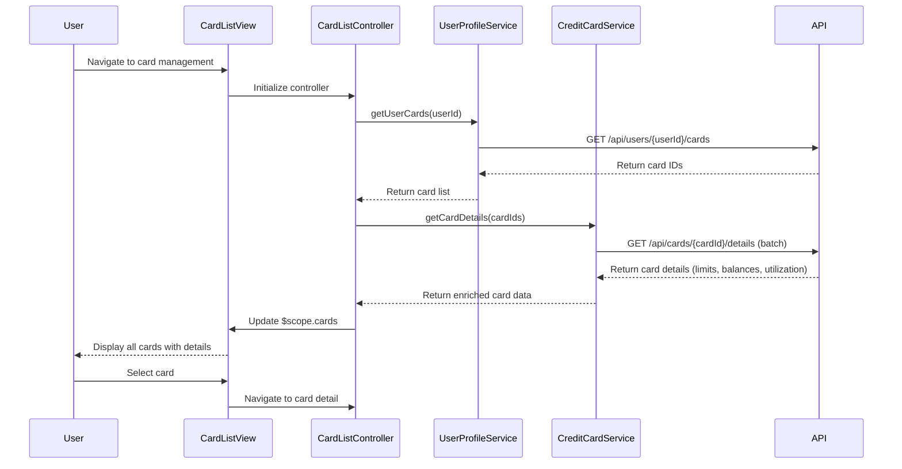

# Low-Level Design: Multi-Card Management and Monitoring
**Epic ID:** QE-9527  
**Tech Stack:** AngularJS 1.x, JavaScript ES6, HTML5, CSS3, Bootstrap, REST APIs, MVC

---

## a. Architecture Mapping

- **cardManagementModule** (AngularJS Module) → Entry point for multi-card management feature
- **CardListController** (Controller) → Manages card list display, selection, and switching logic
- **CardDetailController** (Controller) → Handles individual card detail view and card-wise analytics
- **CreditCardService** (Factory) → Fetches card details, limits, and balances via REST API
- **UserProfileService** (Factory) → Retrieves user-associated cards from User Profile API
- **TransactionService** (Factory) → Provides card-wise spending data and monthly trends
- **cardListDirective** (Directive) → Renders responsive card list with selection UI
- **cardAnalyticsDirective** (Directive) → Displays card-specific spend charts and utilization metrics

**Recommended Folder Structure:**
```
/app
  /modules
    /card-management
      /controllers
        - cardListController.js
        - cardDetailController.js
      /services
        - creditCardService.js
        - userProfileService.js
        - transactionService.js
      /directives
        - cardListDirective.js
        - cardAnalyticsDirective.js
      /views
        - card-list.html
        - card-detail.html
      - cardManagementModule.js
```

---

## b. Component Specifications

| Component Name | Artifact Type | Responsibility | Key Dependencies |
|---|---|---|---|
| cardManagementModule | Module | Registers all controllers, services, and directives for multi-card management | ngRoute, ui.bootstrap |
| CardListController | Controller | Fetches and displays all user cards; handles card selection and switching | CreditCardService, UserProfileService, $scope |
| CardDetailController | Controller | Displays selected card details, utilization, and card-wise spend analysis | CreditCardService, TransactionService, $routeParams, $scope |
| CreditCardService | Factory | Calls REST API to retrieve card details, limits, balances, and utilization | $http, $q |
| UserProfileService | Factory | Calls REST API to fetch user-associated card list | $http, $q |
| TransactionService | Factory | Calls REST API to retrieve card-wise transactions and monthly spend trends | $http, $q |
| cardListDirective | Directive | Renders responsive card list with Bootstrap grid; emits card selection events | None |
| cardAnalyticsDirective | Directive | Renders card-specific spend charts using Chart.js or D3; displays utilization percentage | Chart.js/D3 |

---

## c. Data Model

**CardModel (ES6 Class):**
```javascript
class Card {
  constructor(cardId, cardNumber, cardType, bankName, creditLimit, availableCredit, outstandingBalance, utilizationPercent, isActive) {
    this.cardId = cardId; // String
    this.cardNumber = cardNumber; // String (masked, e.g., "**** **** **** 1234")
    this.cardType = cardType; // String (e.g., "Visa", "Mastercard")
    this.bankName = bankName; // String
    this.creditLimit = creditLimit; // Number
    this.availableCredit = availableCredit; // Number
    this.outstandingBalance = outstandingBalance; // Number
    this.utilizationPercent = utilizationPercent; // Number
    this.isActive = isActive; // Boolean
  }
}
```

**CardSpendModel (ES6 Class):**
```javascript
class CardSpend {
  constructor(cardId, monthlySpend, spendTrend) {
    this.cardId = cardId; // String
    this.monthlySpend = monthlySpend; // Number
    this.spendTrend = spendTrend; // Array of {month: String, amount: Number}
  }
}
```

---

## d. Data Flow

User navigates to the card management view, triggering CardListController to call UserProfileService and CreditCardService to fetch all user-associated cards with details (limits, balances, utilization). The card list is rendered via cardListDirective using Bootstrap grid. When user selects a card, CardDetailController is activated, calling TransactionService to retrieve card-wise spending data and monthly trends. The cardAnalyticsDirective renders interactive charts showing utilization and spend patterns. All API calls are asynchronous using $http with promise-based error handling, and the UI updates reactively via $scope binding.

---

## e. Primary Sequence Diagram



---

## f. Implementation Notes

- Use AngularJS Dependency Injection for all services and controllers; register via module.controller() and module.factory()
- Implement ES6 Promises ($q) in all service methods for consistent async handling and chaining
- Use $http interceptors for global error handling, authentication token injection, and loading state management
- Leverage Bootstrap grid system (col-md-4, col-sm-6, col-xs-12) for responsive card list rendering across devices
- Cache card data in service layer using simple in-memory object to reduce API calls during session; invalidate on user-triggered refresh

---

## g. Error Handling

HTTP interceptor captures API errors (4xx, 5xx), displays user-friendly notifications via Bootstrap alerts, and logs errors to console for debugging.

---

## h. Security Notes

Requires token-based auth via existing SSO; token passed in Authorization header for all API calls; card numbers masked on client side.

---

**End of LLD for QE-9527**