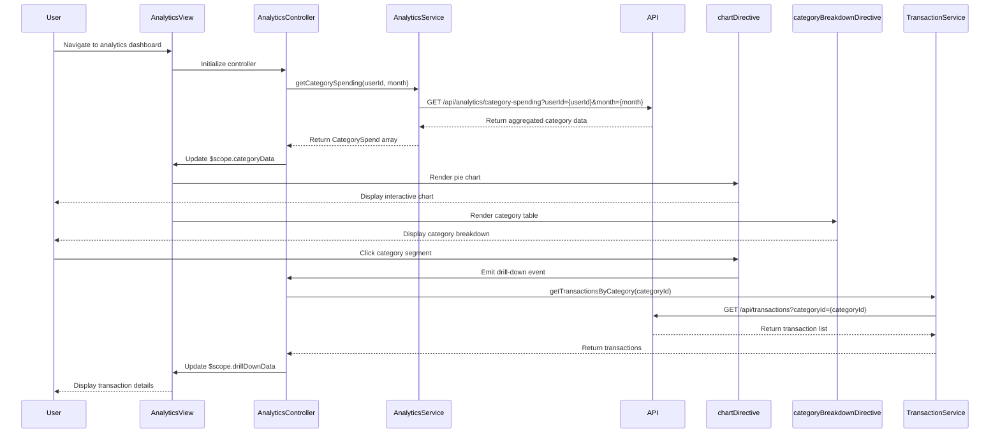

# Low-Level Design: Spending Analytics and Category Insights
**Epic ID:** QE-9528  
**Tech Stack:** AngularJS 1.x, JavaScript ES6, HTML5, CSS3, Bootstrap, REST APIs, MVC

---

## a. Architecture Mapping

- **analyticsModule** (AngularJS Module) → Entry point for spending analytics feature
- **AnalyticsController** (Controller) → Manages analytics view, category selection, and drill-down logic
- **AnalyticsService** (Factory) → Fetches aggregated spending data by category via REST API
- **TransactionService** (Factory) → Retrieves raw transaction data for user
- **CategoryService** (Factory) → Provides category metadata and mapping rules
- **chartDirective** (Directive) → Renders interactive pie/bar charts using Chart.js
- **categoryBreakdownDirective** (Directive) → Displays category-wise spending table with percentages

**Recommended Folder Structure:**
```
/app
  /modules
    /analytics
      /controllers
        - analyticsController.js
      /services
        - analyticsService.js
        - transactionService.js
        - categoryService.js
      /directives
        - chartDirective.js
        - categoryBreakdownDirective.js
      /views
        - analytics-dashboard.html
      - analyticsModule.js
```

---

## b. Component Specifications

| Component Name | Artifact Type | Responsibility | Key Dependencies |
|---|---|---|---|
| analyticsModule | Module | Registers all controllers, services, and directives for spending analytics | ngRoute, ui.bootstrap, chart.js |
| AnalyticsController | Controller | Fetches category-wise spending data; handles user interactions (date range, category drill-down) | AnalyticsService, $scope, $filter |
| AnalyticsService | Factory | Calls REST API to retrieve pre-aggregated spending data by category and time period | $http, $q |
| TransactionService | Factory | Calls REST API to retrieve raw transaction data (used for drill-down) | $http, $q |
| CategoryService | Factory | Provides list of 9 predefined categories and category metadata | None (static data) |
| chartDirective | Directive | Renders interactive pie/bar charts using Chart.js; emits drill-down events on segment click | Chart.js, $timeout |
| categoryBreakdownDirective | Directive | Renders responsive table showing category name, amount, percentage with Bootstrap styling | None |

---

## c. Data Model

**CategorySpendModel (ES6 Class):**
```javascript
class CategorySpend {
  constructor(categoryId, categoryName, totalAmount, percentage, transactionCount, monthlyTrend) {
    this.categoryId = categoryId; // String
    this.categoryName = categoryName; // String (e.g., "Food & Dining", "Fuel")
    this.totalAmount = totalAmount; // Number
    this.percentage = percentage; // Number (0-100)
    this.transactionCount = transactionCount; // Number
    this.monthlyTrend = monthlyTrend; // Array of {month: String, amount: Number}
  }
}
```

**CategoryModel (ES6 Class):**
```javascript
class Category {
  constructor(categoryId, categoryName, iconClass, colorCode) {
    this.categoryId = categoryId; // String
    this.categoryName = categoryName; // String
    this.iconClass = iconClass; // String (Bootstrap icon class)
    this.colorCode = colorCode; // String (hex color for charts)
  }
}
```

---

## d. Data Flow

User navigates to the analytics dashboard, triggering AnalyticsController to call AnalyticsService, which fetches pre-aggregated category-wise spending data from the Analytics API. The controller processes the data and binds it to $scope. The chartDirective renders an interactive pie chart showing spending distribution across 9 categories using Chart.js, while categoryBreakdownDirective displays a responsive table with category names, amounts, and percentages. When user clicks a chart segment, the controller calls TransactionService to fetch detailed transactions for that category and updates the view with drill-down data. All API calls use $http with promise-based handling, and UI updates reactively via two-way data binding.

---

## e. Primary Sequence Diagram



---

## f. Implementation Notes

- Use AngularJS Dependency Injection for all services and controllers; register via module.controller() and module.factory()
- Implement Chart.js for interactive visualizations with click event handlers for drill-down; configure responsive options for mobile
- Use $filter service for formatting currency and percentages in views (e.g., {{amount | currency}}, {{percent | number:2}}%)
- Cache aggregated analytics data in AnalyticsService using timestamp-based invalidation (refresh every 5 minutes)
- Leverage Bootstrap table-responsive class for category breakdown table to ensure mobile compatibility

---

## g. Error Handling

HTTP interceptor captures API errors, displays user-friendly error messages via Bootstrap modals, and provides retry option for failed requests.

---

## h. Security Notes

Standard input validation and secure API calls assumed; authentication token passed in Authorization header for all API requests.

---

**End of LLD for QE-9528**