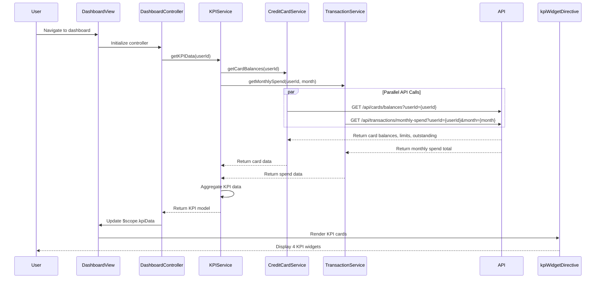

# Low-Level Design: Dashboard and KPI Management
**Epic ID:** QE-9529  
**Tech Stack:** AngularJS 1.x, JavaScript ES6, HTML5, CSS3, Bootstrap, REST APIs, MVC

---

## a. Architecture Mapping

- **dashboardModule** (AngularJS Module) → Entry point for dashboard and KPI feature
- **DashboardController** (Controller) → Manages dashboard view and KPI data binding
- **KPIService** (Factory) → Fetches aggregated KPI data (monthly spend, credit limit, available credit, outstanding) via REST API
- **CreditCardService** (Factory) → Retrieves card balances and limits from Credit Card Data API
- **TransactionService** (Factory) → Retrieves monthly spend aggregations from Transaction API
- **kpiWidgetDirective** (Directive) → Renders individual KPI cards with responsive Bootstrap layout
- **dashboardRefreshDirective** (Directive) → Provides pull-to-refresh or auto-refresh functionality

**Recommended Folder Structure:**
```
/app
  /modules
    /dashboard
      /controllers
        - dashboardController.js
      /services
        - kpiService.js
        - creditCardService.js
        - transactionService.js
      /directives
        - kpiWidgetDirective.js
        - dashboardRefreshDirective.js
      /views
        - dashboard.html
      - dashboardModule.js
```

---

## b. Component Specifications

| Component Name | Artifact Type | Responsibility | Key Dependencies |
|---|---|---|---|
| dashboardModule | Module | Registers all controllers, services, and directives for dashboard feature | ngRoute, ui.bootstrap |
| DashboardController | Controller | Fetches KPI data on load; handles refresh logic and error states | KPIService, $scope, $interval |
| KPIService | Factory | Calls REST API to retrieve aggregated KPI data (monthly spend, total credit limit, available credit, outstanding) | $http, $q, CreditCardService, TransactionService |
| CreditCardService | Factory | Calls REST API to retrieve card balances, limits, and outstanding amounts | $http, $q |
| TransactionService | Factory | Calls REST API to retrieve monthly spend aggregations | $http, $q |
| kpiWidgetDirective | Directive | Renders individual KPI card with icon, label, value, and trend indicator using Bootstrap grid | None |
| dashboardRefreshDirective | Directive | Implements auto-refresh using $interval or manual refresh button with loading spinner | $interval |

---

## c. Data Model

**KPIModel (ES6 Class):**
```javascript
class KPI {
  constructor(monthlySpend, totalCreditLimit, availableCredit, outstandingAmount, lastUpdated) {
    this.monthlySpend = monthlySpend; // Number
    this.totalCreditLimit = totalCreditLimit; // Number
    this.availableCredit = availableCredit; // Number
    this.outstandingAmount = outstandingAmount; // Number
    this.lastUpdated = lastUpdated; // Date
  }
}
```

**KPIWidgetModel (ES6 Class):**
```javascript
class KPIWidget {
  constructor(label, value, iconClass, trendPercent, trendDirection) {
    this.label = label; // String (e.g., "Monthly Spend")
    this.value = value; // Number
    this.iconClass = iconClass; // String (Bootstrap icon class)
    this.trendPercent = trendPercent; // Number (optional)
    this.trendDirection = trendDirection; // String ("up" or "down", optional)
  }
}
```

---

## d. Data Flow

User navigates to the dashboard, triggering DashboardController to call KPIService, which orchestrates parallel API calls to CreditCardService (for card balances, limits, outstanding) and TransactionService (for monthly spend). KPIService aggregates the data into a KPI model and returns it to the controller. The controller binds the KPI data to $scope, and kpiWidgetDirective renders four responsive KPI cards (monthly spend, total credit limit, available credit, outstanding amount) using Bootstrap grid (col-md-3, col-sm-6, col-xs-12). The dashboardRefreshDirective optionally auto-refreshes data every 30 seconds using $interval. All API calls are asynchronous with promise-based error handling, and the UI updates reactively via $scope binding.

---

## e. Primary Sequence Diagram



---

## f. Implementation Notes

- Use AngularJS Dependency Injection for all services and controllers; register via module.controller() and module.factory()
- Use $q.all() in KPIService to execute parallel API calls to CreditCardService and TransactionService for faster load times
- Implement client-side caching in KPIService with 30-second TTL to meet 2-second load requirement on subsequent visits
- Leverage Bootstrap grid system (col-md-3, col-sm-6, col-xs-12) for responsive KPI widget layout across mobile, tablet, desktop
- Use $interval in dashboardRefreshDirective for auto-refresh; ensure cleanup on $scope.$destroy to prevent memory leaks

---

## g. Error Handling

HTTP interceptor captures API errors, displays user-friendly error messages via Bootstrap alerts, and provides manual retry button on dashboard.

---

## h. Security Notes

Requires token-based auth via existing SSO; token passed in Authorization header for all API calls to CreditCardService and TransactionService.

---

**End of LLD for QE-9529**