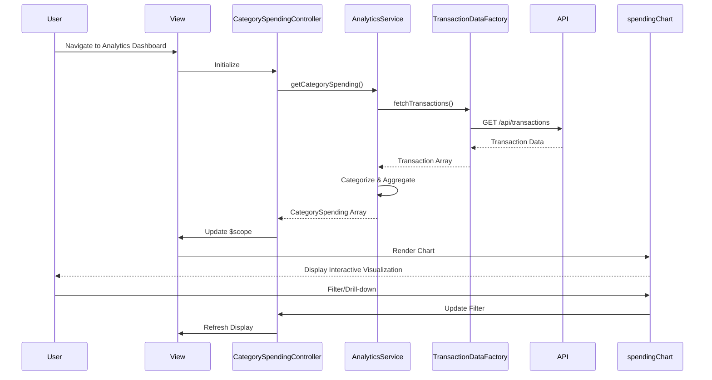

# Low-Level Design: Category-wise Spending Analytics
**Epic ID:** QE-9530

## a. Architecture Mapping

- **AngularJS Module:** `creditCard.analytics` - Root module for spending analytics features
- **Controller:** `CategorySpendingController` - Manages analytics dashboard view and user interactions
- **Service:** `AnalyticsService` - Handles data aggregation and category-wise spending calculations
- **Service:** `TransactionCategorizationService` - Categorizes transactions into predefined categories
- **Factory:** `TransactionDataFactory` - Retrieves transaction data from REST API
- **Directive:** `spendingChart` - Renders interactive category-wise spending visualizations

**Folder Structure:**
```
/app
  /modules
    /analytics
      analytics.module.js
      CategorySpendingController.js
      /services
        AnalyticsService.js
        TransactionCategorizationService.js
      /factories
        TransactionDataFactory.js
      /directives
        spendingChart.directive.js
      /views
        category-spending.html
      /styles
        analytics.css
```

## b. Component Specifications

| Component Name | Artifact Type | Responsibility | Key Dependencies |
|----------------|---------------|----------------|------------------|
| analytics.module | Module | Registers analytics module and configures routes | angular, angular-route, chart.js |
| CategorySpendingController | Controller | Manages view state, handles user interactions, coordinates data flow | AnalyticsService, $scope |
| AnalyticsService | Service | Aggregates transaction data by category, calculates spending totals | TransactionDataFactory, TransactionCategorizationService |
| TransactionCategorizationService | Service | Maps transactions to one of nine predefined categories based on merchant codes | None |
| TransactionDataFactory | Factory | Fetches transaction data from REST API endpoint | $http, $q |
| spendingChart | Directive | Renders interactive pie/bar charts for category-wise spending with drill-down | Chart.js or D3.js |

## c. Data Model

**Transaction Object:**
```javascript
{
  id: String,
  cardId: String,
  amount: Number,
  merchantName: String,
  merchantCode: String,
  category: String, // One of: Food & Dining, Fuel, Shopping, Travel, Entertainment, Utilities, Healthcare, Education, Miscellaneous
  transactionDate: Date,
  description: String
}
```

**CategorySpending Object:**
```javascript
{
  category: String,
  totalAmount: Number,
  transactionCount: Number,
  percentage: Number
}
```

## d. Data Flow

User navigates to the analytics dashboard, triggering CategorySpendingController initialization. The controller calls AnalyticsService.getCategorySpending(), which invokes TransactionDataFactory to fetch transaction data via REST API GET /api/transactions. Retrieved transactions are passed to TransactionCategorizationService to ensure proper category assignment. AnalyticsService aggregates spending by category and calculates totals and percentages. The aggregated CategorySpending array is bound to $scope and passed to the spendingChart directive, which renders interactive visualizations. User interactions (filtering, drill-down) trigger controller methods that update the data model, causing automatic view refresh via AngularJS two-way binding.

## e. Primary Sequence Diagram



## f. Implementation Notes

- Use AngularJS Dependency Injection for all services, factories, and controllers to ensure testability and modularity
- Implement Chart.js or D3.js via custom directive with isolated scope for reusability across multiple views
- Use $http interceptors for centralized error handling and loading state management
- Apply ES6 classes for service definitions with Babel transpilation for browser compatibility
- Cache transaction data in AnalyticsService using $cacheFactory to minimize API calls and improve performance

## g. Error Handling

HTTP interceptor captures API errors; user-friendly notifications displayed via toastr or Bootstrap alerts; try/catch blocks in categorization logic with fallback to "Miscellaneous" category.

## h. Security Notes

Standard input validation and secure API calls assumed; requires token-based authentication via existing SSO for API access.