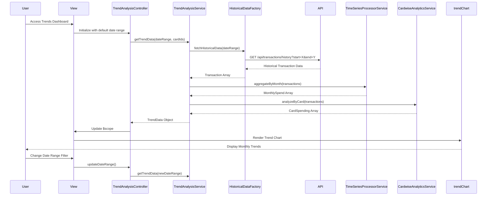

# Low-Level Design: Monthly Spend Trends and Card-wise Analysis
**Epic ID:** QE-9531

## a. Architecture Mapping

- **AngularJS Module:** `creditCard.trends` - Root module for trend analysis features
- **Controller:** `TrendAnalysisController` - Manages trends dashboard and date-range selection
- **Service:** `TrendAnalysisService` - Coordinates trend calculations and card-wise comparisons
- **Service:** `TimeSeriesProcessorService` - Processes historical data and calculates monthly trends
- **Service:** `CardwiseAnalyticsService` - Performs card-specific spending analysis and comparisons
- **Factory:** `HistoricalDataFactory` - Retrieves historical transaction data from REST API
- **Directive:** `trendChart` - Renders line charts for monthly spend trends
- **Directive:** `cardComparisonChart` - Renders bar/column charts for card-wise comparison

**Folder Structure:**
```
/app
  /modules
    /trends
      trends.module.js
      TrendAnalysisController.js
      /services
        TrendAnalysisService.js
        TimeSeriesProcessorService.js
        CardwiseAnalyticsService.js
      /factories
        HistoricalDataFactory.js
      /directives
        trendChart.directive.js
        cardComparisonChart.directive.js
      /views
        trend-analysis.html
      /styles
        trends.css
```

## b. Component Specifications

| Component Name | Artifact Type | Responsibility | Key Dependencies |
|----------------|---------------|----------------|------------------|
| trends.module | Module | Registers trends module and configures routing | angular, angular-route, chart.js |
| TrendAnalysisController | Controller | Manages view state, date-range filters, card selection | TrendAnalysisService, $scope, $filter |
| TrendAnalysisService | Service | Orchestrates trend and card-wise analysis workflows | TimeSeriesProcessorService, CardwiseAnalyticsService, HistoricalDataFactory |
| TimeSeriesProcessorService | Service | Aggregates transactions by month, calculates trends and patterns | None |
| CardwiseAnalyticsService | Service | Groups transactions by card, calculates card-specific totals and comparisons | None |
| HistoricalDataFactory | Factory | Fetches historical transaction data with date-range filtering | $http, $q |
| trendChart | Directive | Renders interactive line chart for monthly spend trends | Chart.js |
| cardComparisonChart | Directive | Renders bar chart comparing spending across cards | Chart.js |

## c. Data Model

**MonthlySpend Object:**
```javascript
{
  month: String, // Format: YYYY-MM
  totalSpend: Number,
  transactionCount: Number
}
```

**CardSpending Object:**
```javascript
{
  cardId: String,
  cardName: String,
  totalSpend: Number,
  transactionCount: Number,
  monthlyBreakdown: Array<MonthlySpend>
}
```

**TrendData Object:**
```javascript
{
  monthlyTrends: Array<MonthlySpend>,
  cardwiseData: Array<CardSpending>,
  dateRange: { startDate: Date, endDate: Date }
}
```

## d. Data Flow

User accesses the trends dashboard and optionally selects a date range or specific cards via TrendAnalysisController. The controller invokes TrendAnalysisService.getTrendData(dateRange, cardIds), which calls HistoricalDataFactory to fetch historical transactions via REST API GET /api/transactions/history with query parameters. The retrieved data is split: TimeSeriesProcessorService aggregates transactions by month to produce MonthlySpend array, while CardwiseAnalyticsService groups by card to generate CardSpending array. Both results are combined into TrendData object and returned to the controller. The controller updates $scope, triggering trendChart and cardComparisonChart directives to render visualizations. User interactions with filters re-trigger the data flow with updated parameters.

## e. Primary Sequence Diagram



## f. Implementation Notes

- Use AngularJS $filter service for date formatting and range validation in the controller
- Implement caching strategy in HistoricalDataFactory using $cacheFactory with time-based expiration (e.g., 5 minutes)
- Apply ES6 arrow functions and template literals for cleaner service code with Babel transpilation
- Use Chart.js time-series plugin for proper date axis rendering in trendChart directive
- Implement lazy loading for historical data: fetch only requested date ranges to optimize performance

## g. Error Handling

$http interceptor handles API failures; user notified via Bootstrap modal or inline alerts; empty state UI displayed when no historical data available.

## h. Security Notes

Requires token-based auth via existing SSO; API validates user access to requested card data; date-range parameters sanitized to prevent injection attacks.