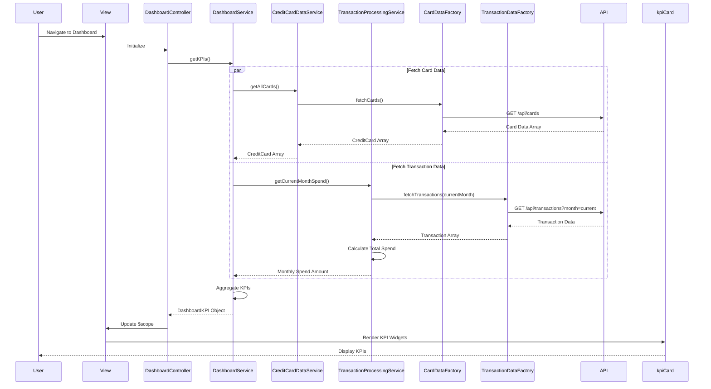

# Low-Level Design: Dashboard KPIs and Credit Card Overview
**Epic ID:** QE-9532

## a. Architecture Mapping

- **AngularJS Module:** `creditCard.dashboard` - Root module for dashboard features
- **Controller:** `DashboardController` - Manages dashboard view and KPI display
- **Service:** `DashboardService` - Orchestrates KPI calculations and data aggregation
- **Service:** `CreditCardDataService` - Retrieves credit card details and credit limits
- **Service:** `TransactionProcessingService` - Calculates monthly spend from transaction data
- **Factory:** `CardDataFactory` - Fetches card data from REST API
- **Factory:** `TransactionDataFactory` - Fetches transaction data from REST API
- **Directive:** `kpiCard` - Renders individual KPI widgets (monthly spend, credit limit, etc.)
- **Directive:** `cardSummary` - Displays multi-card consolidated view

**Folder Structure:**
```
/app
  /modules
    /dashboard
      dashboard.module.js
      DashboardController.js
      /services
        DashboardService.js
        CreditCardDataService.js
        TransactionProcessingService.js
      /factories
        CardDataFactory.js
        TransactionDataFactory.js
      /directives
        kpiCard.directive.js
        cardSummary.directive.js
      /views
        dashboard.html
      /styles
        dashboard.css
```

## b. Component Specifications

| Component Name | Artifact Type | Responsibility | Key Dependencies |
|----------------|---------------|----------------|------------------|
| dashboard.module | Module | Registers dashboard module and configures routing | angular, angular-route, bootstrap |
| DashboardController | Controller | Initializes dashboard, manages KPI refresh logic | DashboardService, $scope, $interval |
| DashboardService | Service | Aggregates KPIs: monthly spend, total credit limit, available credit, outstanding amounts | CreditCardDataService, TransactionProcessingService |
| CreditCardDataService | Service | Fetches and caches credit card details including limits and balances | CardDataFactory |
| TransactionProcessingService | Service | Calculates current month spend by filtering and summing transactions | TransactionDataFactory, $filter |
| CardDataFactory | Factory | Retrieves card data from REST API endpoint | $http, $q |
| TransactionDataFactory | Factory | Retrieves transaction data from REST API endpoint | $http, $q |
| kpiCard | Directive | Renders responsive KPI widget with title, value, and icon | None |
| cardSummary | Directive | Displays list of all cards with individual card KPIs | None |

## c. Data Model

**CreditCard Object:**
```javascript
{
  cardId: String,
  cardNumber: String, // Masked
  cardName: String,
  cardType: String, // Visa, MasterCard, etc.
  creditLimit: Number,
  currentBalance: Number,
  availableCredit: Number
}
```

**DashboardKPI Object:**
```javascript
{
  monthlySpend: Number,
  totalCreditLimit: Number,
  totalAvailableCredit: Number,
  totalOutstanding: Number,
  cards: Array<CreditCard>
}
```

## d. Data Flow

User navigates to the dashboard, triggering DashboardController initialization. The controller calls DashboardService.getKPIs(), which concurrently invokes CreditCardDataService.getAllCards() and TransactionProcessingService.getCurrentMonthSpend(). CreditCardDataService calls CardDataFactory to fetch card data via REST API GET /api/cards. TransactionProcessingService calls TransactionDataFactory to fetch current month transactions via REST API GET /api/transactions?month=current, then filters and sums amounts. DashboardService aggregates results: sums credit limits and balances across all cards, calculates total available credit, and combines with monthly spend. The DashboardKPI object is returned to the controller, bound to $scope, and rendered via kpiCard and cardSummary directives. An $interval service refreshes KPIs every 60 seconds for real-time updates.

## e. Primary Sequence Diagram



## f. Implementation Notes

- Use AngularJS $q.all() to parallelize card and transaction data fetching for faster dashboard load
- Implement responsive grid layout using Bootstrap 3 grid system (col-xs, col-sm, col-md, col-lg) for multi-device support
- Apply $interval service with 60-second refresh cycle; cancel interval on $scope.$destroy to prevent memory leaks
- Use ES6 const/let for variable declarations and arrow functions in services
- Implement optimistic UI updates: show cached data immediately while fetching fresh data in background

## g. Error Handling

$http interceptor captures API errors; display error banner with retry button; gracefully degrade by showing last successful KPI data from cache.

## h. Security Notes

Requires token-based auth via existing SSO; card numbers masked in API response; API enforces user-level access control to card data.