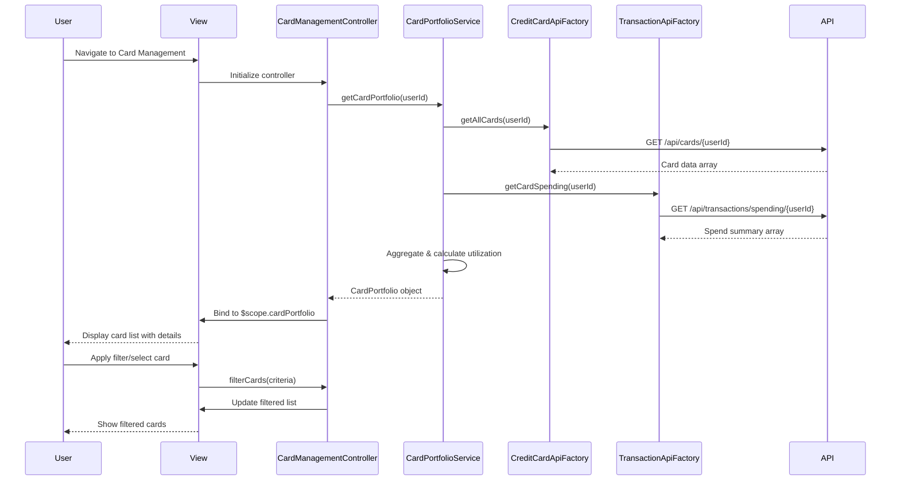

# Low-Level Design: QE-9533 - Multiple Credit Card Management

## a. Architecture Mapping

- **Card Management UI** → AngularJS Module (`creditCardModule`) + Controller (`CardManagementController`)
- **Card Portfolio Aggregator** → AngularJS Service (`CardPortfolioService`) for aggregating card data and spend analysis
- **Credit Card Data Service Integration** → AngularJS Factory (`CreditCardApiFactory`) for REST API calls to retrieve card metadata
- **Transaction Service Integration** → AngularJS Factory (`TransactionApiFactory`) for card-specific spending data
- **Card Filtering & Selection** → AngularJS Directive (`cardFilter`) for dynamic list rendering and filtering

**Recommended Folder Structure:**
```
app/
├── modules/
│   └── creditCard/
│       ├── controllers/
│       │   └── CardManagementController.js
│       ├── services/
│       │   └── CardPortfolioService.js
│       ├── factories/
│       │   ├── CreditCardApiFactory.js
│       │   └── TransactionApiFactory.js
│       ├── directives/
│       │   └── cardFilter.js
│       ├── views/
│       │   └── card-management.html
│       └── creditCardModule.js
```

## b. Component Specifications

| Component Name | Artifact Type | Responsibility | Key Dependencies |
|----------------|---------------|----------------|------------------|
| creditCardModule | Module | Main module registration for credit card management features | angular, ngRoute |
| CardManagementController | Controller | Manages card list display, selection, filtering, and user interactions | CardPortfolioService, $scope |
| CardPortfolioService | Service | Aggregates card data, calculates utilization, performs card-wise spend analysis | CreditCardApiFactory, TransactionApiFactory, $q |
| CreditCardApiFactory | Factory | REST API wrapper for credit card data service endpoints | $http, API_CONFIG |
| TransactionApiFactory | Factory | REST API wrapper for transaction service endpoints | $http, API_CONFIG |
| cardFilter | Directive | Renders dynamic card list with filtering and selection capabilities | None |

## c. Data Model

**CreditCard Object:**
```javascript
{
  cardId: String,
  cardNumber: String,
  cardType: String,
  issuer: String,
  creditLimit: Number,
  currentBalance: Number,
  availableCredit: Number,
  utilizationPercent: Number,
  cardHolderName: String,
  expiryDate: String
}
```

**CardSpendSummary Object:**
```javascript
{
  cardId: String,
  monthlySpend: Number,
  transactionCount: Number,
  lastTransactionDate: String
}
```

**CardPortfolio Object:**
```javascript
{
  userId: String,
  cards: Array<CreditCard>,
  spendSummaries: Array<CardSpendSummary>,
  totalCards: Number
}
```

## d. Data Flow

User accesses the card management view → CardManagementController initializes and invokes CardPortfolioService.getCardPortfolio() → Service calls CreditCardApiFactory.getAllCards() and TransactionApiFactory.getCardSpending() in parallel using $q.all() → API responses are aggregated, utilization is calculated, and CardPortfolio object is constructed → Controller receives the portfolio and binds it to $scope.cardPortfolio → View renders the card list using ng-repeat with cardFilter directive for dynamic filtering → User selects/filters cards triggering controller methods that update $scope and re-render the filtered list.

## e. Primary Sequence Diagram



## f. Implementation Notes

- Use AngularJS Dependency Injection for all services, factories, and controllers; register dependencies in module config
- Implement parallel API calls using $q.all() in CardPortfolioService to meet <1 second retrieval NFR
- Use ng-repeat with track by cardId for efficient dynamic rendering of 10+ cards
- Apply ES6 arrow functions and const/let in services for cleaner code; transpile with Babel if needed
- Implement API_CONFIG constant for base URLs and endpoint paths; inject into factories

## g. Error Handling

HTTP interceptor registered at module level to catch API errors; display user-friendly notifications using toastr or custom modal service.

## h. Security Notes

Standard input validation and secure API calls assumed; card data transmitted over HTTPS with token-based authentication.