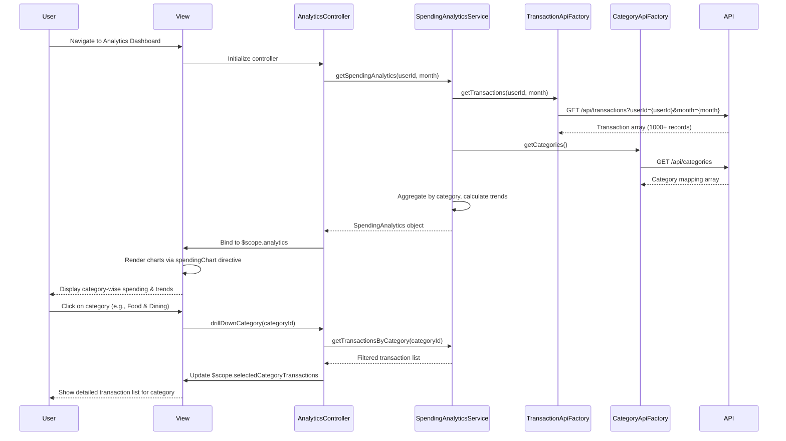

# Low-Level Design: QE-9534 - Analytics and Spending Insights

## a. Architecture Mapping

- **Analytics Dashboard UI** → AngularJS Module (`analyticsModule`) + Controller (`AnalyticsController`)
- **Visualization Component** → AngularJS Directive (`spendingChart`) using Chart.js or D3.js for interactive charts
- **Data Aggregation Service** → AngularJS Service (`SpendingAnalyticsService`) for trend calculations and category aggregation
- **Transaction Service Integration** → AngularJS Factory (`TransactionApiFactory`) for detailed transaction data
- **Categorization Engine Integration** → AngularJS Factory (`CategoryApiFactory`) for transaction classification

**Recommended Folder Structure:**
```
app/
├── modules/
│   └── analytics/
│       ├── controllers/
│       │   └── AnalyticsController.js
│       ├── services/
│       │   └── SpendingAnalyticsService.js
│       ├── factories/
│       │   ├── TransactionApiFactory.js
│       │   └── CategoryApiFactory.js
│       ├── directives/
│       │   └── spendingChart.js
│       ├── views/
│       │   └── analytics-dashboard.html
│       └── analyticsModule.js
```

## b. Component Specifications

| Component Name | Artifact Type | Responsibility | Key Dependencies |
|----------------|---------------|----------------|------------------|
| analyticsModule | Module | Main module registration for analytics and spending insights | angular, ngRoute, chart.js |
| AnalyticsController | Controller | Manages analytics view, user interactions, drill-down actions | SpendingAnalyticsService, $scope |
| SpendingAnalyticsService | Service | Aggregates transaction data, calculates category-wise spending, generates monthly trends | TransactionApiFactory, CategoryApiFactory, $q |
| TransactionApiFactory | Factory | REST API wrapper for transaction service endpoints | $http, API_CONFIG |
| CategoryApiFactory | Factory | REST API wrapper for categorization engine endpoints | $http, API_CONFIG |
| spendingChart | Directive | Renders interactive charts with drill-down capabilities using Chart.js | None |

## c. Data Model

**CategorySpending Object:**
```javascript
{
  categoryName: String,
  categoryId: String,
  totalAmount: Number,
  transactionCount: Number,
  percentageOfTotal: Number
}
```

**MonthlyTrend Object:**
```javascript
{
  month: String,
  year: Number,
  totalSpending: Number,
  categoryBreakdown: Array<CategorySpending>
}
```

**SpendingAnalytics Object:**
```javascript
{
  userId: String,
  currentMonth: MonthlyTrend,
  categories: Array<CategorySpending>,
  trendData: Array<MonthlyTrend>,
  lastUpdated: String
}
```

**Transaction Object:**
```javascript
{
  transactionId: String,
  cardId: String,
  amount: Number,
  categoryId: String,
  categoryName: String,
  merchantName: String,
  transactionDate: String,
  description: String
}
```

## d. Data Flow

User navigates to analytics dashboard → AnalyticsController initializes and calls SpendingAnalyticsService.getSpendingAnalytics() → Service fetches transactions via TransactionApiFactory.getTransactions() and category mappings via CategoryApiFactory.getCategories() → Service aggregates data into nine predefined categories, calculates totals and percentages (accurate to 2 decimals), and generates monthly trend data → SpendingAnalytics object is returned to controller and bound to $scope.analytics → View renders category-wise charts using spendingChart directive with Chart.js → User clicks on a category to drill down → Controller updates $scope with filtered transaction list for that category → View re-renders detailed breakdown.

## e. Primary Sequence Diagram



## f. Implementation Notes

- Use Chart.js library integrated via spendingChart directive for interactive visualizations; configure drill-down via chart onClick events
- Implement data aggregation logic in SpendingAnalyticsService using ES6 Array methods (map, reduce, filter) for category calculations
- Cache category mappings in service using $cacheFactory to avoid repeated API calls
- Use $q.all() for parallel API calls to meet <1.5 second chart rendering NFR
- Format currency and percentages using AngularJS filters (currency, number) with 2 decimal precision

## g. Error Handling

HTTP interceptor catches API failures; fallback to cached data if available, otherwise display error notification to user.

## h. Security Notes

Standard input validation and secure API calls assumed; transaction data transmitted over HTTPS with token-based authentication.