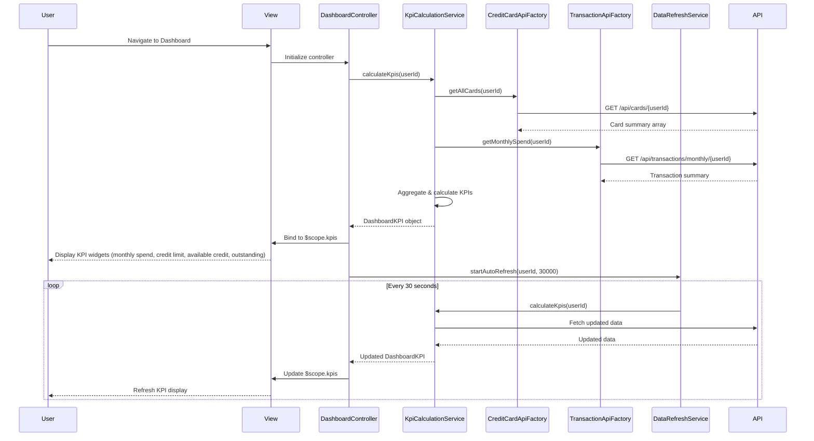

# Low-Level Design: QE-9535 - Dashboard and KPI Management

## a. Architecture Mapping

- **Dashboard UI Component** → AngularJS Module (`dashboardModule`) + Controller (`DashboardController`)
- **KPI Calculation Engine** → AngularJS Service (`KpiCalculationService`) for aggregating and calculating KPIs
- **Credit Card Data Service Integration** → AngularJS Factory (`CreditCardApiFactory`) for card balances and limits
- **Transaction Service Integration** → AngularJS Factory (`TransactionApiFactory`) for monthly spend and outstanding amounts
- **Real-time Data Refresh** → AngularJS Service (`DataRefreshService`) using $interval for periodic polling

**Recommended Folder Structure:**
```
app/
├── modules/
│   └── dashboard/
│       ├── controllers/
│       │   └── DashboardController.js
│       ├── services/
│       │   ├── KpiCalculationService.js
│       │   └── DataRefreshService.js
│       ├── factories/
│       │   ├── CreditCardApiFactory.js
│       │   └── TransactionApiFactory.js
│       ├── views/
│       │   └── dashboard.html
│       └── dashboardModule.js
```

## b. Component Specifications

| Component Name | Artifact Type | Responsibility | Key Dependencies |
|----------------|---------------|----------------|------------------|
| dashboardModule | Module | Main module registration for dashboard and KPI features | angular, ngRoute |
| DashboardController | Controller | Manages dashboard view, KPI display, and user interactions | KpiCalculationService, DataRefreshService, $scope |
| KpiCalculationService | Service | Aggregates data from APIs, calculates KPIs (monthly spend, credit limit, available credit, outstanding) | CreditCardApiFactory, TransactionApiFactory, $q |
| DataRefreshService | Service | Manages periodic data refresh using $interval for real-time updates | $interval, $rootScope |
| CreditCardApiFactory | Factory | REST API wrapper for credit card data service endpoints | $http, API_CONFIG |
| TransactionApiFactory | Factory | REST API wrapper for transaction service endpoints | $http, API_CONFIG |

## c. Data Model

**DashboardKPI Object:**
```javascript
{
  monthlySpend: Number,
  totalCreditLimit: Number,
  availableCredit: Number,
  outstandingAmount: Number,
  creditUtilization: Number,
  lastUpdated: String
}
```

**CreditCardSummary Object:**
```javascript
{
  cardId: String,
  creditLimit: Number,
  currentBalance: Number,
  availableCredit: Number
}
```

**TransactionSummary Object:**
```javascript
{
  userId: String,
  currentMonthSpend: Number,
  outstandingBalance: Number,
  transactionCount: Number
}
```

## d. Data Flow

User accesses dashboard → DashboardController initializes and invokes KpiCalculationService.calculateKpis() → Service calls CreditCardApiFactory.getAllCards() and TransactionApiFactory.getMonthlySpend() in parallel using $q.all() → API responses are received and KPI calculations are performed server-side (aggregating credit limits, available credit, outstanding amounts) → DashboardKPI object is returned to controller and bound to $scope.kpis → View renders KPI widgets using Bootstrap grid layout and AngularJS data binding → DataRefreshService triggers periodic refresh every 30-60 seconds via $interval → On each refresh cycle, KpiCalculationService re-fetches data and updates $scope.kpis → View automatically updates via two-way binding.

## e. Primary Sequence Diagram



## f. Implementation Notes

- Use $q.all() for parallel API calls to meet <2 second dashboard load NFR
- Implement DataRefreshService with $interval set to 30000ms (30 seconds) for real-time refresh; cancel interval on $destroy event
- Use Bootstrap grid (col-md-3) for responsive KPI widget layout; apply CSS3 media queries for mobile/tablet breakpoints
- Apply AngularJS currency and number filters for KPI display formatting
- Inject API_CONFIG constant for base URLs; use ES6 template literals for endpoint construction

## g. Error Handling

HTTP interceptor registered at module level to catch API errors; display user-friendly error messages and retry mechanism for failed refresh cycles.

## h. Security Notes

Requires token-based auth via existing SSO; financial data transmitted over HTTPS with proper authorization headers.