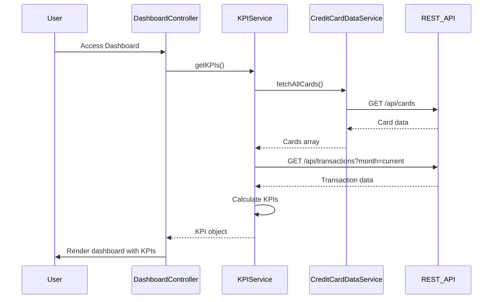

# Low-Level Design: Dashboard and KPI Management (QE-9536)

## a. Architecture Mapping

- **Dashboard Module** → AngularJS Module (`app.dashboard`)
- **Dashboard Controller** → AngularJS Controller (`DashboardController`) - manages KPI display logic
- **KPI Service** → AngularJS Service (`KPIService`) - fetches and calculates KPI data
- **Auth Interceptor** → AngularJS Factory (`AuthInterceptor`) - handles authentication tokens
- **Dashboard Directive** → AngularJS Directive (`kpiWidget`) - reusable KPI visualization component

**Folder Structure:**
```
/app
  /dashboard
    dashboard.module.js
    dashboard.controller.js
    dashboard.html
  /services
    kpi.service.js
  /directives
    kpi-widget.directive.js
  /interceptors
    auth.interceptor.js
```

## b. Component Specifications

| Component Name | Artifact Type | Responsibility | Key Dependencies |
|----------------|---------------|----------------|------------------|
| DashboardController | Controller | Orchestrates dashboard view, binds KPI data to scope | KPIService, $scope, $interval |
| KPIService | Service | Fetches card data via REST API, calculates aggregated KPIs | $http, $q, CreditCardDataService |
| kpiWidget | Directive | Renders individual KPI card with value and label | None |
| AuthInterceptor | Factory | Attaches auth token to outgoing API requests | $window, $q |
| CreditCardDataService | Service | Retrieves card balances and transaction data from backend | $http |

## c. Data Model

```javascript
// KPI Model
const KPIData = {
  monthlySpend: Number,        // Total spend for current month
  totalCreditLimit: Number,    // Sum of all card limits
  availableCredit: Number,     // totalCreditLimit - outstandingAmount
  outstandingAmount: Number,   // Total outstanding balance
  lastUpdated: Date            // Timestamp of last data refresh
};

// Card Model
const CreditCard = {
  cardId: String,
  cardType: String,
  lastFourDigits: String,
  creditLimit: Number,
  currentBalance: Number,
  outstandingAmount: Number
};
```

## d. Data Flow

User accesses the dashboard → DashboardController initializes and calls KPIService.getKPIs() → KPIService invokes CreditCardDataService to fetch all user cards via REST API (/api/cards) → Service aggregates data (sum limits, calculate available credit, fetch monthly transactions via /api/transactions?month=current) → Calculated KPI object returned to controller → Controller binds data to $scope → kpiWidget directives render each KPI in responsive grid → $interval triggers auto-refresh every 5 minutes, repeating the flow.

## e. Primary Sequence Diagram



## f. Implementation Notes

- Use AngularJS dependency injection for all services and controllers; register via module.controller() and module.service()
- Implement $http interceptor (AuthInterceptor) to attach JWT token from localStorage to all API requests
- Use $interval service for auto-refresh every 5 minutes; cancel interval on $scope.$destroy to prevent memory leaks
- Apply Bootstrap grid system (col-md-3) for responsive KPI card layout; use CSS3 media queries for mobile optimization
- Cache KPI data in service using a simple in-memory object to reduce API calls; invalidate cache on refresh

## g. Error Handling

Use $http interceptor to catch API errors (4xx/5xx), display user-friendly notification via a toast service, and log errors to console.

## h. Security Notes

Requires token-based auth via existing SSO; JWT token stored in localStorage and attached to API calls via AuthInterceptor.