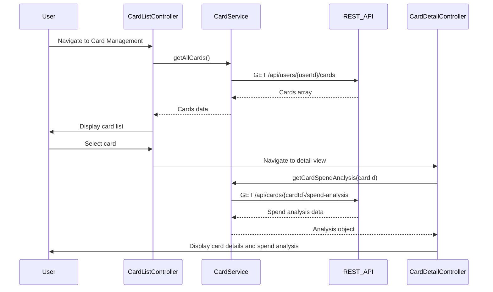

# Low-Level Design: Multiple Credit Card Management (QE-9537)

## a. Architecture Mapping

- **Card Management Module** → AngularJS Module (`app.cardManagement`)
- **Card List Controller** → AngularJS Controller (`CardListController`) - displays all cards
- **Card Detail Controller** → AngularJS Controller (`CardDetailController`) - shows single card details
- **Card Service** → AngularJS Service (`CardService`) - manages card data and spend analysis
- **Card Filter** → AngularJS Filter (`cardTypeFilter`) - filters cards by type

**Folder Structure:**
```
/app
  /card-management
    card-management.module.js
    card-list.controller.js
    card-detail.controller.js
    card-list.html
    card-detail.html
  /services
    card.service.js
  /filters
    card-type.filter.js
```

## b. Component Specifications

| Component Name | Artifact Type | Responsibility | Key Dependencies |
|----------------|---------------|----------------|------------------|
| CardListController | Controller | Displays all user cards, handles selection and filtering | CardService, $scope, $state |
| CardDetailController | Controller | Shows detailed view of selected card with spend analysis | CardService, $stateParams, $scope |
| CardService | Service | Fetches card data, retrieves spend analysis per card | $http, $q |
| cardTypeFilter | Filter | Filters card array by card type (Visa, MasterCard, etc.) | None |
| SpendAnalysisModule | Service | Calculates card-wise spending patterns and utilization | $http |

## c. Data Model

```javascript
// Card Model
const CreditCard = {
  cardId: String,
  userId: String,
  cardType: String,              // Visa, MasterCard, Amex
  lastFourDigits: String,
  issuer: String,
  creditLimit: Number,
  currentBalance: Number,
  outstandingAmount: Number,
  utilizationPercent: Number     // (currentBalance / creditLimit) * 100
};

// Card Spend Analysis Model
const CardSpendAnalysis = {
  cardId: String,
  monthlySpend: Number,
  spendByCategory: Object,       // { "Food": 500, "Fuel": 200, ... }
  transactionCount: Number,
  avgTransactionAmount: Number
};
```

## d. Data Flow

User navigates to card management view → CardListController calls CardService.getAllCards() → Service fetches cards via GET /api/users/{userId}/cards → Cards array returned and bound to $scope.cards → User sees list of cards rendered with card details → User clicks on a card → $state.go('cardDetail', {cardId}) transitions to detail view → CardDetailController loads, calls CardService.getCardSpendAnalysis(cardId) → Service fetches analysis via GET /api/cards/{cardId}/spend-analysis → Spend breakdown and utilization displayed in detail view.

## e. Primary Sequence Diagram



## f. Implementation Notes

- Use ui-router for state management; define states 'cardList' and 'cardDetail' with URL params
- Implement CardService with promise-based methods using $q; handle API errors with rejection
- Apply ng-repeat with track by cardId for efficient rendering of card list
- Use Bootstrap cards (card component) for card display; apply CSS3 transitions for hover effects
- Store selected cardId in $stateParams to enable deep linking to card detail view

## g. Error Handling

Catch API errors in service layer using .catch() on promises; display error message via a notification directive and fallback to empty array.

## h. Security Notes

Card metadata encrypted at rest; only last 4 digits exposed to UI; full card numbers never transmitted or stored client-side.