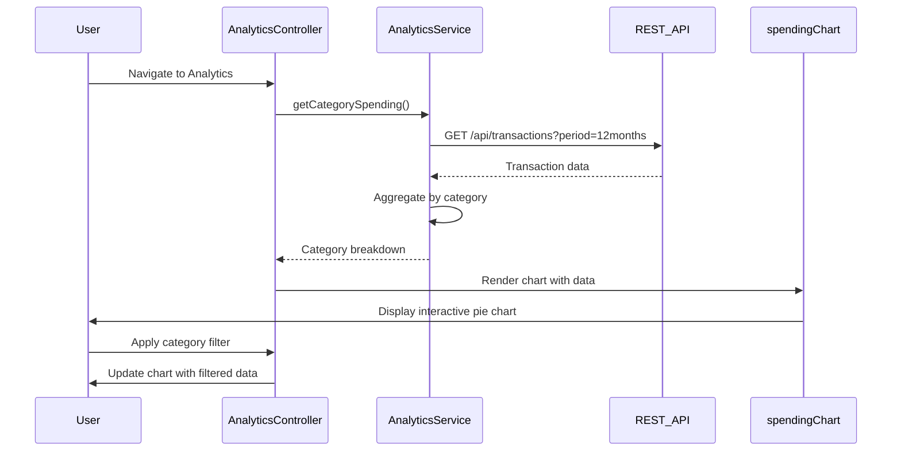

# Low-Level Design: Analytics and Spending Insights (QE-9538)

## a. Architecture Mapping

- **Analytics Module** → AngularJS Module (`app.analytics`)
- **Analytics Controller** → AngularJS Controller (`AnalyticsController`) - manages analytics view
- **Analytics Service** → AngularJS Service (`AnalyticsService`) - fetches spending data and trends
- **Chart Directive** → AngularJS Directive (`spendingChart`) - renders interactive charts using Chart.js
- **Category Filter** → AngularJS Filter (`categoryFilter`) - filters transactions by category

**Folder Structure:**
```
/app
  /analytics
    analytics.module.js
    analytics.controller.js
    analytics.html
  /services
    analytics.service.js
  /directives
    spending-chart.directive.js
  /filters
    category.filter.js
```

## b. Component Specifications

| Component Name | Artifact Type | Responsibility | Key Dependencies |
|----------------|---------------|----------------|------------------|
| AnalyticsController | Controller | Manages analytics view, handles user interactions and filters | AnalyticsService, $scope, $filter |
| AnalyticsService | Service | Fetches transaction data, retrieves category-wise spending and trends | $http, $q |
| spendingChart | Directive | Renders interactive pie/bar charts for category spending using Chart.js | Chart.js library |
| categoryFilter | Filter | Filters transaction array by selected category | None |
| TrendAnalysisModule | Service | Calculates monthly spend trends over 12 months | $http |

## c. Data Model

```javascript
// Spending Insight Model
const SpendingInsight = {
  userId: String,
  month: String,                 // YYYY-MM format
  totalSpend: Number,
  categoryBreakdown: Object      // { "Food & Dining": 1200, "Fuel": 800, ... }
};

// Transaction Model
const Transaction = {
  transactionId: String,
  cardId: String,
  amount: Number,
  category: String,              // One of 9 predefined categories
  merchantName: String,
  transactionDate: Date,
  description: String
};

// Trend Model
const MonthlyTrend = {
  month: String,                 // YYYY-MM
  totalSpend: Number
};
```

## d. Data Flow

User navigates to analytics view → AnalyticsController calls AnalyticsService.getCategorySpending() → Service fetches transactions via GET /api/transactions?userId={userId}&period=12months → Backend returns categorized transactions → Service aggregates spending by category → Controller binds categoryBreakdown to $scope → spendingChart directive renders pie chart → User selects a category filter → categoryFilter applied to transaction list → Filtered data re-rendered → User requests monthly trends → Service calls GET /api/analytics/trends → Trend data returned and line chart rendered.

## e. Primary Sequence Diagram



## f. Implementation Notes

- Integrate Chart.js library via CDN or npm; wrap in AngularJS directive for two-way binding
- Use $http with caching enabled ($http.get(url, {cache: true})) to reduce redundant API calls for historical data
- Implement interactive filtering without page reload using ng-change on filter dropdowns
- Apply ES6 Array.reduce() for client-side aggregation of category spending
- Use AngularJS $filter service to apply categoryFilter programmatically in controller

## g. Error Handling

Use try/catch blocks in service methods for aggregation logic; API errors caught via $http error callback and displayed via toast notification.

## h. Security Notes

Standard input validation and secure API calls assumed; category classification performed server-side to prevent client manipulation.