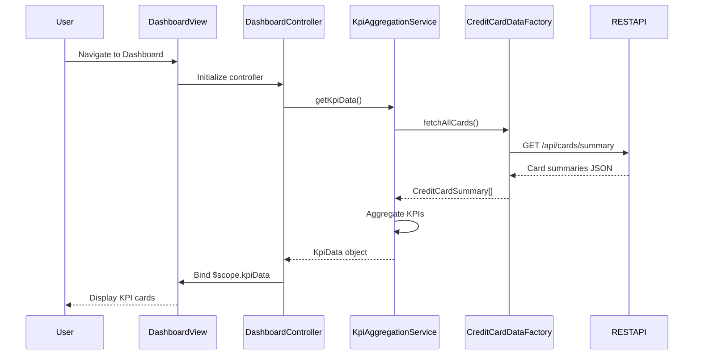

# Low-Level Design: Dashboard and KPI Management
**Epic ID:** QE-9539  
**Application Stack:** AngularJS 1.x, JavaScript ES6, HTML5, CSS3, Bootstrap, REST APIs, MVC Architecture

---

## a. Architecture Mapping

- **User Interface - Dashboard** → AngularJS Module (`dashboardModule`) + Controller (`DashboardController`) + HTML5 View (`dashboard.html`)
- **KPI Aggregation Service** → AngularJS Service (`KpiAggregationService`) for orchestrating API calls and data aggregation
- **Credit Card Data Service** → AngularJS Factory (`CreditCardDataFactory`) for REST API communication
- **User Authentication Service** → AngularJS Service (`AuthService`) for token management and session validation
- **API Gateway** → External REST endpoints consumed via `$http` or `$resource`

**Recommended Folder Structure:**
```
app/
├── modules/
│   └── dashboard/
│       ├── dashboard.module.js
│       ├── dashboard.controller.js
│       ├── dashboard.html
│       └── dashboard.css
├── services/
│   ├── kpi-aggregation.service.js
│   └── auth.service.js
├── factories/
│   └── credit-card-data.factory.js
└── shared/
    └── constants.js
```

---

## b. Component Specifications

| Component Name | Artifact Type | Responsibility | Key Dependencies |
|---|---|---|---|
| `dashboardModule` | Module | Root module for dashboard feature, handles routing and dependency injection | `ngRoute`, `KpiAggregationService`, `AuthService` |
| `DashboardController` | Controller | Manages dashboard view state, binds KPI data to UI, handles user interactions | `KpiAggregationService`, `$scope`, `$timeout` |
| `KpiAggregationService` | Service | Aggregates KPI data (monthly spend, credit limit, available credit, outstanding), orchestrates multiple API calls | `CreditCardDataFactory`, `$q` for promises |
| `CreditCardDataFactory` | Factory | Fetches credit card balances and transaction data from REST API | `$http`, API endpoint constants |
| `AuthService` | Service | Validates user session, manages authentication tokens, enforces secure access | `$http`, `$window` for token storage |
| `dashboard.html` | View | Displays KPI cards (monthly spend, credit limit, available credit, outstanding) in responsive Bootstrap grid | Bootstrap CSS, AngularJS directives |

---

## c. Data Model

**KpiData (JavaScript Object):**
```javascript
{
  monthlySpend: Number,        // Total spend for current month
  totalCreditLimit: Number,    // Sum of all card credit limits
  availableCredit: Number,     // Total credit limit - total outstanding
  outstandingAmount: Number,   // Sum of all card outstanding balances
  lastUpdated: Date            // Timestamp of last data refresh
}
```

**CreditCardSummary (JavaScript Object):**
```javascript
{
  cardId: String,
  cardNumber: String,          // Masked card number
  balance: Number,
  creditLimit: Number,
  outstanding: Number
}
```

---

## d. Data Flow

User navigates to the dashboard view, triggering `DashboardController` initialization. The controller invokes `KpiAggregationService.getKpiData()`, which calls `CreditCardDataFactory.fetchAllCards()` to retrieve card summaries via REST API. The service aggregates monthly spend, total credit limit, available credit, and outstanding amounts from the API response. Aggregated KPI data is returned to the controller, which binds it to `$scope.kpiData`. The view (`dashboard.html`) renders KPI cards using AngularJS data binding and Bootstrap grid layout. Real-time updates are handled via `$timeout` polling or event-driven refresh.

---

## e. Primary Sequence Diagram



---

## f. Implementation Notes

- Use AngularJS dependency injection for all services and factories; register components via `angular.module('dashboardModule', []).controller/service/factory`.
- Leverage ES6 arrow functions and `const`/`let` for cleaner service logic; use `$q.all()` for parallel API calls if multiple endpoints are required.
- Implement API integration via `$http` with interceptors for token injection and error handling; cache KPI data in service for 30 seconds to reduce API load.
- Use Bootstrap responsive grid (`col-xs-*`, `col-md-*`) for KPI card layout; ensure mobile-first design with viewport meta tag.
- Bind KPI values using AngularJS filters (`{{ kpiData.monthlySpend | currency }}`) for formatted display.

---

## g. Error Handling

HTTP interceptor-based error handling with user-friendly toast notifications for API failures; retry logic with exponential backoff for transient errors.

---

## h. Security Notes

Requires token-based authentication via existing SSO; tokens stored in sessionStorage and injected into API requests via HTTP interceptor.