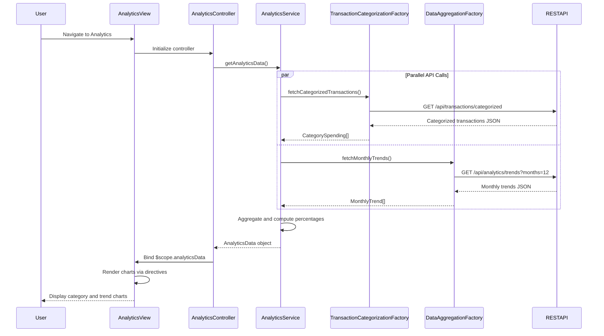

# Low-Level Design: Analytics and Spending Insights
**Epic ID:** QE-9540  
**Application Stack:** AngularJS 1.x, JavaScript ES6, HTML5, CSS3, Bootstrap, REST APIs, MVC Architecture

---

## a. Architecture Mapping

- **User Interface - Analytics Dashboard** → AngularJS Module (`analyticsModule`) + Controller (`AnalyticsController`) + HTML5 View (`analytics.html`)
- **Analytics Service** → AngularJS Service (`AnalyticsService`) for data aggregation and trend computation
- **Transaction Categorization Service** → AngularJS Factory (`TransactionCategorizationFactory`) for fetching categorized transaction data via REST API
- **Data Aggregation Service** → Backend service consumed via `DataAggregationFactory` for category totals and monthly trends
- **Visualization Components** → AngularJS Directives (`categoryChart`, `trendChart`) wrapping chart libraries (e.g., Chart.js, D3.js)

**Recommended Folder Structure:**
```
app/
├── modules/
│   └── analytics/
│       ├── analytics.module.js
│       ├── analytics.controller.js
│       ├── analytics.html
│       └── analytics.css
├── services/
│   └── analytics.service.js
├── factories/
│   ├── transaction-categorization.factory.js
│   └── data-aggregation.factory.js
├── directives/
│   ├── category-chart.directive.js
│   └── trend-chart.directive.js
└── shared/
    └── chart-config.js
```

---

## b. Component Specifications

| Component Name | Artifact Type | Responsibility | Key Dependencies |
|---|---|---|---|
| `analyticsModule` | Module | Root module for analytics feature, handles routing and chart library integration | `ngRoute`, `AnalyticsService`, chart library (Chart.js) |
| `AnalyticsController` | Controller | Manages analytics view state, binds spending data to charts, handles filter interactions | `AnalyticsService`, `$scope`, `$filter` |
| `AnalyticsService` | Service | Orchestrates data fetching for category-wise spending and monthly trends, caches results | `TransactionCategorizationFactory`, `DataAggregationFactory`, `$q` |
| `TransactionCategorizationFactory` | Factory | Fetches categorized transaction data from REST API | `$http`, API endpoint constants |
| `DataAggregationFactory` | Factory | Retrieves aggregated category totals and monthly trend data from backend | `$http`, API endpoint constants |
| `categoryChart` | Directive | Renders interactive pie/bar chart for category-wise spending breakdown | Chart.js library, `$timeout` |
| `trendChart` | Directive | Renders line chart for monthly spend trends over 12 months | Chart.js library, `$timeout` |
| `analytics.html` | View | Displays category filter dropdown, category chart, and trend chart in responsive layout | Bootstrap CSS, AngularJS directives |

---

## c. Data Model

**CategorySpending (JavaScript Object):**
```javascript
{
  category: String,            // e.g., "Food & Dining", "Fuel", "Shopping"
  totalAmount: Number,         // Total spend in category
  transactionCount: Number,    // Number of transactions
  percentage: Number           // Percentage of total spend
}
```

**MonthlyTrend (JavaScript Object):**
```javascript
{
  month: String,               // e.g., "2024-01", "2024-02"
  totalSpend: Number,          // Total spend for the month
  categoryBreakdown: [         // Array of CategorySpending objects
    { category: String, amount: Number }
  ]
}
```

**AnalyticsData (JavaScript Object):**
```javascript
{
  categorySpending: [CategorySpending],  // Array of category spending objects
  monthlyTrends: [MonthlyTrend],         // Array of monthly trend objects (12 months)
  selectedCategory: String,              // Currently selected filter category
  dateRange: { start: Date, end: Date }  // Date range for trend analysis
}
```

---

## d. Data Flow

User navigates to the analytics view, triggering `AnalyticsController` initialization. The controller invokes `AnalyticsService.getAnalyticsData()`, which makes parallel API calls via `TransactionCategorizationFactory.fetchCategorizedTransactions()` and `DataAggregationFactory.fetchMonthlyTrends()`. The service aggregates category totals and monthly trends from API responses, computing percentages and sorting by amount. Aggregated data is returned to the controller and bound to `$scope.analyticsData`. The view renders category and trend charts using custom directives (`categoryChart`, `trendChart`), which consume the bound data and initialize Chart.js visualizations. User interactions (e.g., category filter selection) trigger controller methods that update `$scope.analyticsData.selectedCategory` and re-render charts.

---

## e. Primary Sequence Diagram



---

## f. Implementation Notes

- Use AngularJS dependency injection for all services, factories, and directives; register chart directives with isolated scope for reusability.
- Leverage ES6 `Promise.all()` or `$q.all()` for parallel API calls to reduce total load time; cache analytics data in service for 5 minutes.
- Integrate Chart.js via custom directives that watch data changes and update charts using `chart.update()`; ensure charts are responsive using Chart.js responsive config.
- Implement category filter using AngularJS `ng-options` with `ng-change` to trigger data re-aggregation and chart re-rendering.
- Use AngularJS `$filter` service for date formatting and currency display in chart tooltips and labels.

---

## g. Error Handling

HTTP interceptor captures API errors; user notified via Bootstrap alert component with retry option; fallback to cached data if available.

---

## h. Security Notes

Standard input validation and secure API calls assumed; token-based authentication enforced via HTTP interceptor.