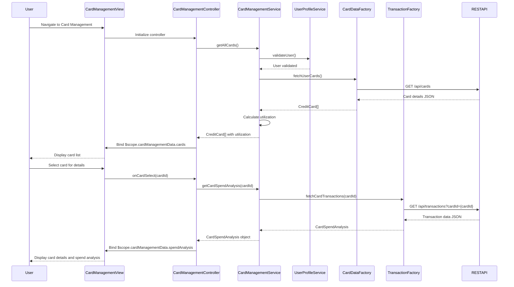

# Low-Level Design: Credit Card Management and Monitoring
**Epic ID:** QE-9541  
**Application Stack:** AngularJS 1.x, JavaScript ES6, HTML5, CSS3, Bootstrap, REST APIs, MVC Architecture

---

## a. Architecture Mapping

- **User Interface - Card Management** → AngularJS Module (`cardManagementModule`) + Controller (`CardManagementController`) + HTML5 View (`card-management.html`)
- **Card Management Service** → AngularJS Service (`CardManagementService`) for orchestrating card data retrieval and spend analysis
- **Credit Card Data Repository** → AngularJS Factory (`CardDataFactory`) for REST API communication to fetch card details
- **Transaction Service** → AngularJS Factory (`TransactionFactory`) for fetching card-wise spending data
- **User Profile Service** → AngularJS Service (`UserProfileService`) for card ownership validation
- **Card List Component** → AngularJS Directive (`cardList`) for rendering multiple cards in a grid/list layout
- **Card Detail Component** → AngularJS Directive (`cardDetail`) for displaying individual card details and spend analysis

**Recommended Folder Structure:**
```
app/
├── modules/
│   └── card-management/
│       ├── card-management.module.js
│       ├── card-management.controller.js
│       ├── card-management.html
│       └── card-management.css
├── services/
│   ├── card-management.service.js
│   └── user-profile.service.js
├── factories/
│   ├── card-data.factory.js
│   └── transaction.factory.js
├── directives/
│   ├── card-list.directive.js
│   └── card-detail.directive.js
└── shared/
    └── card-utils.js
```

---

## b. Component Specifications

| Component Name | Artifact Type | Responsibility | Key Dependencies |
|---|---|---|---|
| `cardManagementModule` | Module | Root module for card management feature, handles routing and dependency injection | `ngRoute`, `CardManagementService`, `UserProfileService` |
| `CardManagementController` | Controller | Manages card list view state, handles card selection, filters, and triggers spend analysis | `CardManagementService`, `$scope`, `$filter` |
| `CardManagementService` | Service | Orchestrates fetching of card details, card-wise spending, and utilization calculations | `CardDataFactory`, `TransactionFactory`, `$q` |
| `CardDataFactory` | Factory | Fetches credit card details (card number, limit, balance, outstanding) from REST API | `$http`, API endpoint constants |
| `TransactionFactory` | Factory | Retrieves card-wise transaction history and spending totals from REST API | `$http`, API endpoint constants |
| `UserProfileService` | Service | Validates card ownership against user profile, enforces access control | `$http`, `$window` for session management |
| `cardList` | Directive | Renders list/grid of credit cards with summary info (card number, balance, utilization) | Bootstrap CSS, AngularJS data binding |
| `cardDetail` | Directive | Displays detailed card information and card-wise spend analysis in modal or side panel | Bootstrap modal, AngularJS data binding |
| `card-management.html` | View | Displays card list, filter controls, and card detail panel in responsive layout | Bootstrap CSS, AngularJS directives |

---

## c. Data Model

**CreditCard (JavaScript Object):**
```javascript
{
  cardId: String,
  cardNumber: String,          // Masked card number (e.g., "**** **** **** 1234")
  cardType: String,            // e.g., "Visa", "MasterCard"
  creditLimit: Number,
  currentBalance: Number,
  outstandingAmount: Number,
  availableCredit: Number,     // creditLimit - outstandingAmount
  utilizationPercentage: Number, // (outstandingAmount / creditLimit) * 100
  expiryDate: String,          // e.g., "12/25"
  status: String               // e.g., "Active", "Blocked"
}
```

**CardSpendAnalysis (JavaScript Object):**
```javascript
{
  cardId: String,
  monthlySpend: Number,        // Total spend for current month
  totalTransactions: Number,   // Number of transactions
  categoryBreakdown: [         // Array of category spending
    { category: String, amount: Number }
  ],
  lastTransactionDate: Date
}
```

**CardManagementData (JavaScript Object):**
```javascript
{
  cards: [CreditCard],         // Array of credit card objects (up to 20)
  selectedCard: CreditCard,    // Currently selected card for detail view
  spendAnalysis: CardSpendAnalysis, // Spend analysis for selected card
  filterCriteria: String       // Filter by card type or status
}
```

---

## d. Data Flow

User navigates to the card management view, triggering `CardManagementController` initialization. The controller invokes `CardManagementService.getAllCards()`, which calls `UserProfileService.validateUser()` for ownership validation, then `CardDataFactory.fetchUserCards()` to retrieve card details via REST API. The service calculates utilization percentages and available credit for each card. Card data is returned to the controller and bound to `$scope.cardManagementData.cards`. The view renders cards using the `cardList` directive in a Bootstrap grid. When user selects a card, the controller invokes `CardManagementService.getCardSpendAnalysis(cardId)`, which calls `TransactionFactory.fetchCardTransactions(cardId)` to retrieve card-wise spending data. Spend analysis is bound to `$scope.cardManagementData.spendAnalysis`, and the `cardDetail` directive displays detailed information in a modal or side panel.

---

## e. Primary Sequence Diagram



---

## f. Implementation Notes

- Use AngularJS dependency injection for all services, factories, and directives; register `cardList` and `cardDetail` directives with isolated scope and two-way data binding.
- Leverage ES6 arrow functions and `const`/`let` for service logic; use `$q.all()` for parallel API calls when fetching multiple card details.
- Implement card utilization calculation in service layer: `utilizationPercentage = (outstandingAmount / creditLimit) * 100`; cache card data for 2 minutes to reduce API load.
- Use Bootstrap grid (`col-md-4`) for card list layout with responsive design; implement card selection via `ng-click` with visual highlight using CSS class toggle.
- Implement card filtering using AngularJS `$filter` service with `ng-repeat` filter expression; support filter by card type and status.

---

## g. Error Handling

HTTP interceptor-based error handling with user-friendly alert messages; retry logic for failed API calls with exponential backoff.

---

## h. Security Notes

Requires token-based auth via existing SSO; card numbers masked on client-side; ownership validation enforced at service layer before data retrieval.