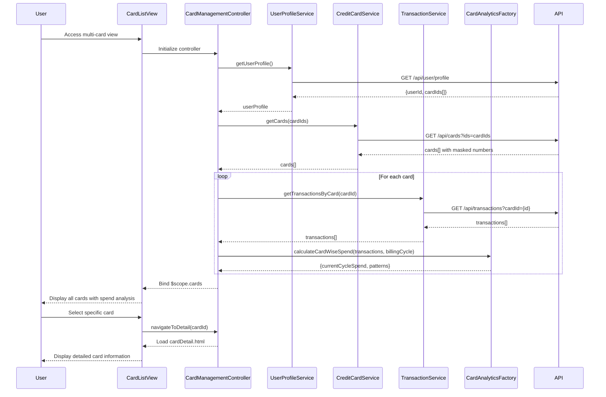

# Low-Level Design: Multi-Card Management and Monitoring
**Epic ID:** QE-9548  
**Technology Stack:** AngularJS 1.x, JavaScript ES6, HTML5, CSS3, Bootstrap, REST APIs, MVC Architecture

---

## a. Architecture Mapping

- **User Interface** → AngularJS View (HTML5 + Bootstrap) with card-list template and card-detail template
- **Card Management Controller** → AngularJS Controller (`CardManagementController`)
- **Credit Card Data Repository** → AngularJS Service (`CreditCardService`) communicating with REST API endpoint `/api/cards`
- **User Profile Service** → AngularJS Service (`UserProfileService`) communicating with REST API endpoint `/api/user/profile`
- **Transaction Service** → AngularJS Service (`TransactionService`) communicating with REST API endpoint `/api/transactions`
- **Card Analytics Module** → AngularJS Factory (`CardAnalyticsFactory`) for client-side spend calculations

**Recommended Folder Structure:**
```
/app
  /modules
    /card-management
      /controllers
        card-management.controller.js
      /services
        credit-card.service.js
        user-profile.service.js
        transaction.service.js
      /factories
        card-analytics.factory.js
      /views
        card-list.html
        card-detail.html
      /directives
        card-item.directive.js
```

---

## b. Component Specifications

| Name | Artifact Type | Responsibility | Key Dependencies |
|------|---------------|----------------|------------------|
| CardManagementController | Controller | Orchestrates card data retrieval, filtering, selection, and view rendering | CreditCardService, UserProfileService, TransactionService, CardAnalyticsFactory |
| CreditCardService | Service | Fetches card data from REST API `/api/cards`, handles caching for 1-second retrieval | $http, $q |
| UserProfileService | Service | Retrieves user profile and card associations from `/api/user/profile` | $http, $q |
| TransactionService | Service | Fetches card-specific transaction data from `/api/transactions?cardId={id}` | $http, $q |
| CardAnalyticsFactory | Factory | Calculates card-wise spend analysis and usage patterns from transaction data | None (pure calculation) |
| cardItem | Directive | Renders individual card tile with masked number, limit, balance, and spending | None |
| cardList | View | Displays all cards with filtering and selection UI using Bootstrap grid | CardManagementController |
| cardDetail | View | Shows detailed card information including spending patterns and analytics | CardManagementController |

---

## c. Data Model

**CreditCard Model:**
```javascript
{
  cardId: String,              // Unique card identifier
  maskedNumber: String,        // Last 4 digits (e.g., "****1234")
  cardType: String,            // "Visa", "MasterCard", etc.
  creditLimit: Number,         // Total credit limit
  outstandingBalance: Number,  // Current outstanding amount
  availableCredit: Number,     // Calculated: creditLimit - outstandingBalance
  billingCycleStart: Date,     // Billing cycle start date
  billingCycleEnd: Date,       // Billing cycle end date
  currentCycleSpend: Number    // Spend in current billing cycle
}
```

**UserProfile Model:**
```javascript
{
  userId: String,
  cardIds: Array<String>       // Array of associated card IDs
}
```

**Transaction Model:**
```javascript
{
  transactionId: String,
  cardId: String,
  amount: Number,
  date: Date,
  category: String
}
```

---

## d. Data Flow

User accesses the multi-card view → `cardList.html` view loads and invokes `CardManagementController` → Controller calls `UserProfileService.getUserProfile()` to fetch user's card associations → Controller then calls `CreditCardService.getCards(cardIds)` which retrieves all card data with masked numbers from `/api/cards` (cached for 1-second performance) → Simultaneously, `TransactionService.getTransactionsByCard(cardId)` fetches spending data for each card → `CardAnalyticsFactory.calculateCardWiseSpend(transactions, billingCycle)` computes current cycle spend and usage patterns → Controller binds aggregated data to `$scope.cards` → View renders card tiles using `cardItem` directive with filtering/selection controls → User selects a card → Controller navigates to `cardDetail.html` view displaying detailed card information, limits, balance, and spending patterns.

---

## e. Primary Sequence Diagram



---

## f. Implementation Notes

- Use AngularJS Dependency Injection to inject services into `CardManagementController` for testability and modularity.
- Implement client-side caching in `CreditCardService` using `$cacheFactory` to ensure 1-second card data retrieval performance.
- Use ES6 arrow functions and template literals in service methods for cleaner async handling with `$q` promises.
- Apply Bootstrap responsive grid (col-xs, col-sm, col-md) in `cardList.html` for mobile and desktop viewport support.
- Use AngularJS `ng-repeat` with `track by cardId` for efficient card list rendering and filtering with `ng-filter`.

---

## g. Error Handling

HTTP interceptor (`$httpProvider.interceptors`) captures API errors and displays user-friendly notifications via a global error service with Bootstrap alerts.

---

## h. Security Notes

Card numbers are encrypted at rest and transmitted via HTTPS; UI displays only masked card numbers (last 4 digits) retrieved from secure API endpoints.

---