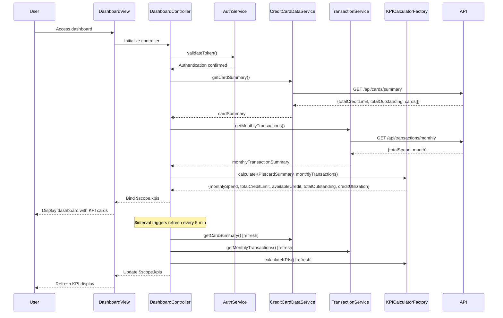

# Low-Level Design: Dashboard and KPI Management
**Epic ID:** QE-9549  
**Technology Stack:** AngularJS 1.x, JavaScript ES6, HTML5, CSS3, Bootstrap, REST APIs, MVC Architecture

---

## a. Architecture Mapping

- **User Interface** → AngularJS View (HTML5 + Bootstrap) with dashboard template
- **Dashboard Controller** → AngularJS Controller (`DashboardController`)
- **Credit Card Data Service** → AngularJS Service (`CreditCardDataService`) communicating with REST API endpoint `/api/cards/summary`
- **Transaction Service** → AngularJS Service (`TransactionService`) communicating with REST API endpoint `/api/transactions/monthly`
- **User Authentication Service** → AngularJS Service (`AuthService`) with token-based authentication
- **KPI Calculation Engine** → AngularJS Factory (`KPICalculatorFactory`) for client-side KPI aggregation

**Recommended Folder Structure:**
```
/app
  /modules
    /dashboard
      /controllers
        dashboard.controller.js
      /services
        credit-card-data.service.js
        transaction.service.js
        auth.service.js
      /factories
        kpi-calculator.factory.js
      /views
        dashboard.html
      /directives
        kpi-card.directive.js
```

---

## b. Component Specifications

| Name | Artifact Type | Responsibility | Key Dependencies |
|------|---------------|----------------|------------------|
| DashboardController | Controller | Orchestrates KPI data retrieval, calculation, real-time refresh, and dashboard rendering | CreditCardDataService, TransactionService, AuthService, KPICalculatorFactory, $interval |
| CreditCardDataService | Service | Fetches aggregated card data (limits, balances, outstanding) from `/api/cards/summary` | $http, $q |
| TransactionService | Service | Retrieves current month transaction data from `/api/transactions/monthly` | $http, $q |
| AuthService | Service | Validates user credentials and manages authentication tokens | $http, $window |
| KPICalculatorFactory | Factory | Aggregates total credit limit, calculates available credit, computes monthly spend, and calculates utilization percentage | None (pure calculation) |
| kpiCard | Directive | Renders individual KPI metric card with value, label, and visual indicator | None |
| dashboard | View | Displays responsive dashboard layout with KPI cards using Bootstrap grid | DashboardController |

---

## c. Data Model

**CardSummary Model:**
```javascript
{
  userId: String,
  cards: Array<{
    cardId: String,
    creditLimit: Number,
    outstandingBalance: Number
  }>,
  totalCreditLimit: Number,      // Sum of all card limits
  totalOutstanding: Number        // Sum of all outstanding balances
}
```

**MonthlyTransactionSummary Model:**
```javascript
{
  userId: String,
  month: String,                  // "YYYY-MM"
  totalSpend: Number,             // Sum of all transactions in current month
  transactionCount: Number
}
```

**KPI Model:**
```javascript
{
  monthlySpend: Number,
  totalCreditLimit: Number,
  availableCredit: Number,        // Calculated: totalCreditLimit - totalOutstanding
  totalOutstanding: Number,
  creditUtilization: Number       // Calculated: (totalOutstanding / totalCreditLimit) * 100
}
```

---

## d. Data Flow

User accesses dashboard → `dashboard.html` view loads and invokes `DashboardController` → Controller calls `AuthService.validateToken()` to ensure authenticated session → Controller calls `CreditCardDataService.getCardSummary()` which fetches aggregated card data from `/api/cards/summary` → Simultaneously, `TransactionService.getMonthlyTransactions()` retrieves current month spend from `/api/transactions/monthly` → `KPICalculatorFactory.calculateKPIs(cardSummary, monthlyTransactions)` computes total credit limit, available credit, utilization percentage, and monthly spend → Controller binds KPI data to `$scope.kpis` → View renders responsive dashboard with KPI cards using `kpiCard` directive → `$interval` service triggers refresh every 5 minutes, repeating the data fetch and calculation cycle to update KPIs in real-time.

---

## e. Primary Sequence Diagram



---

## f. Implementation Notes

- Use AngularJS `$interval` service to trigger automatic KPI refresh every 5 minutes for real-time data updates.
- Implement `$q.all()` to parallelize `CreditCardDataService` and `TransactionService` calls for faster dashboard load (<2 seconds).
- Use ES6 `const` and `let` in service methods; apply arrow functions for promise chaining.
- Apply Bootstrap responsive utilities (col-xs-12, col-md-6, col-lg-3) in `dashboard.html` for mobile and desktop layouts.
- Use `kpiCard` directive with isolated scope to encapsulate KPI rendering logic and enable reusability across dashboard.

---

## g. Error Handling

HTTP interceptor captures API failures and displays error notifications; `AuthService` redirects to login on 401 responses.

---

## h. Security Notes

Requires token-based auth via existing SSO; authentication token stored in `$window.sessionStorage` and included in API request headers.

---