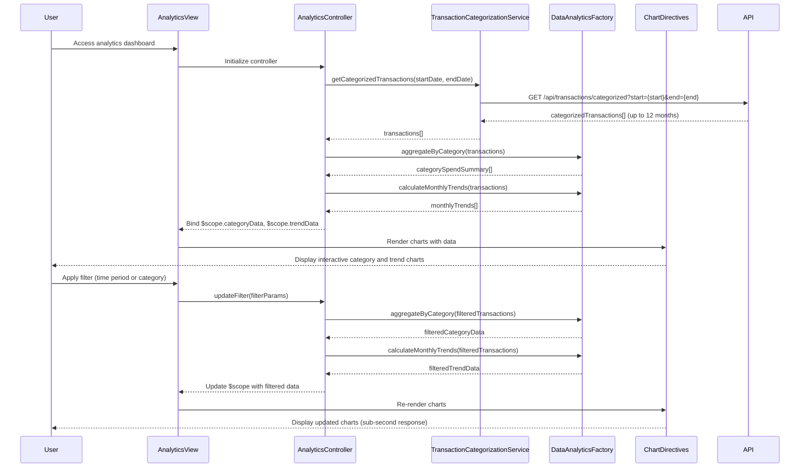

# Low-Level Design: Analytics and Category-Based Spending Insights
**Epic ID:** QE-9550  
**Technology Stack:** AngularJS 1.x, JavaScript ES6, HTML5, CSS3, Bootstrap, REST APIs, MVC Architecture

---

## a. Architecture Mapping

- **User Interface** → AngularJS View (HTML5 + Bootstrap) with analytics dashboard template
- **Analytics Controller** → AngularJS Controller (`AnalyticsController`)
- **Transaction Categorization Service** → AngularJS Service (`TransactionCategorizationService`) communicating with REST API endpoint `/api/transactions/categorized`
- **Data Analytics Engine** → AngularJS Factory (`DataAnalyticsFactory`) for client-side aggregation and trend calculation
- **Visualization Library** → Third-party library integration (Chart.js via `angular-chart.js` directive)
- **Transaction History Database** → Backend REST API endpoint `/api/transactions/history` (up to 12 months)

**Recommended Folder Structure:**
```
/app
  /modules
    /analytics
      /controllers
        analytics.controller.js
      /services
        transaction-categorization.service.js
      /factories
        data-analytics.factory.js
      /views
        analytics-dashboard.html
      /directives
        category-chart.directive.js
        trend-chart.directive.js
```

---

## b. Component Specifications

| Name | Artifact Type | Responsibility | Key Dependencies |
|------|---------------|----------------|------------------|
| AnalyticsController | Controller | Orchestrates transaction data retrieval, filtering by time/category, and visualization rendering | TransactionCategorizationService, DataAnalyticsFactory, $scope, $filter |
| TransactionCategorizationService | Service | Fetches categorized transaction data from `/api/transactions/categorized` with date range parameters | $http, $q |
| DataAnalyticsFactory | Factory | Aggregates spending by category, calculates monthly trends, and prepares chart data structures | None (pure calculation) |
| categoryChart | Directive | Renders interactive category-wise spending pie/bar chart using Chart.js | angular-chart.js |
| trendChart | Directive | Renders monthly spend trend line chart using Chart.js | angular-chart.js |
| analyticsFilterPanel | Directive | Provides UI controls for filtering by time period (1/3/6/12 months) and category selection | None |

---

## c. Data Model

**CategorizedTransaction Model:**
```javascript
{
  transactionId: String,
  cardId: String,
  amount: Number,
  date: Date,                     // Transaction posting date
  category: String                // One of: "Food & Dining", "Fuel", "Shopping", "Travel", "Entertainment", "Utilities", "Healthcare", "Education", "Miscellaneous"
}
```

**CategorySpendSummary Model:**
```javascript
{
  category: String,
  totalSpend: Number,
  transactionCount: Number,
  percentage: Number              // Calculated: (totalSpend / grandTotal) * 100
}
```

**MonthlyTrend Model:**
```javascript
{
  month: String,                  // "YYYY-MM"
  totalSpend: Number,
  categoryBreakdown: Array<{
    category: String,
    spend: Number
  }>
}
```

---

## d. Data Flow

User accesses analytics view → `analytics-dashboard.html` loads and invokes `AnalyticsController` → Controller calls `TransactionCategorizationService.getCategorizedTransactions(startDate, endDate)` which fetches categorized transaction data from `/api/transactions/categorized?start={startDate}&end={endDate}` (default: last 12 months) → `DataAnalyticsFactory.aggregateByCategory(transactions)` computes spending totals and percentages for each of the nine categories → `DataAnalyticsFactory.calculateMonthlyTrends(transactions)` generates month-by-month spend data → Controller binds aggregated data to `$scope.categoryData` and `$scope.trendData` → View renders interactive charts using `categoryChart` and `trendChart` directives powered by Chart.js → User applies filters via `analyticsFilterPanel` (time period or specific category) → Controller re-invokes `DataAnalyticsFactory` methods with filtered data → Charts update with sub-second response time via AngularJS two-way binding.

---

## e. Primary Sequence Diagram



---

## f. Implementation Notes

- Integrate Chart.js via `angular-chart.js` wrapper for declarative chart rendering in AngularJS views.
- Use AngularJS `$filter` service to implement client-side filtering by time period and category for sub-second interaction response.
- Apply ES6 array methods (`map`, `reduce`, `filter`) in `DataAnalyticsFactory` for efficient category aggregation and trend calculation.
- Use AngularJS `ng-if` and `ng-show` to conditionally render chart components based on data availability, ensuring 3-second render target.
- Implement lazy loading for transaction data: fetch only selected time range on filter change to optimize API calls and rendering performance.

---

## g. Error Handling

HTTP interceptor handles API errors; display user-friendly error messages in analytics view using Bootstrap alert components.

---

## h. Security Notes

Standard input validation and secure API calls assumed; transaction data transmitted via HTTPS with authentication token in headers.

---