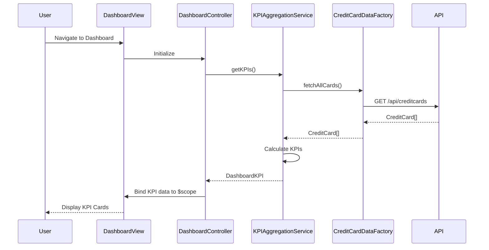

# Low-Level Design: QE-9557 - Credit Card Dashboard and KPI Management

## a. Architecture Mapping

- **Dashboard KPI Display** → AngularJS Module: `dashboard.module.js`, Controller: `DashboardController`, Service: `KPIAggregationService`
- **Credit Card Data Retrieval** → Factory: `CreditCardDataFactory` (REST API integration)
- **KPI Calculation Logic** → Service: `KPICalculationService` (computes available credit, outstanding amounts)
- **Responsive UI Components** → Directives: `kpiCard`, `dashboardSummary` (reusable KPI display widgets)

**Recommended Folder Structure:**
```
app/
├── modules/
│   └── dashboard/
│       ├── dashboard.module.js
│       ├── controllers/
│       │   └── DashboardController.js
│       ├── services/
│       │   ├── KPIAggregationService.js
│       │   └── KPICalculationService.js
│       ├── factories/
│       │   └── CreditCardDataFactory.js
│       ├── directives/
│       │   ├── kpiCard.directive.js
│       │   └── dashboardSummary.directive.js
│       └── views/
│           └── dashboard.html
└── assets/
    └── css/
        └── dashboard.css
```

## b. Component Specifications

| Component Name | Artifact Type | Responsibility | Key Dependencies |
|---|---|---|---|
| `dashboard.module` | Module | Registers dashboard feature module and dependencies | `ngRoute`, `ui.bootstrap` |
| `DashboardController` | Controller | Orchestrates dashboard view, fetches KPIs, binds data to scope | `KPIAggregationService`, `$scope` |
| `KPIAggregationService` | Service | Aggregates KPI data from multiple cards, coordinates calculation | `CreditCardDataFactory`, `KPICalculationService` |
| `KPICalculationService` | Service | Performs KPI computations (available credit, outstanding amount) | None |
| `CreditCardDataFactory` | Factory | Fetches credit card data from REST API endpoint | `$http`, `$q` |
| `kpiCard` | Directive | Renders individual KPI card with value, label, and icon | None |
| `dashboardSummary` | Directive | Displays consolidated summary of all KPIs in responsive layout | None |

## c. Data Model

**CreditCard Object:**
```javascript
{
  cardId: String,
  cardNumber: String,
  cardType: String,
  creditLimit: Number,
  currentBalance: Number,
  availableCredit: Number,
  outstandingAmount: Number,
  monthlySpend: Number,
  lastUpdated: Date
}
```

**DashboardKPI Object:**
```javascript
{
  totalMonthlySpend: Number,
  totalCreditLimit: Number,
  totalAvailableCredit: Number,
  totalOutstandingAmount: Number,
  cardCount: Number
}
```

## d. Data Flow

User navigates to dashboard → `DashboardController` initializes and calls `KPIAggregationService.getKPIs()` → Service invokes `CreditCardDataFactory.fetchAllCards()` which makes REST API call (`GET /api/creditcards`) → Factory returns array of CreditCard objects → `KPIAggregationService` passes data to `KPICalculationService` for aggregation (sum monthly spend, credit limits, calculate available credit) → Aggregated `DashboardKPI` object returned to controller → Controller binds KPI data to `$scope` → View renders KPI cards using `kpiCard` and `dashboardSummary` directives with Bootstrap responsive grid → UI updates with real-time KPI values.

## e. Primary Sequence Diagram



## f. Implementation Notes

- Use AngularJS Dependency Injection to inject services and factories into controllers for testability and modularity.
- Implement ES6 classes for services and factories; use arrow functions for concise callback handling.
- Use `$http` service with promise-based API calls; handle responses with `.then()` and `.catch()` for error handling.
- Apply Bootstrap grid system (`col-md-3`, `col-sm-6`, `col-xs-12`) for responsive KPI card layout across devices.
- Use AngularJS `$q` service for promise chaining when multiple async operations are required.

## g. Error Handling

HTTP interceptor captures API errors; controller displays user-friendly error messages using Bootstrap alerts and logs errors to console.

## h. Security Notes

Standard input validation and secure API calls assumed; token-based authentication via existing SSO integrated in HTTP headers.