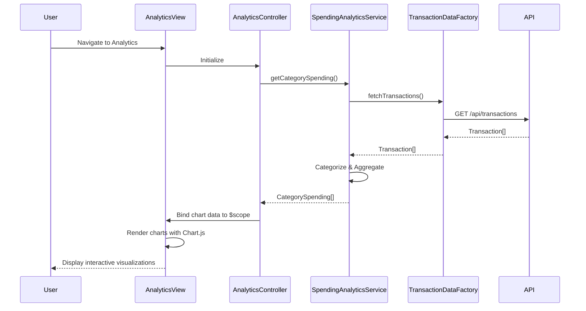

# Low-Level Design: QE-9558 - Spending Analytics and Insights

## a. Architecture Mapping

- **Analytics Dashboard** → AngularJS Module: `analytics.module.js`, Controller: `AnalyticsController`, Service: `SpendingAnalyticsService`
- **Transaction Categorization** → Service: `CategorizationService` (applies rules to classify transactions)
- **Data Visualization** → Directives: `categoryChart`, `trendChart` (wraps charting library for category and trend views)
- **Transaction Data Retrieval** → Factory: `TransactionDataFactory` (REST API integration)

**Recommended Folder Structure:**
```
app/
├── modules/
│   └── analytics/
│       ├── analytics.module.js
│       ├── controllers/
│       │   └── AnalyticsController.js
│       ├── services/
│       │   ├── SpendingAnalyticsService.js
│       │   └── CategorizationService.js
│       ├── factories/
│       │   └── TransactionDataFactory.js
│       ├── directives/
│       │   ├── categoryChart.directive.js
│       │   └── trendChart.directive.js
│       └── views/
│           └── analytics.html
└── assets/
    ├── css/
    │   └── analytics.css
    └── libs/
        └── chart.js
```

## b. Component Specifications

| Component Name | Artifact Type | Responsibility | Key Dependencies |
|---|---|---|---|
| `analytics.module` | Module | Registers analytics feature module and chart library dependencies | `ngRoute`, `chart.js` |
| `AnalyticsController` | Controller | Manages analytics view, fetches transaction data, prepares chart data | `SpendingAnalyticsService`, `$scope` |
| `SpendingAnalyticsService` | Service | Aggregates spending by category and month, coordinates data processing | `TransactionDataFactory`, `CategorizationService` |
| `CategorizationService` | Service | Applies categorization rules to classify transactions into 9 categories | None |
| `TransactionDataFactory` | Factory | Fetches transaction history from REST API endpoint | `$http`, `$q` |
| `categoryChart` | Directive | Renders interactive pie/bar chart for category-wise spending | `chart.js` |
| `trendChart` | Directive | Renders line chart for monthly spend trends over 12 months | `chart.js` |

## c. Data Model

**Transaction Object:**
```javascript
{
  transactionId: String,
  cardId: String,
  amount: Number,
  merchantName: String,
  category: String,
  transactionDate: Date,
  description: String
}
```

**CategorySpending Object:**
```javascript
{
  category: String,
  totalAmount: Number,
  transactionCount: Number,
  percentage: Number
}
```

**MonthlyTrend Object:**
```javascript
{
  month: String,
  year: Number,
  totalSpend: Number
}
```

**Categories Enum:**
```javascript
['Food & Dining', 'Fuel', 'Shopping', 'Travel', 'Entertainment', 'Utilities', 'Healthcare', 'Education', 'Miscellaneous']
```

## d. Data Flow

User navigates to analytics view → `AnalyticsController` initializes and calls `SpendingAnalyticsService.getCategorySpending()` and `getMonthlyTrends()` → Service invokes `TransactionDataFactory.fetchTransactions()` which makes REST API call (`GET /api/transactions`) → Factory returns array of Transaction objects → `SpendingAnalyticsService` passes transactions to `CategorizationService` to ensure all transactions are categorized → Service aggregates spending by category and calculates monthly totals → Returns `CategorySpending[]` and `MonthlyTrend[]` to controller → Controller binds chart data to `$scope` → View renders interactive charts using `categoryChart` and `trendChart` directives with Chart.js library → User interacts with charts (hover, click) to explore spending patterns.

## e. Primary Sequence Diagram



## f. Implementation Notes

- Integrate Chart.js library via CDN or npm; wrap chart rendering in AngularJS directives for reusability and encapsulation.
- Use ES6 array methods (`.filter()`, `.reduce()`, `.map()`) in `SpendingAnalyticsService` for efficient data aggregation and transformation.
- Implement `$watch` in chart directives to re-render charts when underlying data changes dynamically.
- Apply responsive chart options in Chart.js configuration to ensure charts scale properly on mobile, tablet, and desktop.
- Use AngularJS `$filter` service for date formatting in monthly trend labels (e.g., 'Jan 2024').

## g. Error Handling

HTTP interceptor-based error handling with try/catch blocks in service methods; user notified via Bootstrap toast notifications on data fetch failures.

## h. Security Notes

Standard input validation and secure API calls assumed; transaction data filtered by authenticated user context on backend.