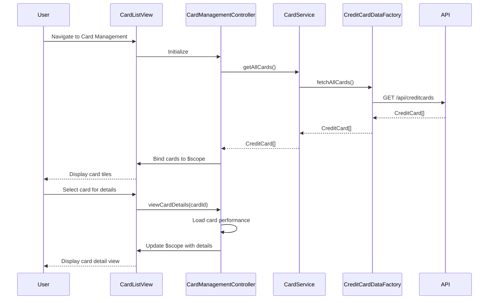

# Low-Level Design: QE-9559 - Multiple Credit Card Management

## a. Architecture Mapping

- **Card List Display** → AngularJS Module: `cardManagement.module.js`, Controller: `CardManagementController`, Service: `CardService`
- **Card Comparison** → Service: `CardComparisonService` (compares metrics across cards)
- **Card-wise Analytics** → Service: `CardAnalyticsService` (aggregates spending per card)
- **Credit Card Data Retrieval** → Factory: `CreditCardDataFactory` (REST API integration)
- **Card Display Components** → Directives: `cardTile`, `cardDetailView`, `cardComparison` (reusable card UI components)

**Recommended Folder Structure:**
```
app/
├── modules/
│   └── cardManagement/
│       ├── cardManagement.module.js
│       ├── controllers/
│       │   └── CardManagementController.js
│       ├── services/
│       │   ├── CardService.js
│       │   ├── CardComparisonService.js
│       │   └── CardAnalyticsService.js
│       ├── factories/
│       │   └── CreditCardDataFactory.js
│       ├── directives/
│       │   ├── cardTile.directive.js
│       │   ├── cardDetailView.directive.js
│       │   └── cardComparison.directive.js
│       └── views/
│           ├── cardList.html
│           └── cardDetail.html
└── assets/
    └── css/
        └── cardManagement.css
```

## b. Component Specifications

| Component Name | Artifact Type | Responsibility | Key Dependencies |
|---|---|---|---|
| `cardManagement.module` | Module | Registers card management feature module and dependencies | `ngRoute`, `ui.bootstrap` |
| `CardManagementController` | Controller | Manages card list view, handles card selection, coordinates services | `CardService`, `CardAnalyticsService`, `$scope` |
| `CardService` | Service | Fetches and caches credit card data, provides card CRUD operations | `CreditCardDataFactory` |
| `CardComparisonService` | Service | Compares multiple cards based on metrics (limit, APR, rewards) | None |
| `CardAnalyticsService` | Service | Calculates card-wise spending and performance metrics | `TransactionDataFactory` |
| `CreditCardDataFactory` | Factory | Fetches credit card data from REST API endpoint | `$http`, `$q` |
| `cardTile` | Directive | Renders individual card summary tile in grid layout | None |
| `cardDetailView` | Directive | Displays detailed card information in modal or dedicated view | None |
| `cardComparison` | Directive | Renders side-by-side comparison table for selected cards | `CardComparisonService` |

## c. Data Model

**CreditCard Object:**
```javascript
{
  cardId: String,
  cardNumber: String,
  cardHolderName: String,
  cardType: String,
  issuer: String,
  creditLimit: Number,
  currentBalance: Number,
  availableCredit: Number,
  apr: Number,
  rewardsProgram: String,
  annualFee: Number,
  expiryDate: Date,
  lastUpdated: Date
}
```

**CardPerformance Object:**
```javascript
{
  cardId: String,
  monthlySpend: Number,
  utilizationRate: Number,
  transactionCount: Number,
  categoryBreakdown: Object
}
```

**CardComparison Object:**
```javascript
{
  cards: CreditCard[],
  comparisonMetrics: {
    creditLimit: Number[],
    apr: Number[],
    annualFee: Number[],
    utilizationRate: Number[]
  }
}
```

## d. Data Flow

User navigates to card management view → `CardManagementController` initializes and calls `CardService.getAllCards()` → Service invokes `CreditCardDataFactory.fetchAllCards()` which makes REST API call (`GET /api/creditcards`) → Factory returns array of CreditCard objects → `CardService` caches cards and returns to controller → Controller binds card list to `$scope` → View renders card tiles using `cardTile` directive in responsive grid → User selects card for details → Controller calls `CardAnalyticsService.getCardPerformance(cardId)` → Service fetches transactions for card and calculates performance metrics → Controller updates `$scope` with detailed card data → View displays card details using `cardDetailView` directive → User selects multiple cards for comparison → Controller invokes `CardComparisonService.compareCards(cardIds)` → Service returns comparison data → View renders comparison table using `cardComparison` directive.

## e. Primary Sequence Diagram



## f. Implementation Notes

- Use AngularJS `$cacheFactory` in `CardService` to cache fetched card data and reduce redundant API calls.
- Implement ES6 classes for services; use destructuring and spread operators for efficient data manipulation.
- Use `ui-router` or `ngRoute` for navigation between card list and card detail views with URL parameters (e.g., `/cards/:cardId`).
- Apply Bootstrap responsive grid (`col-md-4`, `col-sm-6`, `col-xs-12`) for card tile layout that adapts to screen size.
- Use AngularJS `ng-repeat` with `track by cardId` for efficient rendering of card lists and preventing unnecessary DOM manipulation.

## g. Error Handling

HTTP interceptor captures API errors; controller displays user-friendly error messages using Bootstrap modals and provides retry options.

## h. Security Notes

Requires token-based auth via existing SSO; card data filtered by authenticated user; sensitive card numbers masked in UI (show last 4 digits only).