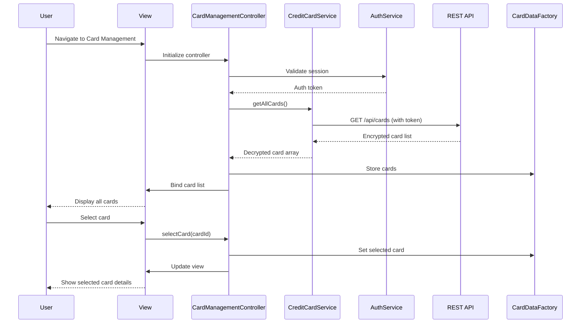

# Low-Level Design: QE-9560 - Multiple Credit Card Management

## a. Architecture Mapping

- **AngularJS Module**: `creditCardManagementModule` - Main module for card management features
- **Controller**: `CardManagementController` - Handles card display, selection, and switching logic
- **Service**: `CreditCardService` - Manages API calls for card data retrieval
- **Service**: `AuthService` - Handles user authentication and authorization
- **Service**: `EncryptionService` - Manages client-side encryption/decryption operations
- **Directive**: `cardListDirective` - Renders individual card tiles with details
- **Factory**: `CardDataFactory` - Caches and manages card data state

**Folder Structure:**
```
/app
  /modules
    /card-management
      card-management.module.js
      card-management.controller.js
      card-management.service.js
      card-list.directive.js
  /shared
    /services
      auth.service.js
      encryption.service.js
    /factories
      card-data.factory.js
  /assets
    /views
      card-management.html
```

## b. Component Specifications

| Component Name | Artifact Type | Responsibility | Key Dependencies |
|----------------|---------------|----------------|------------------|
| creditCardManagementModule | Module | Registers all card management components and dependencies | angular, ngRoute |
| CardManagementController | Controller | Manages card list display, selection, switching, and view state | CreditCardService, CardDataFactory, $scope |
| CreditCardService | Service | Fetches card list, individual card details via REST API | $http, $q, AuthService |
| AuthService | Service | Validates user session and provides auth tokens for API calls | $http, $window |
| EncryptionService | Service | Decrypts sensitive card data received from backend | CryptoJS (external library) |
| cardListDirective | Directive | Renders card tiles with credit limit, available credit, outstanding balance | CardDataFactory |
| CardDataFactory | Factory | Maintains card collection state and selected card reference | none |

## c. Data Model

**CreditCard Object:**
```javascript
{
  cardId: String,              // Unique card identifier
  cardNumber: String,          // Masked card number (e.g., "**** **** **** 1234")
  cardHolderName: String,      // Name on the card
  cardType: String,            // "Visa", "MasterCard", "Amex", etc.
  creditLimit: Number,         // Total credit limit
  availableCredit: Number,     // Remaining available credit
  outstandingBalance: Number,  // Current outstanding amount
  expiryDate: String,          // MM/YY format
  isActive: Boolean,           // Card active status
  lastUpdated: Date            // Timestamp of last data refresh
}
```

**User Object (partial):**
```javascript
{
  userId: String,
  cards: Array<CreditCard>     // Collection of user's credit cards (max 10)
}
```

## d. Data Flow

User logs in and navigates to card management view → CardManagementController initializes and calls CreditCardService.getAllCards() → Service sends authenticated GET request to `/api/cards` endpoint → Backend returns encrypted card list → EncryptionService decrypts card data → CardDataFactory stores card collection → Controller binds cards to view → cardListDirective renders each card tile with details → User clicks a card → Controller updates selected card in CardDataFactory (< 500ms) → View updates to display selected card's detailed information.

## e. Primary Sequence Diagram



## f. Implementation Notes

- Use AngularJS Dependency Injection for all services and factories to ensure testability and modularity.
- Implement card switching using CardDataFactory state management to achieve sub-500ms performance without API calls.
- Use $http interceptors for automatic auth token injection and error handling across all API requests.
- Leverage AngularJS $q promises for asynchronous card data loading with proper error propagation.
- Store selected card reference in factory to persist state across view transitions and enable fast switching.

## g. Error Handling

HTTP interceptor captures API errors; user-friendly messages displayed via toast notifications; session expiry redirects to login.

## h. Security Notes

Requires token-based auth via existing SSO; card data encrypted in transit (HTTPS) and decrypted client-side only for display.