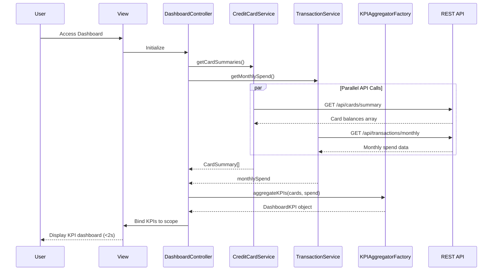

# Low-Level Design: QE-9561 - Dashboard KPIs and Credit Card Overview

## a. Architecture Mapping

- **AngularJS Module**: `dashboardModule` - Main module for dashboard and KPI display
- **Controller**: `DashboardController` - Manages KPI aggregation and dashboard state
- **Service**: `CreditCardService` - Fetches card details and balances
- **Service**: `TransactionService` - Retrieves monthly spend and outstanding amounts
- **Factory**: `KPIAggregatorFactory` - Computes portfolio-level KPIs from card data
- **Directive**: `kpiCardDirective` - Renders individual KPI metric cards
- **Filter**: `currencyFormatFilter` - Formats currency values consistently

**Folder Structure:**
```
/app
  /modules
    /dashboard
      dashboard.module.js
      dashboard.controller.js
      kpi-card.directive.js
  /shared
    /services
      credit-card.service.js
      transaction.service.js
    /factories
      kpi-aggregator.factory.js
    /filters
      currency-format.filter.js
  /assets
    /views
      dashboard.html
```

## b. Component Specifications

| Component Name | Artifact Type | Responsibility | Key Dependencies |
|----------------|---------------|----------------|------------------|
| dashboardModule | Module | Registers dashboard components and routing | angular, ngRoute, ui.bootstrap |
| DashboardController | Controller | Orchestrates KPI data fetching, aggregation, and view binding | CreditCardService, TransactionService, KPIAggregatorFactory, $scope |
| CreditCardService | Service | Fetches all card details, limits, and current balances via REST API | $http, $q |
| TransactionService | Service | Retrieves monthly spend and outstanding amounts from backend | $http, $q |
| KPIAggregatorFactory | Factory | Aggregates data across cards to compute total credit limit, available credit, monthly spend, outstanding | none |
| kpiCardDirective | Directive | Renders individual KPI metric with icon, label, and value | currencyFormatFilter |
| currencyFormatFilter | Filter | Formats numbers as currency with proper locale and symbol | $filter |

## c. Data Model

**DashboardKPI Object:**
```javascript
{
  totalCreditLimit: Number,      // Sum of all card credit limits
  totalAvailableCredit: Number,  // Sum of all card available credits
  totalOutstanding: Number,      // Sum of all card outstanding balances
  monthlySpend: Number,          // Total spend for current month across all cards
  creditUtilization: Number,     // Percentage (totalOutstanding / totalCreditLimit * 100)
  cardCount: Number,             // Number of active cards
  lastUpdated: Date              // Timestamp of last data refresh
}
```

**CardSummary Object:**
```javascript
{
  cardId: String,
  creditLimit: Number,
  availableCredit: Number,
  outstandingBalance: Number
}
```

## d. Data Flow

User navigates to dashboard → DashboardController initializes → Controller calls CreditCardService.getCardSummaries() and TransactionService.getMonthlySpend() in parallel → Both services send GET requests to `/api/cards/summary` and `/api/transactions/monthly` → Backend returns card balances and transaction totals → KPIAggregatorFactory receives data and computes totalCreditLimit, totalAvailableCredit, totalOutstanding, creditUtilization → Aggregated KPIs bound to $scope → View renders KPI cards using kpiCardDirective with real-time values → Dashboard loads within 2 seconds with responsive Bootstrap grid layout.

## e. Primary Sequence Diagram



## f. Implementation Notes

- Use $q.all() to parallelize CreditCardService and TransactionService API calls for faster dashboard load.
- Implement KPIAggregatorFactory as stateless pure functions for easy unit testing and reusability.
- Leverage Bootstrap responsive grid (col-xs, col-sm, col-md) in dashboard.html for mobile and desktop support.
- Use AngularJS $interval for optional auto-refresh of KPIs every 60 seconds to maintain real-time data.
- Apply AngularJS one-time binding (::) for static labels to optimize digest cycle performance.

## g. Error Handling

HTTP interceptor-based error handling with fallback to cached KPI values; user notified via inline alert if data refresh fails.

## h. Security Notes

Standard input validation and secure API calls assumed; auth token required for all API endpoints.