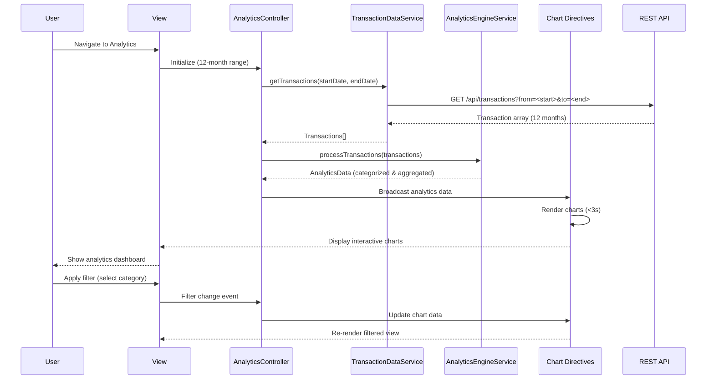

# Low-Level Design: QE-9562 - Spending Analytics and Insights

## a. Architecture Mapping

- **AngularJS Module**: `analyticsModule` - Main module for spending analytics features
- **Controller**: `AnalyticsController` - Manages analytics view state, filters, and chart interactions
- **Service**: `TransactionDataService` - Fetches transaction history from backend
- **Service**: `AnalyticsEngineService` - Processes and categorizes transactions for visualization
- **Factory**: `ChartConfigFactory` - Generates chart.js configuration objects for different chart types
- **Directive**: `spendTrendChartDirective` - Renders monthly spend trend line chart
- **Directive**: `categoryBreakdownChartDirective` - Renders category-wise pie/bar chart
- **Directive**: `cardWiseSpendChartDirective` - Renders card-wise spend comparison chart

**Folder Structure:**
```
/app
  /modules
    /analytics
      analytics.module.js
      analytics.controller.js
      spend-trend-chart.directive.js
      category-breakdown-chart.directive.js
      card-wise-spend-chart.directive.js
  /shared
    /services
      transaction-data.service.js
      analytics-engine.service.js
    /factories
      chart-config.factory.js
  /assets
    /views
      analytics.html
```

## b. Component Specifications

| Component Name | Artifact Type | Responsibility | Key Dependencies |
|----------------|---------------|----------------|------------------|
| analyticsModule | Module | Registers analytics components and chart.js library | angular, ngRoute, chart.js |
| AnalyticsController | Controller | Manages date range filters, card selection, and coordinates data flow to charts | TransactionDataService, AnalyticsEngineService, $scope, $filter |
| TransactionDataService | Service | Fetches transaction history for specified date range and cards via REST API | $http, $q |
| AnalyticsEngineService | Service | Categorizes transactions into 9 predefined categories and aggregates by month/card | none |
| ChartConfigFactory | Factory | Provides chart.js config objects for line, pie, and bar charts with consistent styling | none |
| spendTrendChartDirective | Directive | Renders interactive monthly spend trend line chart using chart.js | ChartConfigFactory, chart.js |
| categoryBreakdownChartDirective | Directive | Renders category-wise spending pie chart with drill-down capability | ChartConfigFactory, chart.js |
| cardWiseSpendChartDirective | Directive | Renders card-wise spend comparison bar chart | ChartConfigFactory, chart.js |

## c. Data Model

**Transaction Object:**
```javascript
{
  transactionId: String,
  cardId: String,
  amount: Number,
  category: String,            // One of 9 predefined categories
  merchantName: String,
  transactionDate: Date,
  description: String
}
```

**MonthlySpendData Object:**
```javascript
{
  month: String,               // "YYYY-MM" format
  totalSpend: Number,
  categoryBreakdown: {         // Spend by category
    "Food & Dining": Number,
    "Fuel": Number,
    "Shopping": Number,
    "Travel": Number,
    "Entertainment": Number,
    "Utilities": Number,
    "Healthcare": Number,
    "Education": Number,
    "Miscellaneous": Number
  },
  cardBreakdown: {             // Spend by card
    [cardId]: Number
  }
}
```

**AnalyticsData Object:**
```javascript
{
  monthlyTrends: Array<MonthlySpendData>,  // 12 months of data
  totalsByCategory: Object,                 // Aggregated category totals
  totalsByCard: Object                      // Aggregated card totals
}
```

## d. Data Flow

User navigates to analytics view → AnalyticsController initializes with default 12-month date range → Controller calls TransactionDataService.getTransactions(startDate, endDate) → Service sends GET request to `/api/transactions?from=<start>&to=<end>` → Backend returns transaction array → AnalyticsEngineService.processTransactions() categorizes each transaction into one of 9 categories and aggregates by month and card → Processed AnalyticsData object returned → Controller broadcasts data to chart directives → Each directive uses ChartConfigFactory to generate chart.js config → Charts render within 3 seconds → User applies filters (date range, card selection) → Controller re-processes data and updates charts with interactive drill-down.

## e. Primary Sequence Diagram



## f. Implementation Notes

- Use AngularJS $watch on filter objects to automatically trigger chart updates when user changes date range or card selection.
- Implement AnalyticsEngineService with ES6 Map and reduce functions for efficient transaction categorization and aggregation.
- Leverage chart.js onClick events in directives to enable drill-down from category chart to transaction list view.
- Cache processed AnalyticsData in controller scope to avoid re-processing on filter changes that only require data slicing.
- Use AngularJS $q promises with TransactionDataService to handle large transaction datasets with loading indicators.

## g. Error Handling

Try/catch blocks in AnalyticsEngineService for data processing errors; HTTP interceptor for API failures; user notified via toast with retry option.

## h. Security Notes

Standard input validation and secure API calls assumed; date range parameters validated to prevent SQL injection in backend queries.