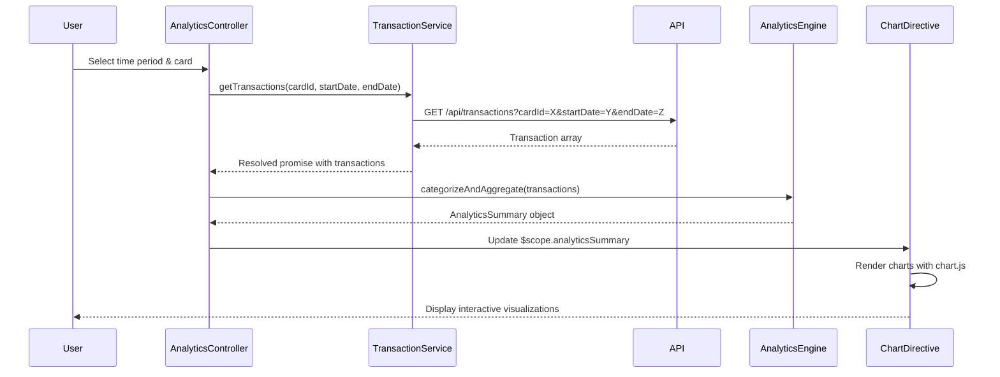

# Low-Level Design: QE-9563 - Spending Analytics and Transaction Insights

## a. Architecture Mapping

- **AnalyticsModule** (angular.module): Root module for spending analytics feature
- **AnalyticsController** (Controller): Manages analytics dashboard state, user interactions, and visualization rendering
- **TransactionService** (Service): Retrieves transaction data from REST API
- **AnalyticsEngine** (Factory): Processes transactions, categorizes spending, and aggregates data
- **CategoryChartDirective** (Directive): Renders interactive category-wise spending charts
- **TrendChartDirective** (Directive): Renders monthly spend trend visualizations

**Folder Structure:**
```
/app
  /analytics
    analytics.module.js
    analytics.controller.js
    analytics.service.js
    analytics.factory.js
    /directives
      category-chart.directive.js
      trend-chart.directive.js
    /views
      analytics-dashboard.html
```

## b. Component Specifications

| Name | Artifact Type | Responsibility | Key Dependencies |
|------|---------------|----------------|------------------|
| AnalyticsModule | Module | Registers analytics feature components and routing | ngRoute, chart.js |
| AnalyticsController | Controller | Manages dashboard state, filters (time, card), and triggers data refresh | TransactionService, AnalyticsEngine, $scope |
| TransactionService | Service | Fetches transaction history from /api/transactions endpoint with card/date filters | $http, $q |
| AnalyticsEngine | Factory | Categorizes transactions into 9 predefined categories and aggregates spending totals | None |
| CategoryChartDirective | Directive | Renders pie/bar chart for category-wise spending breakdown | chart.js, $timeout |
| TrendChartDirective | Directive | Renders line chart for monthly spend trends over 12 months | chart.js, $timeout |
| TransactionListController | Controller | Displays transaction-level details with sorting and filtering | TransactionService, $filter |

## c. Data Model

**Transaction Object:**
```javascript
{
  id: String,
  cardId: String,
  amount: Number,
  category: String, // One of 9 predefined categories
  merchant: String,
  date: Date,
  description: String
}
```

**AnalyticsSummary Object:**
```javascript
{
  categoryBreakdown: Array<{category: String, total: Number, percentage: Number}>,
  monthlyTrends: Array<{month: String, total: Number}>,
  totalSpend: Number,
  transactionCount: Number
}
```

## d. Data Flow

User selects time period and card filters in the AnalyticsController, which calls TransactionService to fetch raw transaction data via GET /api/transactions?cardId=X&startDate=Y&endDate=Z. TransactionService returns promise-resolved transaction array. AnalyticsEngine processes transactions, applies category classification rules, and aggregates spending by category and month. Processed AnalyticsSummary object is bound to $scope. CategoryChartDirective and TrendChartDirective watch scope changes and render interactive charts using chart.js within 3 seconds. User interactions (chart clicks, filter changes) trigger controller methods that update filters and re-fetch data.

## e. Primary Sequence Diagram



## f. Implementation Notes

- Use AngularJS dependency injection to inject TransactionService and AnalyticsEngine into AnalyticsController
- Implement category classification in AnalyticsEngine using switch/case or lookup map for 9 predefined categories
- Integrate chart.js via angular-chart.js wrapper for declarative chart rendering in directives
- Use $http interceptor for global error handling and loading states during API calls
- Cache transaction data in TransactionService using simple object cache with TTL to reduce API calls on filter changes

## g. Error Handling

HTTP interceptor captures API errors; user-friendly messages displayed via toastr notifications; try/catch in AnalyticsEngine for data processing errors.

## h. Security Notes

Requires token-based auth via existing SSO; API validates card ownership per user session to enforce data isolation.