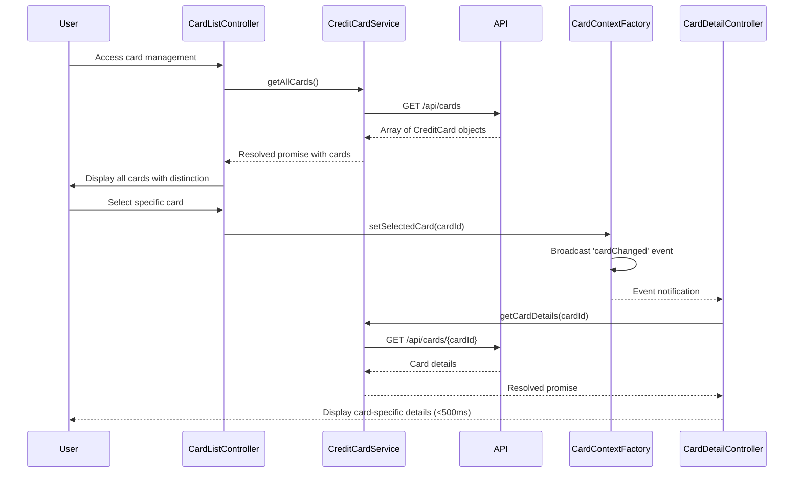

# Low-Level Design: QE-9564 - Multiple Credit Card Management

## a. Architecture Mapping

- **CardManagementModule** (angular.module): Root module for multi-card management feature
- **CardListController** (Controller): Manages display of all user credit cards and card selection
- **CardDetailController** (Controller): Manages individual card detail view and card-specific data
- **CreditCardService** (Service): Retrieves credit card information from REST API
- **CardContextFactory** (Factory): Maintains currently selected card context across views
- **CardSwitcherDirective** (Directive): Provides UI component for quick card switching

**Folder Structure:**
```
/app
  /cards
    card-management.module.js
    card-list.controller.js
    card-detail.controller.js
    credit-card.service.js
    card-context.factory.js
    /directives
      card-switcher.directive.js
    /views
      card-list.html
      card-detail.html
```

## b. Component Specifications

| Name | Artifact Type | Responsibility | Key Dependencies |
|------|---------------|----------------|------------------|
| CardManagementModule | Module | Registers card management components and routing | ngRoute, ui.bootstrap |
| CardListController | Controller | Fetches and displays all user cards; handles card selection | CreditCardService, CardContextFactory, $scope |
| CardDetailController | Controller | Displays selected card details (limit, balance, transactions) | CreditCardService, CardContextFactory, $routeParams |
| CreditCardService | Service | Fetches card list and card-specific details from /api/cards endpoints | $http, $q |
| CardContextFactory | Factory | Stores and broadcasts currently selected card ID across controllers | $rootScope |
| CardSwitcherDirective | Directive | Renders dropdown/list for switching between cards with visual distinction | CardContextFactory |

## c. Data Model

**CreditCard Object:**
```javascript
{
  cardId: String,
  cardNumber: String, // Masked (e.g., **** **** **** 1234)
  cardType: String, // Visa, Mastercard, etc.
  cardHolderName: String,
  creditLimit: Number,
  availableCredit: Number,
  outstandingBalance: Number,
  expiryDate: String
}
```

**CardContext Object:**
```javascript
{
  selectedCardId: String,
  selectedCard: CreditCard
}
```

## d. Data Flow

User authenticates and CardListController calls CreditCardService.getAllCards() which invokes GET /api/cards. API validates user session and returns array of CreditCard objects (minimum 10 supported). Cards are displayed with visual distinction (card type icons, colors). User selects a card, triggering CardContextFactory.setSelectedCard(cardId), which broadcasts 'cardChanged' event. CardDetailController listens for event and calls CreditCardService.getCardDetails(cardId) via GET /api/cards/{cardId}. Card-specific details (transactions, spend analysis) are fetched and rendered. Card switching completes within 500ms via client-side context update and optimized API calls with caching.

## e. Primary Sequence Diagram



## f. Implementation Notes

- Use AngularJS $routeProvider to define routes for card list (/cards) and card detail (/cards/:cardId)
- Implement CardContextFactory as singleton using factory pattern to maintain state across route changes
- Use $rootScope.$broadcast for 'cardChanged' event and $scope.$on in listening controllers
- Cache card list in CreditCardService with 5-minute TTL to reduce API calls; invalidate on card updates
- Apply CSS classes dynamically based on card type (Visa/Mastercard/Amex) for visual distinction

## g. Error Handling

HTTP interceptor for API errors; card ownership validation failures show access denied message; try/catch in controllers with user notification.

## h. Security Notes

Token-based auth via existing SSO; API enforces card ownership validation on every request to ensure data isolation between users.