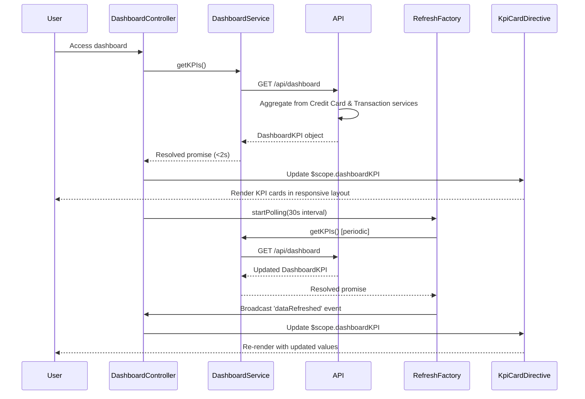

# Low-Level Design: QE-9565 - Dashboard KPIs and Credit Card Overview

## a. Architecture Mapping

- **DashboardModule** (angular.module): Root module for KPI dashboard feature
- **DashboardController** (Controller): Manages dashboard state, KPI data, and real-time refresh
- **DashboardService** (Service): Retrieves aggregated KPI data from REST API
- **KpiCardDirective** (Directive): Renders individual KPI metric cards (spend, limit, available, outstanding)
- **RefreshFactory** (Factory): Manages polling mechanism for real-time data updates

**Folder Structure:**
```
/app
  /dashboard
    dashboard.module.js
    dashboard.controller.js
    dashboard.service.js
    refresh.factory.js
    /directives
      kpi-card.directive.js
    /views
      dashboard.html
```

## b. Component Specifications

| Name | Artifact Type | Responsibility | Key Dependencies |
|------|---------------|----------------|------------------|
| DashboardModule | Module | Registers dashboard components and routing | ngRoute, ui.bootstrap |
| DashboardController | Controller | Fetches KPI data, manages refresh state, and binds data to view | DashboardService, RefreshFactory, $scope |
| DashboardService | Service | Retrieves consolidated KPI data from /api/dashboard endpoint | $http, $q |
| KpiCardDirective | Directive | Renders individual KPI metric with label, value, and visual indicator | None |
| RefreshFactory | Factory | Implements polling mechanism for real-time data refresh at configurable intervals | $interval, $rootScope |

## c. Data Model

**DashboardKPI Object:**
```javascript
{
  monthlySpend: Number,
  totalCreditLimit: Number,
  availableCredit: Number,
  outstandingAmount: Number,
  creditUtilization: Number, // Percentage
  cardCount: Number,
  lastUpdated: Date
}
```

## d. Data Flow

User accesses dashboard and DashboardController calls DashboardService.getKPIs() which invokes GET /api/dashboard. API aggregates data from Credit Card Data Service (card limits, balances) and Transaction Processing System (monthly spend, outstanding amounts). Server-side calculations ensure 100% financial accuracy. DashboardKPI object is returned and bound to $scope within 2 seconds. KpiCardDirective instances render individual metrics in responsive grid layout. RefreshFactory starts polling at 30-second intervals, triggering DashboardService.getKPIs() to fetch updated data. On successful refresh, $scope.dashboardKPI is updated and KPI cards re-render with new values.

## e. Primary Sequence Diagram



## f. Implementation Notes

- Use AngularJS $interval service in RefreshFactory for polling with configurable interval (default 30s)
- Implement DashboardService with caching to prevent redundant API calls within refresh window
- Use Bootstrap grid system (col-md-3) for responsive KPI card layout across desktop/tablet/mobile
- Apply CSS transitions in KpiCardDirective for smooth value updates during refresh
- Cancel $interval polling when user navigates away from dashboard using $scope.$on('$destroy')

## g. Error Handling

HTTP interceptor for API errors; failed refresh attempts retry with exponential backoff; user notified via toastr on persistent failures.

## h. Security Notes

Requires token-based auth via existing SSO; API validates user session and returns only authorized user's aggregated KPI data.