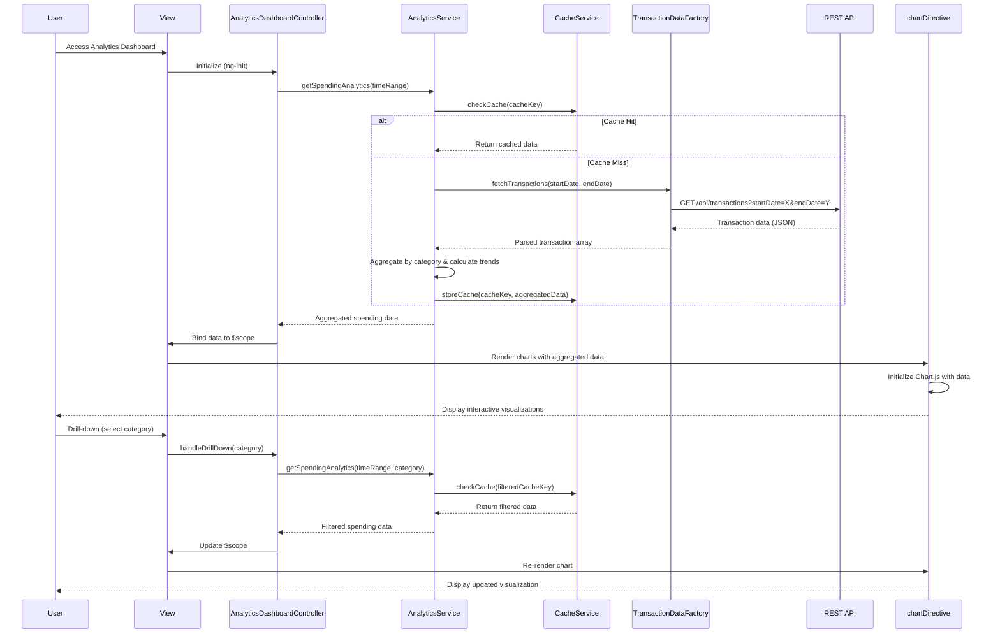

# Low-Level Design: QE-9572 - Spending Analytics and Insights

## a. Architecture Mapping

- **Analytics Dashboard UI** → AngularJS Module (`app.analytics`) + Controller (`AnalyticsDashboardController`) + View Template (`analytics-dashboard.html`)
- **Analytics Engine** → AngularJS Service (`AnalyticsService`) for data aggregation and processing
- **Transaction Data Service** → AngularJS Factory (`TransactionDataFactory`) wrapping REST API calls
- **Data Visualization Library** → External library (Chart.js) integrated via AngularJS Directive (`chartDirective`)
- **Aggregation Cache** → Browser sessionStorage managed by `CacheService`

**Recommended Folder Structure:**
```
app/
├── modules/
│   └── analytics/
│       ├── controllers/
│       │   └── analytics-dashboard.controller.js
│       ├── services/
│       │   ├── analytics.service.js
│       │   └── cache.service.js
│       ├── factories/
│       │   └── transaction-data.factory.js
│       ├── directives/
│       │   └── chart.directive.js
│       └── views/
│           └── analytics-dashboard.html
├── assets/
│   ├── css/
│   └── js/
└── app.js
```

## b. Component Specifications

| Name | Artifact Type | Responsibility | Key Dependencies |
|------|---------------|----------------|------------------|
| `app.analytics` | Module | Root module for analytics feature | `ngRoute`, `chart.js` |
| `AnalyticsDashboardController` | Controller | Manages analytics dashboard state, handles user interactions, coordinates data fetching | `AnalyticsService`, `$scope`, `$timeout` |
| `AnalyticsService` | Service | Aggregates transaction data by category and time period, calculates monthly trends with 2-decimal precision | `TransactionDataFactory`, `CacheService` |
| `TransactionDataFactory` | Factory | Fetches categorized transaction data from REST API for up to 12 months | `$http`, `$q` |
| `CacheService` | Service | Manages sessionStorage for pre-computed aggregations to meet 3-second rendering NFR | `$window.sessionStorage` |
| `chartDirective` | Directive | Renders interactive Chart.js visualizations for category breakdown and monthly trends | `Chart.js`, `$timeout` |

## c. Data Model

**Transaction Model:**
```javascript
{
  transactionId: String,
  cardId: String,
  amount: Number,
  category: String, // One of: 'Food & Dining', 'Fuel', 'Shopping', 'Travel', 'Entertainment', 'Utilities', 'Healthcare', 'Education', 'Miscellaneous'
  transactionDate: Date,
  description: String
}
```

**Aggregated Spending Model:**
```javascript
{
  categorySpending: {
    'Food & Dining': Number,
    'Fuel': Number,
    'Shopping': Number,
    'Travel': Number,
    'Entertainment': Number,
    'Utilities': Number,
    'Healthcare': Number,
    'Education': Number,
    'Miscellaneous': Number
  },
  monthlyTrends: [
    {
      month: String, // 'YYYY-MM'
      totalSpend: Number,
      categoryBreakdown: Object // Same structure as categorySpending
    }
  ],
  timeRange: { startDate: Date, endDate: Date }
}
```

## d. Data Flow

User accesses analytics dashboard → `AnalyticsDashboardController` initializes and calls `AnalyticsService.getSpendingAnalytics(timeRange)` → Service checks `CacheService` for cached aggregations → On cache miss, `TransactionDataFactory` makes REST API call (`GET /api/transactions?startDate=X&endDate=Y`) to retrieve categorized transactions → `AnalyticsService` aggregates data by category and calculates monthly trends with 2-decimal precision → Aggregated data is stored in `CacheService` and returned to controller → Controller binds data to `$scope` → `chartDirective` watches scope and renders interactive Chart.js visualizations → User drill-down interactions trigger controller methods that re-invoke `AnalyticsService` with filtered parameters → Updated data flows back through the same path, rendering within 3 seconds via cached aggregations.

## e. Primary Sequence Diagram



## f. Implementation Notes

- Use AngularJS 1.x module pattern with dependency injection for all services, factories, and controllers
- Implement ES6 classes for service logic; transpile with Babel if needed for browser compatibility
- Leverage Chart.js `update()` method in directive for smooth drill-down transitions without full re-render
- Use `$http` interceptors for global error handling and loading states during API calls
- Cache aggregations in sessionStorage with TTL (5 minutes) to balance freshness and 3-second rendering NFR

## g. Error Handling

Interceptor-based approach using `$httpProvider.interceptors` for API errors, with user-friendly notifications via Bootstrap modals and controller-level try/catch for aggregation errors.

## h. Security Notes

Standard input validation and secure API calls assumed; transaction data API requires token-based authentication via existing SSO.