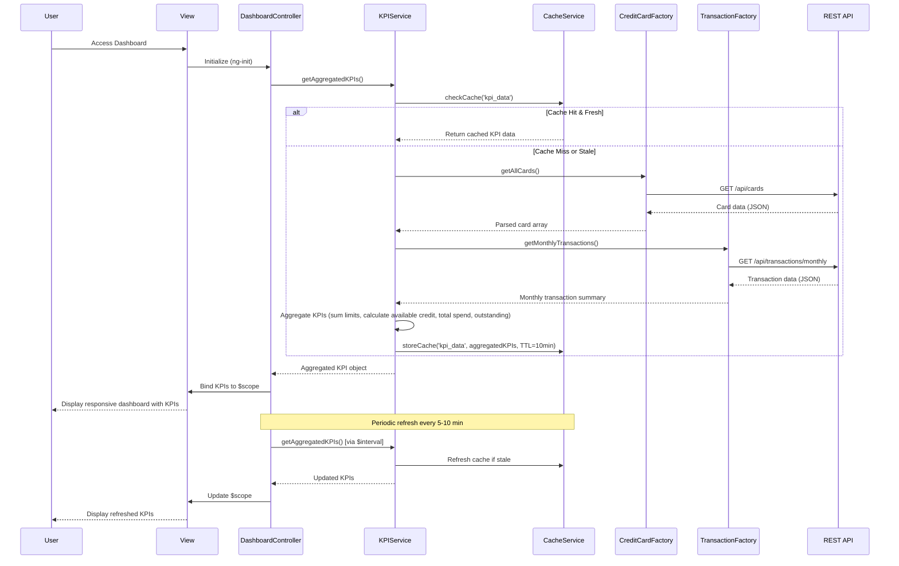

# Low-Level Design: QE-9573 - Dashboard KPIs and Credit Overview

## a. Architecture Mapping

- **User Dashboard UI** → AngularJS Module (`app.dashboard`) + Controller (`DashboardController`) + View Template (`dashboard.html`)
- **KPI Aggregation Service** → AngularJS Service (`KPIService`) for aggregating metrics across cards
- **Credit Card Data Service** → AngularJS Factory (`CreditCardFactory`) wrapping REST API for card data
- **Transaction Processing Service** → AngularJS Factory (`TransactionFactory`) wrapping REST API for transaction/spend data
- **Data Cache Layer** → Browser localStorage managed by `CacheService` for near real-time refresh

**Recommended Folder Structure:**
```
app/
├── modules/
│   └── dashboard/
│       ├── controllers/
│       │   └── dashboard.controller.js
│       ├── services/
│       │   ├── kpi.service.js
│       │   └── cache.service.js
│       ├── factories/
│       │   ├── credit-card.factory.js
│       │   └── transaction.factory.js
│       └── views/
│           └── dashboard.html
├── assets/
│   ├── css/
│   │   └── dashboard.css
│   └── js/
└── app.js
```

## b. Component Specifications

| Name | Artifact Type | Responsibility | Key Dependencies |
|------|---------------|----------------|------------------|
| `app.dashboard` | Module | Root module for dashboard feature | `ngRoute`, `ui.bootstrap` |
| `DashboardController` | Controller | Manages dashboard state, triggers KPI loading, handles UI interactions | `KPIService`, `$scope`, `$interval` |
| `KPIService` | Service | Aggregates monthly spend, total credit limit, available credit, and outstanding amounts across all cards | `CreditCardFactory`, `TransactionFactory`, `CacheService` |
| `CreditCardFactory` | Factory | Fetches credit card details (limits, status) from REST API | `$http`, `$q` |
| `TransactionFactory` | Factory | Fetches transaction data for calculating monthly spend and outstanding amounts from REST API | `$http`, `$q` |
| `CacheService` | Service | Manages localStorage for KPI data with TTL (5-10 minutes) to enable near real-time refresh | `$window.localStorage` |

## c. Data Model

**Credit Card Model:**
```javascript
{
  cardId: String,
  cardNumber: String, // Masked (e.g., '**** **** **** 1234')
  cardType: String, // 'Visa', 'MasterCard', 'Amex'
  creditLimit: Number,
  availableCredit: Number,
  outstandingAmount: Number,
  status: String // 'Active', 'Blocked'
}
```

**KPI Model:**
```javascript
{
  monthlySpend: Number,
  totalCreditLimit: Number,
  totalAvailableCredit: Number,
  totalOutstandingAmount: Number,
  cardCount: Number,
  lastUpdated: Date
}
```

## d. Data Flow

User accesses dashboard → `DashboardController` initializes and calls `KPIService.getAggregatedKPIs()` → Service checks `CacheService` for cached KPI data → On cache miss or stale data, service fetches card details via `CreditCardFactory.getAllCards()` (REST call `GET /api/cards`) and transaction data via `TransactionFactory.getMonthlyTransactions()` (REST call `GET /api/transactions/monthly`) → Service aggregates monthly spend, sums credit limits, calculates available credit and outstanding amounts across all cards → Aggregated KPIs are cached in localStorage with timestamp and returned to controller → Controller binds KPIs to `$scope` → View renders responsive dashboard with Bootstrap grid displaying consolidated metrics → `$interval` service triggers periodic cache refresh (every 5-10 minutes) to maintain near real-time data, ensuring 2-second load time via cached data.

## e. Primary Sequence Diagram



## f. Implementation Notes

- Use AngularJS 1.x module pattern with strict DI annotation (`$inject` or inline array syntax) for minification safety
- Implement ES6 Promises via `$q` for coordinating parallel API calls to card and transaction services
- Leverage Bootstrap responsive grid (col-xs, col-sm, col-md) for mobile and desktop layouts; ensure WCAG 2.1 compliance with semantic HTML and ARIA labels
- Use `$interval` service for periodic cache refresh (5-10 minutes) to maintain near real-time data without manual user refresh
- Pre-aggregate KPIs server-side if possible; client-side aggregation is fallback for flexibility

## g. Error Handling

Interceptor-based approach using `$httpProvider.interceptors` for API failures, with Bootstrap alert components for user notifications and graceful degradation (show last cached KPIs on error).

## h. Security Notes

Requires token-based authentication via existing SSO; card numbers are masked server-side before transmission to client.