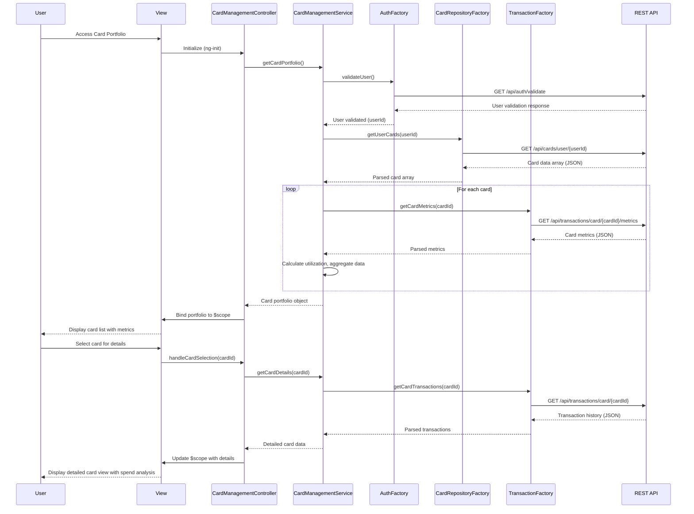

# Low-Level Design: QE-9574 - Multiple Credit Card Management

## a. Architecture Mapping

- **User Interface** → AngularJS Module (`app.cardManagement`) + Controller (`CardManagementController`) + View Template (`card-management.html`)
- **Card Management Service** → AngularJS Service (`CardManagementService`) for orchestrating card operations and data retrieval
- **User Authentication Service** → AngularJS Factory (`AuthFactory`) wrapping authentication REST API
- **Credit Card Data Repository** → AngularJS Factory (`CardRepositoryFactory`) wrapping card data REST API
- **Transaction Service** → AngularJS Factory (`TransactionFactory`) wrapping transaction REST API for card-specific metrics

**Recommended Folder Structure:**
```
app/
├── modules/
│   └── card-management/
│       ├── controllers/
│       │   └── card-management.controller.js
│       ├── services/
│       │   └── card-management.service.js
│       ├── factories/
│       │   ├── auth.factory.js
│       │   ├── card-repository.factory.js
│       │   └── transaction.factory.js
│       └── views/
│           └── card-management.html
├── assets/
│   ├── css/
│   │   └── card-management.css
│   └── js/
└── app.js
```

## b. Component Specifications

| Name | Artifact Type | Responsibility | Key Dependencies |
|------|---------------|----------------|------------------|
| `app.cardManagement` | Module | Root module for card management feature | `ngRoute`, `ui.bootstrap` |
| `CardManagementController` | Controller | Manages card portfolio view state, handles filtering, selection, and comparison interactions | `CardManagementService`, `$scope`, `$filter` |
| `CardManagementService` | Service | Orchestrates card data retrieval, validates user identity, aggregates card metrics, coordinates with transaction service | `AuthFactory`, `CardRepositoryFactory`, `TransactionFactory` |
| `AuthFactory` | Factory | Validates user identity and card ownership via authentication REST API | `$http`, `$q` |
| `CardRepositoryFactory` | Factory | Fetches registered card details (limits, balances, utilization) from card data REST API | `$http`, `$q` |
| `TransactionFactory` | Factory | Fetches card-specific spending metrics and transaction history from transaction REST API | `$http`, `$q` |

## c. Data Model

**Credit Card Model:**
```javascript
{
  cardId: String,
  userId: String,
  cardNumber: String, // Masked
  cardType: String, // 'Visa', 'MasterCard', 'Amex'
  creditLimit: Number,
  availableCredit: Number,
  outstandingBalance: Number,
  utilizationRate: Number, // Percentage (0-100)
  status: String, // 'Active', 'Blocked', 'Inactive'
  expiryDate: String // 'MM/YY'
}
```

**Card Metrics Model:**
```javascript
{
  cardId: String,
  monthlySpend: Number,
  totalTransactions: Number,
  averageTransactionAmount: Number,
  lastTransactionDate: Date
}
```

**Card Portfolio Model:**
```javascript
{
  userId: String,
  cards: [
    {
      ...CreditCardModel,
      metrics: CardMetricsModel
    }
  ],
  totalCards: Number
}
```

## d. Data Flow

User authenticates and accesses card portfolio view → `CardManagementController` initializes and calls `CardManagementService.getCardPortfolio()` → Service validates user identity via `AuthFactory.validateUser()` (REST call `GET /api/auth/validate`) → On successful validation, service retrieves all registered cards via `CardRepositoryFactory.getUserCards(userId)` (REST call `GET /api/cards/user/{userId}`) → For each card, service fetches spending metrics via `TransactionFactory.getCardMetrics(cardId)` (REST call `GET /api/transactions/card/{cardId}/metrics`) → Service aggregates card data with metrics, calculates utilization rates, and constructs card portfolio object → Portfolio data is returned to controller and bound to `$scope` → View renders card list with individual card details using Bootstrap cards/panels → User interactions (filter by status, select card, compare cards) trigger controller methods that manipulate `$scope` data using AngularJS `$filter` → Drilling down into individual card triggers `CardManagementService.getCardDetails(cardId)` for detailed spend analysis, fetching transaction history via `TransactionFactory.getCardTransactions(cardId)` → Detailed data flows back to controller and updates view within 1-second NFR via cached metrics.

## e. Primary Sequence Diagram



## f. Implementation Notes

- Use AngularJS 1.x module pattern with dependency injection; employ `$inject` for minification-safe DI
- Implement ES6 Promises via `$q.all()` for parallel fetching of metrics for up to 10 cards to meet 1-second retrieval NFR
- Leverage AngularJS `$filter` service for client-side filtering and sorting of card list (by status, utilization, etc.)
- Use Bootstrap card components for responsive card display; ensure performance with `ng-repeat` track by `cardId`
- Cache card metrics in service layer (in-memory) with TTL to optimize repeated access and maintain 1-second performance

## g. Error Handling

Interceptor-based approach using `$httpProvider.interceptors` for API errors, with try/catch in service layer for aggregation logic and Bootstrap alert notifications for user feedback.

## h. Security Notes

Requires token-based authentication via existing SSO; card ownership validation enforced server-side before returning card data.