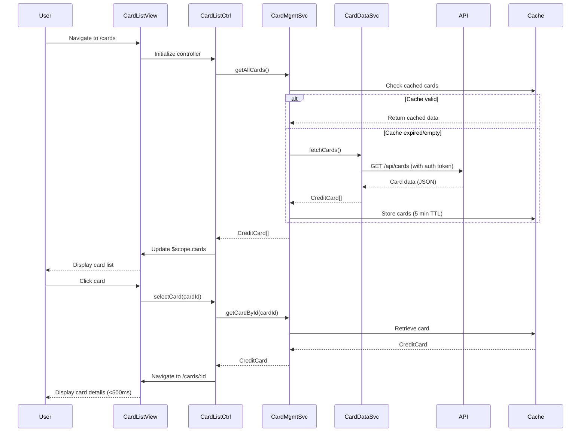

# Low-Level Design: Multiple Credit Card Management
**Epic ID:** QE-9575  
**Epic Title:** PERFTEST20261110203433-Multiple Credit Card Management

---

## a. Architecture Mapping

| HLD Component | AngularJS Artifact | Purpose |
|---------------|-------------------|----------|
| User Interface | Module: `creditCardModule` | Root module for credit card management features |
| Card Management Service | Service: `CardManagementService` | Handles card data retrieval, caching, and business logic |
| User Profile Service | Factory: `UserProfileFactory` | Manages user-card associations and ownership validation |
| Credit Card Data Repository | Service: `CardDataService` | REST API integration for card details and spending data |
| Authentication Service | Service: `AuthService` | Token-based authentication and authorization |
| Card List View | Controller: `CardListController` + Template: `card-list.html` | Displays all user cards with filtering |
| Card Detail View | Controller: `CardDetailController` + Template: `card-detail.html` | Shows individual card details and spending |
| Card Selector | Directive: `cardSelector` | Reusable card selection component |

**Recommended Folder Structure:**
```
app/
├── modules/
│   └── credit-card/
│       ├── controllers/
│       │   ├── card-list.controller.js
│       │   └── card-detail.controller.js
│       ├── services/
│       │   ├── card-management.service.js
│       │   ├── card-data.service.js
│       │   └── user-profile.factory.js
│       ├── directives/
│       │   └── card-selector.directive.js
│       ├── views/
│       │   ├── card-list.html
│       │   └── card-detail.html
│       └── credit-card.module.js
├── shared/
│   └── services/
│       └── auth.service.js
└── assets/
    ├── css/
    └── images/
```

---

## b. Component Specifications

| Component Name | Artifact Type | Responsibility | Key Dependencies |
|----------------|---------------|----------------|------------------|
| `creditCardModule` | Module | Registers all card management components and routing | `ngRoute`, `AuthService` |
| `CardListController` | Controller | Manages card list display, filtering, and selection | `CardManagementService`, `$scope` |
| `CardDetailController` | Controller | Handles single card detail view and card-wise spend display | `CardManagementService`, `$routeParams`, `$scope` |
| `CardManagementService` | Service | Orchestrates card operations, caching, and state management | `CardDataService`, `UserProfileFactory`, `$q` |
| `CardDataService` | Service | REST API calls for card data (GET /api/cards, GET /api/cards/:id) | `$http`, `AuthService` |
| `UserProfileFactory` | Factory | Validates card ownership and retrieves user-card associations | `$http`, `AuthService` |
| `cardSelector` | Directive | Reusable dropdown/list for card selection with two-way binding | `CardManagementService` |
| `AuthService` | Service | Provides authentication tokens and user session management | `$http`, `$window` (localStorage) |

---

## c. Data Model

**CreditCard Object:**
```javascript
{
  cardId: String,              // Unique card identifier
  cardNumber: String,          // Masked card number (e.g., "**** **** **** 1234")
  cardType: String,            // "VISA", "MasterCard", "Amex", etc.
  cardHolderName: String,      // Name on card
  expiryDate: String,          // Format: "MM/YY"
  creditLimit: Number,         // Total credit limit
  availableCredit: Number,     // Remaining available credit
  outstandingAmount: Number,   // Current outstanding balance
  status: String,              // "ACTIVE", "BLOCKED", "EXPIRED"
  monthlySpend: Number,        // Current month spend
  issuerBank: String,          // Issuing bank name
  lastUpdated: Date            // Last data sync timestamp
}
```

**UserCardAssociation Object:**
```javascript
{
  userId: String,
  cardIds: Array<String>,      // List of card IDs owned by user
  primaryCardId: String        // Default/primary card
}
```

---

## d. Data Flow

User navigates to the card management view → `CardListController` initializes and calls `CardManagementService.getAllCards()` → Service checks cache; if expired, calls `CardDataService.fetchCards()` which makes GET /api/cards with auth token → `UserProfileFactory` validates card ownership → Response data is transformed into `CreditCard` objects, cached (5-minute TTL), and returned to controller → Controller updates `$scope.cards` → View renders card list using `ng-repeat` with Bootstrap grid → User selects a card → `CardDetailController` retrieves card from cache via `CardManagementService.getCardById(cardId)` → Detailed card view and spending data displayed → UI updates within 500ms due to client-side caching.

---

## e. Primary Sequence Diagram



---

## f. Implementation Notes

- Use AngularJS 1.x module pattern with dependency injection for all services, controllers, and directives.
- Implement client-side caching in `CardManagementService` using a simple object store with TTL (5 minutes) to achieve sub-500ms card switching.
- Use `$http` interceptor in `AuthService` to automatically attach JWT tokens to all outgoing API requests.
- Apply Bootstrap 3/4 responsive grid (col-md-4, col-sm-6, col-xs-12) for card display to support desktop and mobile layouts.
- Use AngularJS `$routeProvider` for routing between card list (/cards) and card detail (/cards/:id) views.

---

## g. Error Handling

HTTP interceptor captures API errors (401, 403, 500); user-friendly messages displayed via Bootstrap alerts; failed requests logged to console.

---

## h. Security Notes

Requires token-based auth via existing SSO; card numbers masked on client-side; all API calls over HTTPS with auth headers.