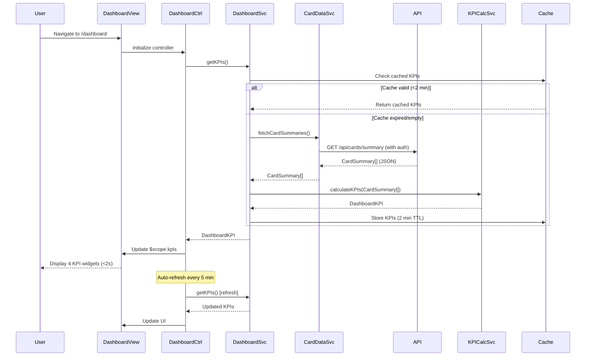

# Low-Level Design: Dashboard KPIs and Credit Card Overview
**Epic ID:** QE-9576  
**Epic Title:** PERFTEST20261110203433-Dashboard KPIs and Credit Card Overview

---

## a. Architecture Mapping

| HLD Component | AngularJS Artifact | Purpose |
|---------------|-------------------|----------|
| User Interface | Module: `dashboardModule` | Root module for dashboard features |
| Dashboard Service | Service: `DashboardService` | Orchestrates KPI data retrieval and aggregation |
| Credit Card Data Service | Service: `CardDataService` | REST API integration for card and transaction data |
| Authentication Service | Service: `AuthService` | Token-based authentication and session management |
| KPI Calculation Engine | Service: `KPICalculatorService` | Client-side KPI computation and caching |
| Dashboard View | Controller: `DashboardController` + Template: `dashboard.html` | Main dashboard UI with KPI widgets |
| KPI Widget | Directive: `kpiWidget` | Reusable KPI display component |

**Recommended Folder Structure:**
```
app/
├── modules/
│   └── dashboard/
│       ├── controllers/
│       │   └── dashboard.controller.js
│       ├── services/
│       │   ├── dashboard.service.js
│       │   ├── kpi-calculator.service.js
│       │   └── card-data.service.js
│       ├── directives/
│       │   └── kpi-widget.directive.js
│       ├── views/
│       │   └── dashboard.html
│       └── dashboard.module.js
├── shared/
│   └── services/
│       └── auth.service.js
└── assets/
    ├── css/
    └── images/
```

---

## b. Component Specifications

| Component Name | Artifact Type | Responsibility | Key Dependencies |
|----------------|---------------|----------------|------------------|
| `dashboardModule` | Module | Registers dashboard components and routing | `ngRoute`, `AuthService` |
| `DashboardController` | Controller | Manages dashboard state, KPI refresh, and user interactions | `DashboardService`, `$scope`, `$interval` |
| `DashboardService` | Service | Fetches and aggregates card data for KPI display | `CardDataService`, `KPICalculatorService`, `$q` |
| `CardDataService` | Service | REST API calls (GET /api/cards/summary, GET /api/transactions/current-month) | `$http`, `AuthService` |
| `KPICalculatorService` | Service | Computes monthly spend, total limit, available credit, outstanding amount | None (pure calculation logic) |
| `kpiWidget` | Directive | Displays individual KPI with icon, value, label, and trend indicator | None (isolated scope) |
| `AuthService` | Service | Provides authentication tokens and validates user session | `$http`, `$window` |

---

## c. Data Model

**DashboardKPI Object:**
```javascript
{
  monthlySpend: Number,         // Total spend in current month
  totalCreditLimit: Number,     // Sum of credit limits across all cards
  availableCredit: Number,      // Sum of available credit across all cards
  outstandingAmount: Number,    // Total outstanding balance
  lastUpdated: Date,            // Timestamp of last data refresh
  cardCount: Number             // Number of active cards
}
```

**CardSummary Object:**
```javascript
{
  cardId: String,
  creditLimit: Number,
  availableCredit: Number,
  outstandingAmount: Number,
  currentMonthSpend: Number
}
```

---

## d. Data Flow

User navigates to dashboard (/) → `DashboardController` initializes and calls `DashboardService.getKPIs()` → Service checks cache (2-minute TTL); if expired, calls `CardDataService.fetchCardSummaries()` which makes GET /api/cards/summary with auth token → API returns array of `CardSummary` objects → `KPICalculatorService` aggregates data (sum credit limits, available credit, outstanding amounts, monthly spend) → Computed `DashboardKPI` object cached and returned to controller → Controller updates `$scope.kpis` → View renders four KPI widgets using `kpi-widget` directive with Bootstrap responsive grid → Dashboard loads in under 2 seconds due to server-side aggregation and client-side caching → Auto-refresh every 5 minutes via `$interval`.

---

## e. Primary Sequence Diagram



---

## f. Implementation Notes

- Use AngularJS module pattern with strict DI annotation (`['$scope', 'DashboardService', function($scope, DashboardService) {...}]`).
- Implement `kpiWidget` directive with isolated scope (`scope: { label: '@', value: '=', icon: '@' }`) for reusability across KPIs.
- Use `$http` interceptor in `AuthService` to attach JWT tokens; implement request/response caching via `$cacheFactory` for 2-minute TTL.
- Apply Bootstrap grid (col-lg-3 col-md-6 col-sm-12) for responsive KPI widget layout across desktop, tablet, and mobile.
- Use `$interval` service for auto-refresh every 5 minutes; cancel interval on `$scope.$on('$destroy')` to prevent memory leaks.

---

## g. Error Handling

HTTP interceptor catches API errors; retry logic (max 2 attempts) for transient failures; user notified via Bootstrap toast/alert on persistent errors.

---

## h. Security Notes

Requires token-based auth via existing SSO; sensitive financial data transmitted over HTTPS; XSS protection via AngularJS built-in sanitization.