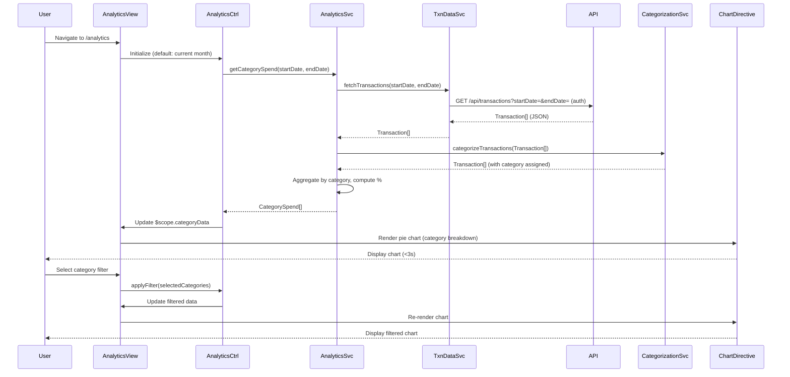

# Low-Level Design: Spending Analytics and Insights
**Epic ID:** QE-9577  
**Epic Title:** PERFTEST20261110203433-Spending Analytics and Insights

---

## a. Architecture Mapping

| HLD Component | AngularJS Artifact | Purpose |
|---------------|-------------------|----------|
| User Interface | Module: `analyticsModule` | Root module for analytics features |
| Analytics Service | Service: `AnalyticsService` | Orchestrates analytics data retrieval and processing |
| Transaction Data Service | Service: `TransactionDataService` | REST API integration for transaction data |
| Categorization Engine | Service: `CategorizationService` | Maps transactions to predefined spending categories |
| Visualization Library | Directive: `chartDirective` (wraps Chart.js/D3.js) | Renders interactive charts and graphs |
| Historical Data Storage | Service: `HistoricalDataService` | Fetches and caches 12-month historical data |
| Analytics View | Controller: `AnalyticsController` + Template: `analytics.html` | Main analytics dashboard with filters |
| Category Filter | Directive: `categoryFilter` | Multi-select filter for spending categories |

**Recommended Folder Structure:**
```
app/
├── modules/
│   └── analytics/
│       ├── controllers/
│       │   └── analytics.controller.js
│       ├── services/
│       │   ├── analytics.service.js
│       │   ├── transaction-data.service.js
│       │   ├── categorization.service.js
│       │   └── historical-data.service.js
│       ├── directives/
│       │   ├── chart.directive.js
│       │   └── category-filter.directive.js
│       ├── views/
│       │   └── analytics.html
│       └── analytics.module.js
├── shared/
│   └── services/
│       └── auth.service.js
└── assets/
    ├── js/
    │   └── chart.min.js  (Chart.js library)
    └── css/
```

---

## b. Component Specifications

| Component Name | Artifact Type | Responsibility | Key Dependencies |
|----------------|---------------|----------------|------------------|
| `analyticsModule` | Module | Registers analytics components, routing, and Chart.js integration | `ngRoute`, `AuthService`, `chart.js` |
| `AnalyticsController` | Controller | Manages analytics view state, filter selections, date range, and chart data | `AnalyticsService`, `$scope`, `$filter` |
| `AnalyticsService` | Service | Aggregates transaction data by category and time period | `TransactionDataService`, `CategorizationService`, `$q` |
| `TransactionDataService` | Service | REST API calls (GET /api/transactions?startDate=&endDate=&cardId=) | `$http`, `AuthService` |
| `CategorizationService` | Service | Maps transaction merchant/MCC codes to 9 predefined categories | None (static category mapping) |
| `HistoricalDataService` | Service | Fetches and caches 12-month transaction history | `TransactionDataService`, `$cacheFactory` |
| `chartDirective` | Directive | Wraps Chart.js to render pie, bar, and line charts with AngularJS data binding | `chart.js` library |
| `categoryFilter` | Directive | Multi-select dropdown for filtering by spending categories | None |

---

## c. Data Model

**Transaction Object:**
```javascript
{
  transactionId: String,
  cardId: String,
  amount: Number,
  currency: String,              // "USD", "EUR", etc.
  merchantName: String,
  merchantCategory: String,      // MCC code or category name
  transactionDate: Date,
  description: String,
  category: String               // One of 9 predefined categories (assigned by CategorizationService)
}
```

**CategorySpend Object:**
```javascript
{
  category: String,              // "Food & Dining", "Fuel", "Shopping", etc.
  totalSpend: Number,
  transactionCount: Number,
  percentage: Number             // % of total monthly spend
}
```

**MonthlyTrend Object:**
```javascript
{
  month: String,                 // "Jan 2025", "Feb 2025", etc.
  totalSpend: Number,
  categoryBreakdown: Array<CategorySpend>
}
```

**Predefined Categories (constant):**
```javascript
const SPENDING_CATEGORIES = [
  'Food & Dining', 'Fuel', 'Shopping', 'Travel', 
  'Entertainment', 'Utilities', 'Healthcare', 'Education', 'Miscellaneous'
];
```

---

## d. Data Flow

User navigates to analytics view (/analytics) → `AnalyticsController` initializes with default date range (current month) and calls `AnalyticsService.getCategorySpend(startDate, endDate)` → Service checks cache; if expired, calls `TransactionDataService.fetchTransactions(startDate, endDate)` which makes GET /api/transactions with auth token → API returns array of `Transaction` objects → `CategorizationService.categorizeTransactions(transactions)` maps each transaction to one of 9 categories using merchant/MCC rules → `AnalyticsService` aggregates spend by category, computes percentages, and returns `CategorySpend[]` → Controller updates `$scope.categoryData` → `chartDirective` renders pie chart (category-wise breakdown) and bar chart (monthly trends) using Chart.js → User applies category filter or changes date range → Controller re-invokes service with new parameters → Charts update within 3 seconds due to pre-aggregated data and client-side caching.

---

## e. Primary Sequence Diagram



---

## f. Implementation Notes

- Use AngularJS module pattern with DI; integrate Chart.js via custom `chartDirective` with isolated scope and two-way data binding (`scope: { data: '=', type: '@' }`).
- Implement `CategorizationService` as a stateless service with a static mapping object (merchantCategory/MCC → predefined category); fallback to "Miscellaneous" for unmapped transactions.
- Use `$cacheFactory` in `HistoricalDataService` to cache 12-month transaction data (1-hour TTL) to minimize API calls and meet 3-second render time.
- Apply Bootstrap grid and responsive utilities for chart containers (col-md-6 for side-by-side charts on desktop, col-sm-12 for stacked on mobile).
- Use AngularJS `$filter` service for date range filtering and sorting in controller; leverage Chart.js built-in interactivity (tooltips, legends, drill-down) for user engagement.

---

## g. Error Handling

HTTP interceptor handles API errors; failed categorization defaults to "Miscellaneous"; empty data states display "No transactions found" message via ng-if.

---

## h. Security Notes

Requires token-based auth via existing SSO; transaction data sanitized on client-side to prevent XSS; all API calls over HTTPS with auth headers.