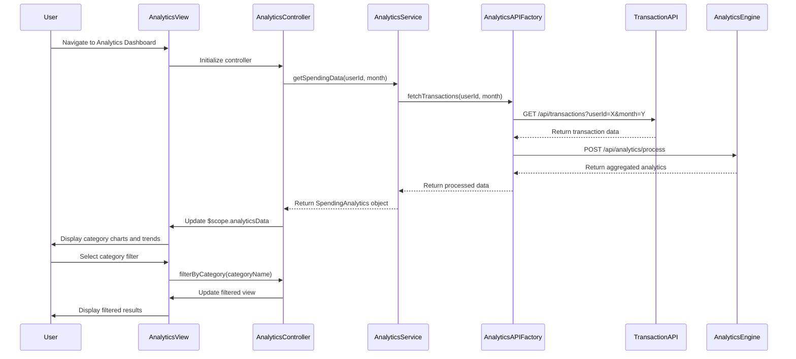

# Low-Level Design: QE-9578 - Spending Analytics and Insights

## a. Architecture Mapping

**Component to AngularJS Artifact Mapping:**
- Analytics UI → AngularJS Module: `app.analytics`
- Analytics Dashboard Controller → Controller: `AnalyticsController`
- Analytics Data Service → Service: `AnalyticsService`
- Category Filter Component → Directive: `categoryFilter`
- Chart Rendering → Directive: `spendingChart`
- API Communication → Factory: `AnalyticsAPIFactory`

**Recommended Folder Structure:**
```
app/
├── modules/
│   └── analytics/
│       ├── controllers/
│       │   └── analytics.controller.js
│       ├── services/
│       │   └── analytics.service.js
│       ├── directives/
│       │   ├── category-filter.directive.js
│       │   └── spending-chart.directive.js
│       ├── factories/
│       │   └── analytics-api.factory.js
│       ├── views/
│       │   └── analytics.html
│       └── analytics.module.js
```

## b. Component Specifications

| Component Name | Artifact Type | Responsibility | Key Dependencies |
|----------------|---------------|----------------|------------------|
| AnalyticsController | Controller | Orchestrates analytics view, handles user interactions, manages filter state | AnalyticsService, $scope, $filter |
| AnalyticsService | Service | Fetches and processes spending data, aggregates category-wise and trend data | AnalyticsAPIFactory, $q |
| AnalyticsAPIFactory | Factory | Handles REST API calls to Analytics Engine and Transaction Service | $http, $q |
| categoryFilter | Directive | Renders interactive category filter UI, emits filter change events | None |
| spendingChart | Directive | Renders interactive charts using Chart.js or D3.js, handles drill-down | Chart.js/D3.js |
| app.analytics | Module | Main analytics module, declares all analytics components | ngRoute, chart.js |

## c. Data Model

**SpendingAnalytics (JS Object):**
```javascript
{
  userId: String,
  month: String,              // Format: 'YYYY-MM'
  totalSpend: Number,
  categoryBreakdown: Array,   // Array of CategorySpend objects
  trends: Array               // Array of MonthlyTrend objects
}
```

**CategorySpend (JS Object):**
```javascript
{
  categoryName: String,       // e.g., 'Food & Dining', 'Fuel', 'Shopping'
  amount: Number,
  percentage: Number,
  transactionCount: Number
}
```

**MonthlyTrend (JS Object):**
```javascript
{
  month: String,              // Format: 'YYYY-MM'
  totalSpend: Number,
  categoryBreakdown: Array    // Array of CategorySpend objects
}
```

## d. Data Flow

User accesses the Analytics view, triggering AnalyticsController to initialize and call AnalyticsService.getSpendingData(). AnalyticsService invokes AnalyticsAPIFactory to fetch transaction data from the Transaction Service REST API, which is processed by the Analytics Engine to compute category-wise breakdowns and monthly trends. The aggregated data is returned to the controller, which updates $scope.analyticsData, triggering view updates that render interactive charts via the spendingChart directive and category filters via the categoryFilter directive. User interactions (filter selection, chart drill-down) trigger controller methods that re-fetch or re-filter data, updating the UI in real-time.

## e. Primary Sequence Diagram



## f. Implementation Notes

- Use AngularJS dependency injection to inject AnalyticsService and AnalyticsAPIFactory into AnalyticsController for testability and modularity.
- Implement ES6 classes for Service and Factory; use arrow functions for promise chaining to maintain lexical `this` context.
- Leverage Chart.js or D3.js within spendingChart directive for interactive visualizations; bind chart updates to $scope.$watch for reactive rendering.
- Use $http interceptor for global error handling and loading state management across all API calls.
- Implement client-side caching in AnalyticsService using $cacheFactory to reduce redundant API calls for recently fetched data.

## g. Error Handling

HTTP interceptor-based error handling with user-friendly notifications via toastr or custom modal; service-level try/catch for data processing errors.

## h. Security Notes

Requires token-based authentication via existing SSO; all API calls include Authorization header with JWT token.