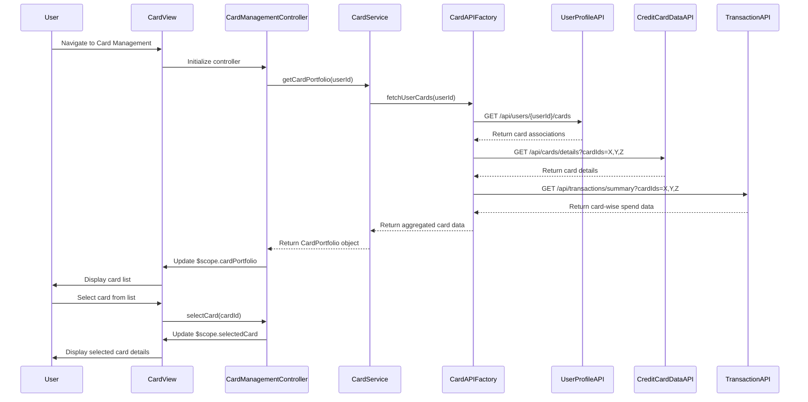

# Low-Level Design: QE-9579 - Multiple Credit Card Management

## a. Architecture Mapping

**Component to AngularJS Artifact Mapping:**
- Multi-card UI → AngularJS Module: `app.cards`
- Card Management Controller → Controller: `CardManagementController`
- Card Data Service → Service: `CardService`
- Card List Component → Directive: `cardList`
- Card Detail Component → Directive: `cardDetail`
- Card API Communication → Factory: `CardAPIFactory`

**Recommended Folder Structure:**
```
app/
├── modules/
│   └── cards/
│       ├── controllers/
│       │   └── card-management.controller.js
│       ├── services/
│       │   └── card.service.js
│       ├── directives/
│       │   ├── card-list.directive.js
│       │   └── card-detail.directive.js
│       ├── factories/
│       │   └── card-api.factory.js
│       ├── views/
│       │   └── card-management.html
│       └── cards.module.js
```

## b. Component Specifications

| Component Name | Artifact Type | Responsibility | Key Dependencies |
|----------------|---------------|----------------|------------------|
| CardManagementController | Controller | Manages card selection, switches between cards, orchestrates card data display | CardService, $scope, $state |
| CardService | Service | Fetches card data, manages card state, computes card-wise spend and utilization | CardAPIFactory, $q |
| CardAPIFactory | Factory | Handles REST API calls to Credit Card Data Service, User Profile Service, Transaction Service | $http, $q |
| cardList | Directive | Renders list of all user credit cards, handles card selection events | None |
| cardDetail | Directive | Displays detailed information for selected card including balances, limits, spend analysis | None |
| app.cards | Module | Main card management module, declares all card-related components | ngRoute, ui.bootstrap |

## c. Data Model

**CreditCard (JS Object):**
```javascript
{
  cardId: String,
  cardNumber: String,         // Masked, e.g., '**** **** **** 1234'
  cardType: String,           // e.g., 'Visa', 'MasterCard', 'Amex'
  cardName: String,
  creditLimit: Number,
  availableCredit: Number,
  outstandingBalance: Number,
  utilizationPercentage: Number,
  monthlySpend: Number,
  isActive: Boolean
}
```

**CardPortfolio (JS Object):**
```javascript
{
  userId: String,
  cards: Array,               // Array of CreditCard objects
  selectedCardId: String,
  totalCreditLimit: Number,
  totalAvailableCredit: Number,
  totalOutstanding: Number
}
```

## d. Data Flow

User navigates to the Card Management view, triggering CardManagementController to initialize and call CardService.getCardPortfolio(). CardService uses CardAPIFactory to fetch card associations from User Profile Service REST API, then retrieves detailed card information from Credit Card Data Service and card-wise transaction data from Transaction Service. The aggregated CardPortfolio object is returned to the controller, which updates $scope.cardPortfolio, rendering the card list via the cardList directive. When the user selects a card, the controller updates $scope.selectedCard, triggering the cardDetail directive to display card-specific information. Card switching updates the selected card state and refreshes the detail view with sub-500ms response time through optimized data binding.

## e. Primary Sequence Diagram



## f. Implementation Notes

- Use AngularJS dependency injection to inject CardService and CardAPIFactory into CardManagementController for loose coupling and testability.
- Implement ES6 classes for Service and Factory; use Promise.all() to parallelize API calls to Credit Card Data Service and Transaction Service for faster data aggregation.
- Use ng-repeat with track by cardId in cardList directive for optimized rendering and smooth card switching performance.
- Implement one-way data binding for card detail view to prevent unnecessary digest cycles and maintain sub-500ms switching performance.
- Store selected card state in CardService as a singleton to persist selection across view transitions.

## g. Error Handling

HTTP interceptor captures API errors; service-level try/catch with fallback to cached data if available; user notifications via toastr.

## h. Security Notes

Requires token-based auth via existing SSO; card data encrypted at rest and in transit; sensitive card numbers masked in UI and logs.