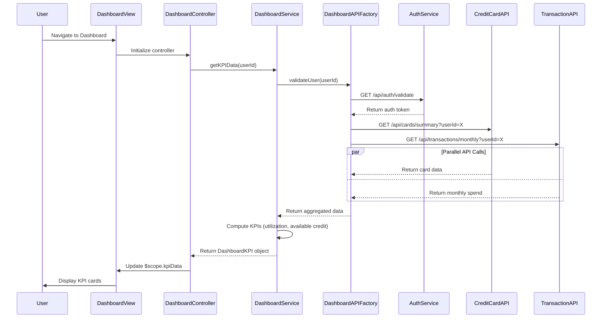

# Low-Level Design: QE-9580 - Dashboard KPIs and Financial Overview

## a. Architecture Mapping

**Component to AngularJS Artifact Mapping:**
- Dashboard UI → AngularJS Module: `app.dashboard`
- Dashboard Controller → Controller: `DashboardController`
- Dashboard Orchestration Service → Service: `DashboardService`
- KPI Display Component → Directive: `kpiCard`
- Financial Summary Component → Directive: `financialSummary`
- API Communication Layer → Factory: `DashboardAPIFactory`

**Recommended Folder Structure:**
```
app/
├── modules/
│   └── dashboard/
│       ├── controllers/
│       │   └── dashboard.controller.js
│       ├── services/
│       │   └── dashboard.service.js
│       ├── directives/
│       │   ├── kpi-card.directive.js
│       │   └── financial-summary.directive.js
│       ├── factories/
│       │   └── dashboard-api.factory.js
│       ├── views/
│       │   └── dashboard.html
│       └── dashboard.module.js
```

## b. Component Specifications

| Component Name | Artifact Type | Responsibility | Key Dependencies |
|----------------|---------------|----------------|------------------|
| DashboardController | Controller | Orchestrates dashboard view, manages KPI data refresh, handles user interactions | DashboardService, $scope, $interval |
| DashboardService | Service | Aggregates financial data from multiple sources, computes KPIs, manages data caching | DashboardAPIFactory, $q |
| DashboardAPIFactory | Factory | Handles REST API calls to Credit Card Data Service, Transaction Service, User Authentication Service | $http, $q |
| kpiCard | Directive | Renders individual KPI metric with value, label, and trend indicator | None |
| financialSummary | Directive | Displays consolidated financial overview with all KPIs in responsive grid layout | None |
| app.dashboard | Module | Main dashboard module, declares all dashboard components and routes | ngRoute, ui.bootstrap |

## c. Data Model

**DashboardKPI (JS Object):**
```javascript
{
  userId: String,
  monthlySpend: Number,
  totalCreditLimit: Number,
  availableCredit: Number,
  outstandingAmount: Number,
  creditUtilization: Number,  // Percentage
  lastUpdated: Date
}
```

**KPIMetric (JS Object):**
```javascript
{
  label: String,              // e.g., 'Monthly Spend', 'Total Credit Limit'
  value: Number,
  formattedValue: String,     // e.g., '$1,234.56'
  unit: String,               // e.g., 'USD', '%'
  trend: String               // e.g., 'up', 'down', 'neutral'
}
```

## d. Data Flow

User accesses the Dashboard view, triggering DashboardController initialization which calls DashboardService.getKPIData(). DashboardService uses DashboardAPIFactory to make parallel REST API calls to Credit Card Data Service for card details and balances, and Transaction Service for monthly spend calculation. User Authentication Service validates the user session before data retrieval. The service aggregates responses, computes derived metrics (credit utilization, available credit), and returns a DashboardKPI object to the controller. The controller updates $scope.kpiData, which triggers the financialSummary directive to render KPI cards via the kpiCard directive. Real-time data refresh is managed through $interval polling or WebSocket updates, ensuring the dashboard loads within 2 seconds and maintains 99.9% uptime.

## e. Primary Sequence Diagram



## f. Implementation Notes

- Use AngularJS dependency injection to inject DashboardService and DashboardAPIFactory into DashboardController for modularity and testability.
- Implement ES6 Promises with Promise.all() in DashboardAPIFactory to parallelize API calls and meet 2-second load time requirement.
- Use $cacheFactory in DashboardService to cache KPI data with 30-second TTL to reduce API load and improve response time.
- Implement responsive grid layout using Bootstrap classes in financialSummary directive to support desktop, tablet, and mobile devices.
- Use $interval for periodic data refresh (configurable interval, default 60 seconds) to maintain real-time visibility without overwhelming the backend.

## g. Error Handling

HTTP interceptor-based global error handling with retry logic for transient failures; user notifications via toastr for persistent errors.

## h. Security Notes

Requires token-based authentication via existing SSO; all API calls include Authorization header with JWT token; sensitive financial data encrypted in transit.