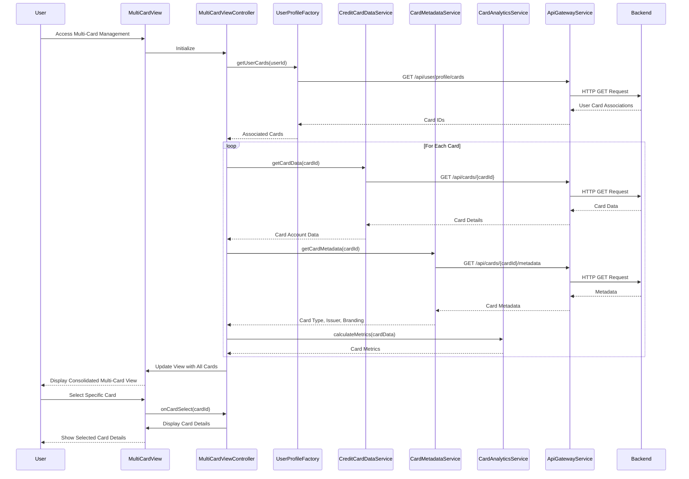

# Low-Level Design: QE-9587 - Multiple Credit Card Management

## a. Architecture Mapping

- **User Interface Multi-Card View** → AngularJS Module: `creditCard.multiCardModule` with Controller: `MultiCardViewController`
- **API Gateway Integration** → AngularJS Service: `ApiGatewayService` (handles all REST API calls)
- **User Profile Service** → AngularJS Factory: `UserProfileFactory` (manages user-to-card associations)
- **Credit Card Data Repository** → AngularJS Service: `CreditCardDataService` (retrieves card account and transaction data)
- **Card Metadata Service** → AngularJS Service: `CardMetadataService` (provides card details, type, issuer, branding)
- **Card-Wise Analytics Engine** → AngularJS Service: `CardAnalyticsService` (calculates individual card metrics)

**Recommended Folder Structure:**
```
app/
├── modules/
│   └── creditCard/
│       ├── multiCard/
│       │   ├── multiCardView.controller.js
│       │   ├── multiCardView.html
│       │   └── multiCard.module.js
├── services/
│   ├── apiGateway.service.js
│   ├── creditCardData.service.js
│   ├── cardMetadata.service.js
│   └── cardAnalytics.service.js
├── factories/
│   └── userProfile.factory.js
└── assets/
    └── css/
        └── multiCard.css
```

## b. Component Specifications

| Name | Artifact Type | Responsibility | Key Dependencies |
|------|---------------|----------------|------------------|
| `creditCard.multiCardModule` | Module | Root module for multi-card management feature | `ngRoute`, `ApiGatewayService` |
| `MultiCardViewController` | Controller | Manages multi-card view state, card selection, switching, and display logic | `UserProfileFactory`, `CreditCardDataService`, `CardMetadataService`, `CardAnalyticsService` |
| `ApiGatewayService` | Service | Centralized REST API communication handler with interceptors | `$http`, `$q` |
| `UserProfileFactory` | Factory | Retrieves and caches user-to-card associations | `ApiGatewayService` |
| `CreditCardDataService` | Service | Fetches card account and transaction data from repository | `ApiGatewayService` |
| `CardMetadataService` | Service | Retrieves card-specific metadata (type, issuer, branding) | `ApiGatewayService` |
| `CardAnalyticsService` | Service | Calculates card-wise financial metrics and spending analysis | `CreditCardDataService` |
| `multiCardView.html` | View/Template | Displays consolidated multi-card view with card switching UI | Bootstrap grid, AngularJS directives |

## c. Data Model

**CreditCard Model:**
```javascript
{
  cardId: String,
  cardNumber: String (masked),
  cardType: String,
  issuer: String,
  brandingUrl: String,
  creditLimit: Number,
  availableCredit: Number,
  outstandingAmount: Number,
  userId: String
}
```

**CardMetrics Model:**
```javascript
{
  cardId: String,
  monthlySpend: Number,
  totalTransactions: Number,
  averageTransactionAmount: Number,
  lastTransactionDate: Date
}
```

**UserProfile Model:**
```javascript
{
  userId: String,
  associatedCards: Array<String>,
  selectedCardId: String
}
```

## d. Data Flow

User opens the multi-card management view, triggering `MultiCardViewController` to call `UserProfileFactory.getUserCards()`, which retrieves user-to-card associations via `ApiGatewayService` from the User Profile Service REST endpoint. For each associated card, `CreditCardDataService.getCardData()` fetches account and transaction data, while `CardMetadataService.getCardMetadata()` enriches with card details. `CardAnalyticsService.calculateMetrics()` processes the data to compute individual card financial metrics. The controller binds the consolidated card list and metrics to `$scope`, and the view renders all cards with switching capability. When user selects a card, the controller updates `selectedCardId` and displays card-specific details.

## e. Primary Sequence Diagram



## f. Implementation Notes

- Use AngularJS Dependency Injection to inject all services and factories into controllers; maintain singleton pattern for services
- Implement promise-based API calls using `$http` service; chain promises using `.then()` for sequential data fetching
- Use `$q.all()` to parallelize multiple card data fetches when loading all cards for improved performance
- Apply Bootstrap grid system (col-md-4, col-sm-6) for responsive multi-card layout; use ng-repeat for card iteration
- Implement card selection state management using controller scope variable; use ng-class for visual selection indication

## g. Error Handling

HTTP interceptor registered in `ApiGatewayService` captures all API errors; displays user-friendly notifications via Bootstrap alerts; implements try/catch in controller methods.

## h. Security Notes

Requires token-based authentication via existing SSO; card numbers are masked on display; API Gateway validates user authorization for card access.