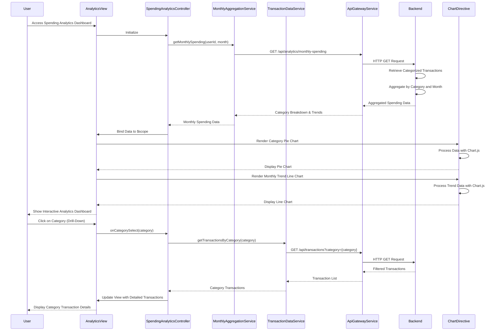

# Low-Level Design: QE-9588 - Spending Analytics and Insights

## a. Architecture Mapping

- **User Interface Analytics Dashboard** → AngularJS Module: `analytics.spendingModule` with Controller: `SpendingAnalyticsController`
- **API Gateway Integration** → AngularJS Service: `ApiGatewayService` (handles all REST API calls)
- **Transaction Data Service** → AngularJS Service: `TransactionDataService` (retrieves raw transaction data)
- **Transaction Categorization Engine** → Backend service consumed via REST API (categorization logic server-side)
- **Monthly Aggregation Service** → AngularJS Service: `MonthlyAggregationService` (processes aggregated data from backend)
- **Data Visualization Library** → Directive: `chartDirective` wrapping Chart.js or D3.js for rendering interactive charts

**Recommended Folder Structure:**
```
app/
├── modules/
│   └── analytics/
│       ├── spending/
│       │   ├── spendingAnalytics.controller.js
│       │   ├── spendingAnalytics.html
│       │   └── spending.module.js
├── services/
│   ├── apiGateway.service.js
│   ├── transactionData.service.js
│   └── monthlyAggregation.service.js
├── directives/
│   └── chart.directive.js
└── assets/
    ├── css/
    │   └── analytics.css
    └── js/
        └── libs/ (Chart.js or D3.js)
```

## b. Component Specifications

| Name | Artifact Type | Responsibility | Key Dependencies |
|------|---------------|----------------|------------------|
| `analytics.spendingModule` | Module | Root module for spending analytics feature | `ngRoute`, `ApiGatewayService`, `chartDirective` |
| `SpendingAnalyticsController` | Controller | Manages analytics dashboard state, filters, and data binding for visualizations | `TransactionDataService`, `MonthlyAggregationService` |
| `ApiGatewayService` | Service | Centralized REST API communication handler with interceptors | `$http`, `$q` |
| `TransactionDataService` | Service | Fetches raw and categorized transaction data from backend | `ApiGatewayService` |
| `MonthlyAggregationService` | Service | Retrieves pre-aggregated monthly spending data by category from backend | `ApiGatewayService` |
| `chartDirective` | Directive | Wraps Chart.js/D3.js to render interactive category-wise and trend charts | Chart.js or D3.js library |
| `spendingAnalytics.html` | View/Template | Displays category breakdown, monthly trends, and interactive charts | Bootstrap grid, `chartDirective` |

## c. Data Model

**Transaction Model:**
```javascript
{
  transactionId: String,
  cardId: String,
  amount: Number,
  category: String,
  merchantName: String,
  transactionDate: Date,
  description: String
}
```

**CategorySpending Model:**
```javascript
{
  category: String,
  totalAmount: Number,
  transactionCount: Number,
  percentage: Number
}
```

**MonthlyTrend Model:**
```javascript
{
  month: String,
  year: Number,
  categoryBreakdown: Array<CategorySpending>,
  totalSpend: Number
}
```

**Categories Enum:**
```javascript
[
  'Food & Dining',
  'Fuel',
  'Shopping',
  'Travel',
  'Entertainment',
  'Utilities',
  'Healthcare',
  'Education',
  'Miscellaneous'
]
```

## d. Data Flow

User accesses the spending analytics dashboard, triggering `SpendingAnalyticsController` to call `MonthlyAggregationService.getMonthlySpending()`, which requests pre-aggregated category-wise spending data via `ApiGatewayService` from the Monthly Aggregation Service REST endpoint. The backend's Transaction Categorization Engine has already classified transactions into nine predefined categories. The aggregated data (category totals, monthly trends) is returned to the controller, which binds it to `$scope`. The `chartDirective` consumes the scope data and renders interactive pie charts for category breakdown and line charts for monthly trends using Chart.js. User interactions (filtering, drill-down) trigger controller methods that update scope data, causing directive to re-render charts.

## e. Primary Sequence Diagram



## f. Implementation Notes

- Use AngularJS Dependency Injection for all services; implement `MonthlyAggregationService` and `TransactionDataService` as singletons
- Implement `chartDirective` as an isolated scope directive with two-way data binding for chart configuration and data
- Use Chart.js for rendering; configure responsive: true and maintainAspectRatio: false for mobile compatibility
- Implement client-side filtering using AngularJS filters for interactive drill-down without additional API calls when data is cached
- Use `$scope.$watch` in directive to detect data changes and trigger chart re-rendering for dynamic updates

## g. Error Handling

HTTP interceptor in `ApiGatewayService` captures API errors; displays Bootstrap toast notifications; controller implements try/catch with fallback to cached data if available.

## h. Security Notes

Requires token-based auth via existing SSO; transaction data filtered by authenticated user ID on backend; no sensitive merchant details exposed beyond what's necessary.