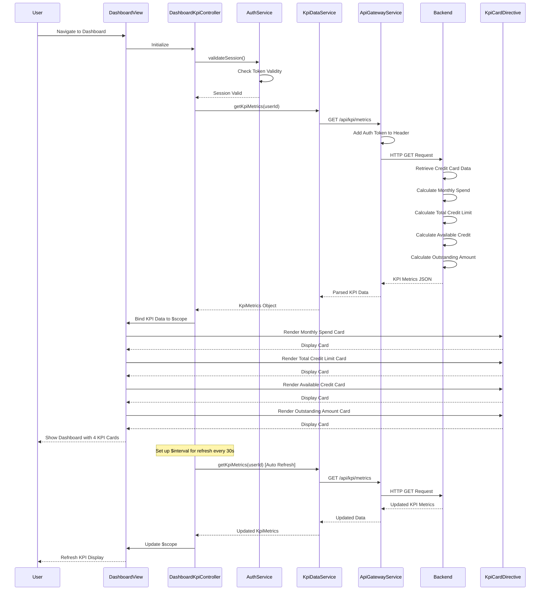

# Low-Level Design: QE-9589 - Dashboard KPIs and Financial Overview

## a. Architecture Mapping

- **User Interface Dashboard** → AngularJS Module: `dashboard.kpiModule` with Controller: `DashboardKpiController`
- **API Gateway Integration** → AngularJS Service: `ApiGatewayService` (handles all REST API calls)
- **User Authentication Service** → AngularJS Service: `AuthService` (manages user authentication and session)
- **Data Aggregation Service** → Backend service consumed via REST API (calculates consolidated KPIs server-side)
- **Credit Card Data Source** → Backend data source accessed via Data Aggregation Service
- **KPI Display Components** → AngularJS Directives: `kpiCardDirective` for individual KPI widgets

**Recommended Folder Structure:**
```
app/
├── modules/
│   └── dashboard/
│       ├── kpi/
│       │   ├── dashboardKpi.controller.js
│       │   ├── dashboardKpi.html
│       │   └── kpi.module.js
├── services/
│   ├── apiGateway.service.js
│   ├── auth.service.js
│   └── kpiData.service.js
├── directives/
│   └── kpiCard.directive.js
└── assets/
    └── css/
        └── dashboard.css
```

## b. Component Specifications

| Name | Artifact Type | Responsibility | Key Dependencies |
|------|---------------|----------------|------------------|
| `dashboard.kpiModule` | Module | Root module for KPI dashboard feature | `ngRoute`, `ApiGatewayService`, `AuthService` |
| `DashboardKpiController` | Controller | Manages dashboard state, KPI data fetching, and real-time refresh logic | `KpiDataService`, `AuthService`, `$interval` |
| `ApiGatewayService` | Service | Centralized REST API communication handler with interceptors | `$http`, `$q` |
| `AuthService` | Service | Handles user authentication, token management, and session validation | `ApiGatewayService`, `$window` |
| `KpiDataService` | Service | Fetches consolidated KPI metrics (monthly spend, credit limit, available credit, outstanding) from Data Aggregation Service | `ApiGatewayService` |
| `kpiCardDirective` | Directive | Reusable component to display individual KPI with title, value, and icon | Bootstrap card styling |
| `dashboardKpi.html` | View/Template | Displays four KPI cards in responsive grid layout | Bootstrap grid, `kpiCardDirective` |

## c. Data Model

**KpiMetrics Model:**
```javascript
{
  userId: String,
  monthlySpend: Number,
  totalCreditLimit: Number,
  availableCredit: Number,
  outstandingAmount: Number,
  lastUpdated: Date
}
```

**KpiCard Model (for directive):**
```javascript
{
  title: String,
  value: Number,
  icon: String,
  color: String
}
```

**AuthToken Model:**
```javascript
{
  token: String,
  userId: String,
  expiresAt: Date
}
```

## d. Data Flow

User navigates to the dashboard, triggering `DashboardKpiController` initialization. Controller calls `AuthService.validateSession()` to ensure user is authenticated; if not, redirects to login. Upon successful authentication, controller invokes `KpiDataService.getKpiMetrics()`, which sends a GET request via `ApiGatewayService` to the Data Aggregation Service REST endpoint `/api/kpi/metrics`. The backend Data Aggregation Service retrieves raw credit card data from Credit Card Data Source, calculates consolidated KPIs (monthly spend for current calendar month, total credit limit across all cards, available credit, outstanding amount), and returns the metrics. Controller binds the KPI data to `$scope`, and the view renders four `kpiCardDirective` instances displaying each metric. Controller sets up `$interval` for real-time refresh every 30 seconds, re-fetching KPI data and updating the view.

## e. Primary Sequence Diagram



## f. Implementation Notes

- Use AngularJS Dependency Injection to inject `KpiDataService`, `AuthService`, and `$interval` into `DashboardKpiController`
- Implement `kpiCardDirective` with isolated scope accepting `title`, `value`, `icon`, and `color` attributes for reusability
- Use `$interval` service for real-time refresh; ensure to cancel interval on `$scope.$on('$destroy')` to prevent memory leaks
- Apply Bootstrap grid (col-lg-3, col-md-6, col-sm-12) for responsive 4-column KPI card layout that stacks on mobile
- Implement HTTP interceptor in `ApiGatewayService` to automatically attach authentication token to all outgoing requests

## g. Error Handling

HTTP interceptor in `ApiGatewayService` captures all API errors; displays user-friendly Bootstrap alert notifications; controller implements try/catch with graceful degradation showing cached data if refresh fails.

## h. Security Notes

Requires token-based authentication via existing SSO; `AuthService` validates token on every dashboard load; API Gateway validates user authorization before returning KPI data.