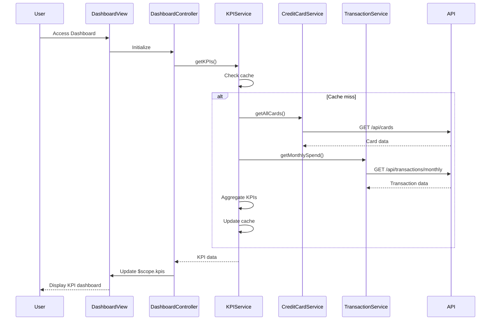

# Low-Level Design: Credit Card Dashboard and KPIs
**Epic ID:** QE-9590

## a. Architecture Mapping

- **Dashboard Module** → AngularJS Module (`app.dashboard`)
- **Dashboard Controller** → AngularJS Controller (`DashboardController`)
- **KPI Service** → AngularJS Service (`KPIService`)
- **Credit Card Service** → AngularJS Service (`CreditCardService`)
- **Transaction Service** → AngularJS Service (`TransactionService`)
- **KPI Directive** → AngularJS Directive (`kpiCard`)

**Folder Structure:**
```
/app
  /dashboard
    dashboard.module.js
    dashboard.controller.js
    dashboard.html
  /services
    kpi.service.js
    creditcard.service.js
    transaction.service.js
  /directives
    kpi-card.directive.js
  /styles
    dashboard.css
```

## b. Component Specifications

| Name | Artifact Type | Responsibility | Key Dependencies |
|------|---------------|----------------|------------------|
| DashboardModule | Module | Entry point for dashboard feature, registers all dashboard components | angular, ui.router |
| DashboardController | Controller | Orchestrates dashboard view, fetches and displays KPIs, handles refresh | KPIService, $scope, $interval |
| KPIService | Service | Aggregates KPI data from multiple sources, implements caching logic | CreditCardService, TransactionService, $http, $q |
| CreditCardService | Service | Fetches credit card balances, limits, and outstanding amounts from REST API | $http, $q |
| TransactionService | Service | Retrieves monthly transaction data and calculates monthly spend | $http, $q |
| kpiCard | Directive | Reusable UI component for displaying individual KPI metrics with visual indicators | None |

## c. Data Model

```javascript
// KPI Dashboard Model
const DashboardKPI = {
  monthlySpend: Number,        // Total spend for current month
  totalCreditLimit: Number,    // Sum of all card limits
  availableCredit: Number,     // Sum of available credit across cards
  totalOutstanding: Number,    // Sum of outstanding balances
  utilizationRate: Number,     // (totalOutstanding / totalCreditLimit) * 100
  lastUpdated: Date           // Timestamp of last data refresh
};

// Credit Card Model
const CreditCard = {
  cardId: String,
  balance: Number,
  creditLimit: Number,
  availableCredit: Number,
  outstandingAmount: Number
};

// Transaction Summary Model
const TransactionSummary = {
  month: String,              // YYYY-MM format
  totalSpend: Number,
  transactionCount: Number
};
```

## d. Data Flow

User accesses dashboard → DashboardController initializes and calls KPIService.getKPIs() → KPIService checks local cache (5-minute TTL) → On cache miss, service makes parallel $http calls to CreditCardService.getAllCards() and TransactionService.getMonthlySpend() → Services invoke REST endpoints (/api/cards, /api/transactions/monthly) → Backend returns JSON responses → KPIService aggregates data (sums limits, calculates utilization) → Aggregated KPIs cached and returned to controller → Controller updates $scope.kpis → View renders KPI cards via kpiCard directive with two-way binding → Auto-refresh via $interval triggers every 5 minutes.

## e. Primary Sequence Diagram



## f. Implementation Notes

- Use AngularJS $http service with promise chaining ($q.all) for parallel API calls to meet <2s load time requirement.
- Implement in-memory caching using Angular $cacheFactory with 5-minute TTL for KPI data refresh.
- Use $interval service for auto-refresh mechanism; ensure proper cleanup in $scope.$on('$destroy') to prevent memory leaks.
- Apply Bootstrap grid system (col-md-3, col-sm-6, col-xs-12) for responsive KPI card layout across devices.
- Use ES6 arrow functions and const/let in services; leverage AngularJS DI with $inject annotation for minification safety.

## g. Error Handling

HTTP interceptor captures API errors; user-friendly notifications displayed via toastr/angular-ui-notification with retry option for failed requests.

## h. Security Notes

Standard input validation and secure API calls assumed; token-based auth via existing SSO integrated in $http interceptor.