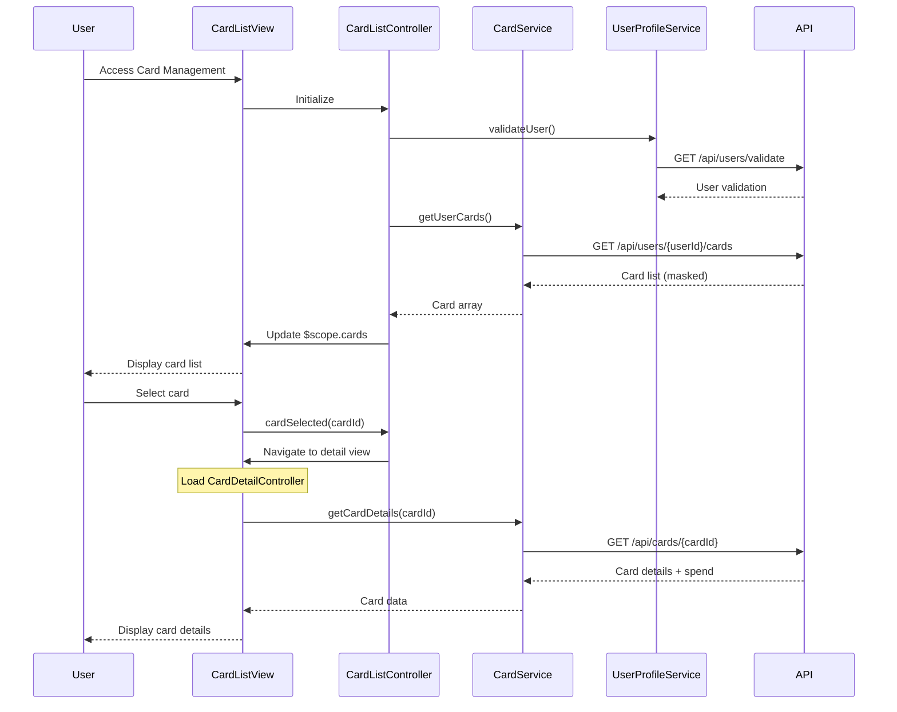

# Low-Level Design: Multiple Credit Card Management
**Epic ID:** QE-9591

## a. Architecture Mapping

- **Card Management Module** → AngularJS Module (`app.cardManagement`)
- **Card List Controller** → AngularJS Controller (`CardListController`)
- **Card Detail Controller** → AngularJS Controller (`CardDetailController`)
- **Card Service** → AngularJS Service (`CardService`)
- **User Profile Service** → AngularJS Service (`UserProfileService`)
- **Card Item Directive** → AngularJS Directive (`cardItem`)

**Folder Structure:**
```
/app
  /card-management
    card-management.module.js
    card-list.controller.js
    card-detail.controller.js
    card-list.html
    card-detail.html
  /services
    card.service.js
    user-profile.service.js
  /directives
    card-item.directive.js
  /styles
    card-management.css
```

## b. Component Specifications

| Name | Artifact Type | Responsibility | Key Dependencies |
|------|---------------|----------------|------------------|
| CardManagementModule | Module | Entry point for card management feature, configures routing for list and detail views | angular, ui.router |
| CardListController | Controller | Displays all user cards, handles card selection and navigation to detail view | CardService, UserProfileService, $scope, $state |
| CardDetailController | Controller | Displays individual card details and card-wise spend analysis | CardService, $scope, $stateParams |
| CardService | Service | Fetches card data, manages card selection state, retrieves card-wise spend | $http, $q, $cacheFactory |
| UserProfileService | Service | Validates user authentication and retrieves user-card associations | $http, $q |
| cardItem | Directive | Reusable component for rendering individual card with masked number and brand logo | None |

## c. Data Model

```javascript
// Credit Card Model
const CreditCard = {
  cardId: String,
  cardNumber: String,          // Last 4 digits only (e.g., "****1234")
  cardBrand: String,           // Visa, MasterCard, Amex
  cardType: String,            // Credit, Debit
  expiryDate: String,          // MM/YY format
  creditLimit: Number,
  availableCredit: Number,
  outstandingBalance: Number,
  cardHolderName: String
};

// Card Spend Analysis Model
const CardSpendAnalysis = {
  cardId: String,
  currentMonthSpend: Number,
  lastMonthSpend: Number,
  averageMonthlySpend: Number,
  topCategory: String          // e.g., "Food & Dining"
};

// User Card List Model
const UserCardList = {
  userId: String,
  cards: Array<CreditCard>,
  totalCards: Number
};
```

## d. Data Flow

User accesses Card Management → CardListController calls UserProfileService.validateUser() and CardService.getUserCards() → CardService invokes GET /api/users/{userId}/cards → API returns array of card objects with masked numbers → Controller populates $scope.cards and renders card list via cardItem directive → User clicks on a card → $state.go('cardDetail', {cardId}) transitions to detail view → CardDetailController retrieves cardId from $stateParams → Calls CardService.getCardDetails(cardId) and CardService.getCardSpend(cardId) → API returns detailed card info and spend analysis → Controller updates $scope and view displays full card details with spend breakdown.

## e. Primary Sequence Diagram



## f. Implementation Notes

- Use ui-router for state management with lazy-loaded card detail view to optimize initial load time.
- Implement $cacheFactory with LRU cache (max 10 cards) to meet <1s card listing load requirement.
- Use ng-repeat with track by cardId for efficient card list rendering; apply one-time binding (::) for static card properties.
- Mask card numbers on client side using Angular filter (e.g., {{ card.cardNumber | cardMask }}).
- Use $http interceptor to inject authentication token; leverage AngularJS DI with explicit $inject for services.

## g. Error Handling

Global $http interceptor with error handler; display user-friendly messages via modal/toast for API failures with retry mechanism.

## h. Security Notes

Requires token-based auth via existing SSO; card numbers transmitted and stored masked; PCI-DSS compliance enforced at API layer.