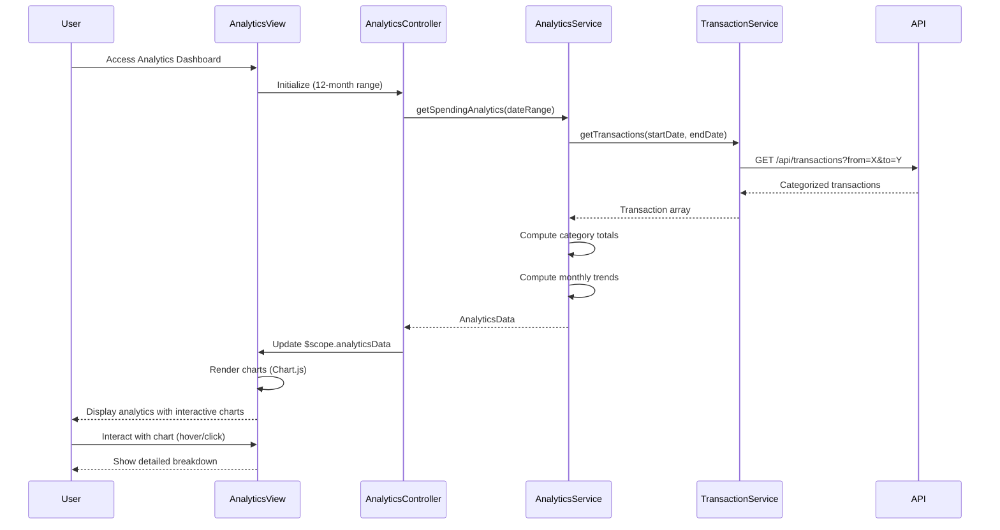

# Low-Level Design: Spending Analytics and Insights
**Epic ID:** QE-9592

## a. Architecture Mapping

- **Analytics Module** → AngularJS Module (`app.analytics`)
- **Analytics Controller** → AngularJS Controller (`AnalyticsController`)
- **Analytics Service** → AngularJS Service (`AnalyticsService`)
- **Transaction Service** → AngularJS Service (`TransactionService`)
- **Chart Directive** → AngularJS Directive (`spendingChart`)
- **Category Filter** → AngularJS Filter (`categoryName`)

**Folder Structure:**
```
/app
  /analytics
    analytics.module.js
    analytics.controller.js
    analytics.html
  /services
    analytics.service.js
    transaction.service.js
  /directives
    spending-chart.directive.js
  /filters
    category-name.filter.js
  /styles
    analytics.css
```

## b. Component Specifications

| Name | Artifact Type | Responsibility | Key Dependencies |
|------|---------------|----------------|------------------|
| AnalyticsModule | Module | Entry point for analytics feature, registers components and chart library (Chart.js/D3) | angular, ui.router, chart.js |
| AnalyticsController | Controller | Orchestrates analytics view, fetches spending data, manages date range selection | AnalyticsService, TransactionService, $scope |
| AnalyticsService | Service | Processes transaction data, computes category-wise totals and monthly trends | TransactionService, $http, $q |
| TransactionService | Service | Fetches categorized transaction data for specified date range from REST API | $http, $q |
| spendingChart | Directive | Renders interactive charts (pie for categories, line/bar for trends) using Chart.js | chart.js |
| categoryName | Filter | Formats category codes to display names (e.g., "FOOD" → "Food & Dining") | None |

## c. Data Model

```javascript
// Category Spending Model
const CategorySpending = {
  category: String,            // One of 9 categories
  amount: Number,
  percentage: Number,          // % of total spend
  transactionCount: Number
};

// Monthly Trend Model
const MonthlyTrend = {
  month: String,               // YYYY-MM format
  totalSpend: Number,
  categoryBreakdown: Array<CategorySpending>
};

// Analytics Data Model
const AnalyticsData = {
  dateRange: {
    startDate: Date,
    endDate: Date
  },
  totalSpend: Number,
  categorySpending: Array<CategorySpending>,
  monthlyTrends: Array<MonthlyTrend>,
  topCategory: String
};

// Transaction Model (from API)
const Transaction = {
  transactionId: String,
  amount: Number,
  category: String,            // Pre-categorized
  date: Date,
  merchantName: String
};
```

## d. Data Flow

User accesses Analytics Dashboard → AnalyticsController initializes with default 12-month date range → Calls AnalyticsService.getSpendingAnalytics(dateRange) → AnalyticsService invokes TransactionService.getTransactions(startDate, endDate) → TransactionService calls GET /api/transactions?from=X&to=Y → API returns categorized transaction array → AnalyticsService processes data to compute category-wise totals and monthly aggregations → Returns AnalyticsData object to controller → Controller updates $scope.analyticsData → spendingChart directive watches data and renders pie chart (category breakdown) and line chart (monthly trends) using Chart.js → User interacts with charts (hover, click) to explore details.

## e. Primary Sequence Diagram



## f. Implementation Notes

- Use Chart.js integrated via angular-chart.js directive for declarative chart rendering with AngularJS data binding.
- Implement lazy loading for Chart.js library using ocLazyLoad to reduce initial bundle size.
- Use $q.defer() for asynchronous data processing; compute category aggregations using Array.reduce() in ES6.
- Cache transaction data using $cacheFactory with date-range-based keys to avoid redundant API calls.
- Apply responsive chart options (Chart.js responsive: true, maintainAspectRatio: false) for mobile/tablet compatibility.

## g. Error Handling

$http interceptor handles API errors; display error notification with option to reload data; graceful degradation shows cached data if available.

## h. Security Notes

Standard input validation and secure API calls assumed; token-based auth via existing SSO integrated in $http interceptor.