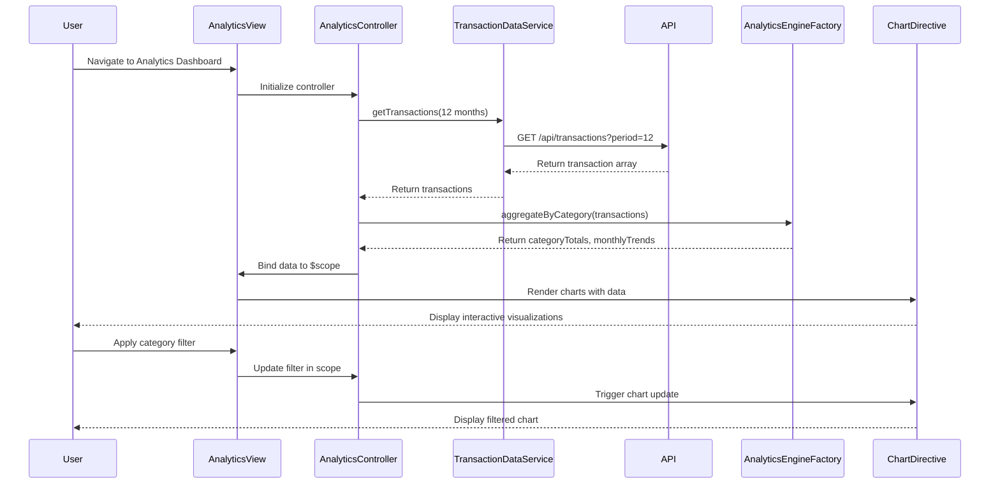

# Low-Level Design: QE-9602 - Spending Analytics and Insights

## a. Architecture Mapping

- **Analytics Dashboard Component** → AngularJS Module (`app.analytics`) + Controller (`AnalyticsController`)
- **Transaction Data Service** → AngularJS Service (`TransactionDataService`) for API calls
- **Analytics Engine Integration** → AngularJS Factory (`AnalyticsEngineFactory`) for data aggregation
- **Data Visualization** → Directive (`spendingChart`) wrapping Chart.js/D3.js library
- **Category Filter** → Controller method with two-way binding to view filters

**Folder Structure:**
```
app/
├── modules/
│   └── analytics/
│       ├── analytics.module.js
│       ├── analytics.controller.js
│       ├── analytics.service.js
│       ├── analytics.factory.js
│       └── directives/
│           └── spending-chart.directive.js
├── models/
│   └── spending.model.js
└── views/
    └── analytics/
        └── analytics.html
```

## b. Component Specifications

| Name | Artifact Type | Responsibility | Key Dependencies |
|------|---------------|----------------|------------------|
| `app.analytics` | Module | Root module for analytics feature | `ngRoute`, `chart.js` |
| `AnalyticsController` | Controller | Manages analytics view state, filters, and data binding | `TransactionDataService`, `AnalyticsEngineFactory`, `$scope` |
| `TransactionDataService` | Service | Fetches categorized transaction data from REST API | `$http`, `API_CONFIG` |
| `AnalyticsEngineFactory` | Factory | Aggregates and processes spending data by category and month | `TransactionDataService` |
| `spendingChart` | Directive | Renders interactive category-wise and trend charts | `Chart.js` or `D3.js`, isolated scope |
| `SpendingModel` | Model | Defines transaction and spending data structure | None |

## c. Data Model

**SpendingModel (JavaScript ES6 Class):**
```javascript
class SpendingModel {
  constructor() {
    this.transactions = []; // Array<Transaction>
    this.categoryTotals = {}; // Object: { category: amount }
    this.monthlyTrends = []; // Array<MonthlySpend>
  }
}

class Transaction {
  constructor(id, date, amount, category, description, cardId) {
    this.id = id; // String
    this.date = date; // Date
    this.amount = amount; // Number
    this.category = category; // String (Food & Dining, Fuel, Shopping, etc.)
    this.description = description; // String
    this.cardId = cardId; // String
  }
}

class MonthlySpend {
  constructor(month, year, totalAmount, categoryBreakdown) {
    this.month = month; // Number (1-12)
    this.year = year; // Number
    this.totalAmount = totalAmount; // Number
    this.categoryBreakdown = categoryBreakdown; // Object: { category: amount }
  }
}
```

## d. Data Flow

User navigates to analytics view → `AnalyticsController` initializes and calls `TransactionDataService.getTransactions()` → Service makes GET request to `/api/transactions?period=12months` → API returns categorized transaction array → `AnalyticsEngineFactory.aggregateByCategory()` processes data into category totals and monthly trends → Controller binds aggregated data to `$scope.categoryTotals` and `$scope.monthlyTrends` → `spendingChart` directive watches scope data and renders interactive charts using Chart.js → User applies category filter → Controller updates scope filter → Directive re-renders chart with filtered data.

## e. Primary Sequence Diagram



## f. Implementation Notes

- Use AngularJS Dependency Injection to inject `TransactionDataService` and `AnalyticsEngineFactory` into `AnalyticsController`.
- Implement `TransactionDataService` as a singleton service using `$http` for REST API calls with promise-based responses.
- Use ES6 classes for data models (`SpendingModel`, `Transaction`, `MonthlySpend`) and instantiate in controller.
- Implement `spendingChart` directive with isolated scope (`scope: { data: '=', type: '@' }`) and link function to initialize Chart.js.
- Use `$scope.$watch` in directive to detect data changes and trigger chart re-rendering for interactivity.

## g. Error Handling

HTTP interceptor captures API errors; controller displays user-friendly error messages via `$scope.errorMessage` and provides retry option.

## h. Security Notes

Standard input validation and secure API calls assumed; token-based authentication via existing SSO for API access.