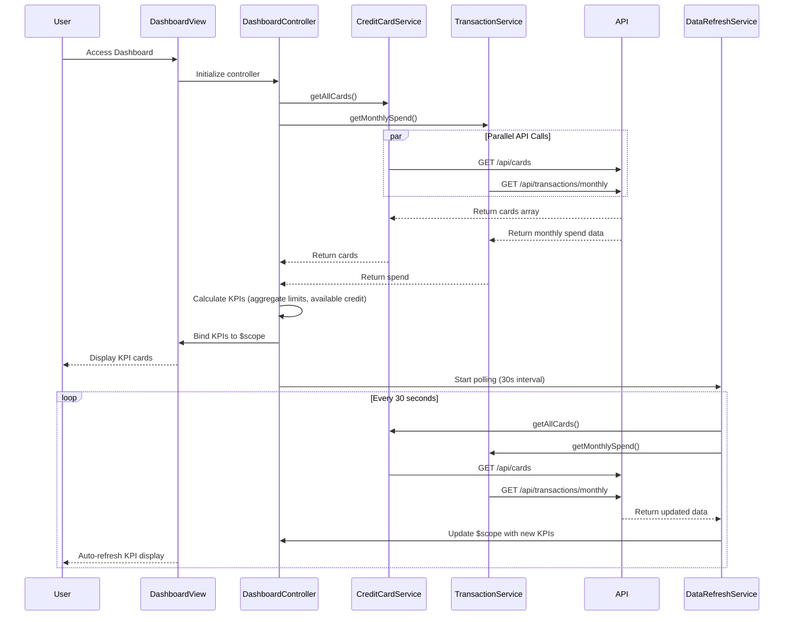

# Low-Level Design: QE-9603 - Credit Card Dashboard and KPI Management

## a. Architecture Mapping

- **Dashboard UI Component** → AngularJS Module (`app.dashboard`) + Controller (`DashboardController`)
- **Credit Card Data Service** → AngularJS Service (`CreditCardService`) for fetching card details and balances
- **Transaction Processing Service** → AngularJS Service (`TransactionService`) for monthly spend and outstanding calculations
- **KPI Display** → Directive (`kpiCard`) for reusable KPI card components
- **Real-time Refresh** → Service (`DataRefreshService`) with `$interval` for polling updates

**Folder Structure:**
```
app/
├── modules/
│   └── dashboard/
│       ├── dashboard.module.js
│       ├── dashboard.controller.js
│       ├── services/
│       │   ├── credit-card.service.js
│       │   ├── transaction.service.js
│       │   └── data-refresh.service.js
│       └── directives/
│           └── kpi-card.directive.js
├── models/
│   └── dashboard.model.js
└── views/
    └── dashboard/
        └── dashboard.html
```

## b. Component Specifications

| Name | Artifact Type | Responsibility | Key Dependencies |
|------|---------------|----------------|------------------|
| `app.dashboard` | Module | Root module for dashboard feature | `ngRoute`, `app.common` |
| `DashboardController` | Controller | Manages dashboard state, aggregates KPIs, handles refresh | `CreditCardService`, `TransactionService`, `DataRefreshService`, `$scope` |
| `CreditCardService` | Service | Fetches credit card details, limits, and balances via REST API | `$http`, `API_CONFIG` |
| `TransactionService` | Service | Retrieves monthly spend and outstanding amounts from API | `$http`, `API_CONFIG` |
| `DataRefreshService` | Service | Polls backend every 30 seconds for real-time KPI updates | `$interval`, `CreditCardService`, `TransactionService` |
| `kpiCard` | Directive | Renders individual KPI card with title, value, and icon | Isolated scope, Bootstrap CSS |
| `DashboardModel` | Model | Defines KPI data structure (monthlySpend, creditLimit, etc.) | None |

## c. Data Model

**DashboardModel (JavaScript ES6 Class):**
```javascript
class DashboardModel {
  constructor() {
    this.monthlySpend = 0; // Number
    this.totalCreditLimit = 0; // Number
    this.availableCredit = 0; // Number
    this.outstandingAmount = 0; // Number
    this.cards = []; // Array<CreditCard>
  }
}

class CreditCard {
  constructor(id, cardNumber, cardType, creditLimit, currentBalance, status) {
    this.id = id; // String
    this.cardNumber = cardNumber; // String (masked)
    this.cardType = cardType; // String (Visa, Mastercard, etc.)
    this.creditLimit = creditLimit; // Number
    this.currentBalance = currentBalance; // Number
    this.status = status; // String (active, inactive, blocked)
  }
}
```

## d. Data Flow

User accesses dashboard → `DashboardController` initializes and calls `CreditCardService.getAllCards()` and `TransactionService.getMonthlySpend()` → Services make parallel GET requests to `/api/cards` and `/api/transactions/monthly` → API returns card array and spend data → Controller calculates aggregated KPIs (total credit limit = sum of all card limits, available credit = total limit - outstanding) → Controller binds KPIs to `$scope.dashboard` → View renders four `kpiCard` directives with bound data → `DataRefreshService` starts `$interval` polling every 30 seconds → On each interval, services re-fetch data → Controller updates `$scope.dashboard` → View auto-updates via two-way binding.

## e. Primary Sequence Diagram



## f. Implementation Notes

- Use AngularJS DI to inject `CreditCardService`, `TransactionService`, and `DataRefreshService` into `DashboardController`.
- Implement services with `$http` for REST API calls; use `$q.all()` for parallel requests to improve load time.
- Use `$interval` in `DataRefreshService` for 30-second polling; cancel interval on `$scope.$on('$destroy')` to prevent memory leaks.
- Implement `kpiCard` directive with isolated scope (`scope: { title: '@', value: '=', icon: '@' }`) and Bootstrap grid for responsive layout.
- Use CSS media queries and Bootstrap classes (`col-xs-12`, `col-md-6`, `col-lg-3`) for responsive KPI card layout across devices.

## g. Error Handling

HTTP interceptor-based error handling; controller displays error notification using `$scope.errorMessage` and disables refresh on persistent failures.

## h. Security Notes

Requires token-based authentication via existing SSO; API calls include Authorization header with JWT token.