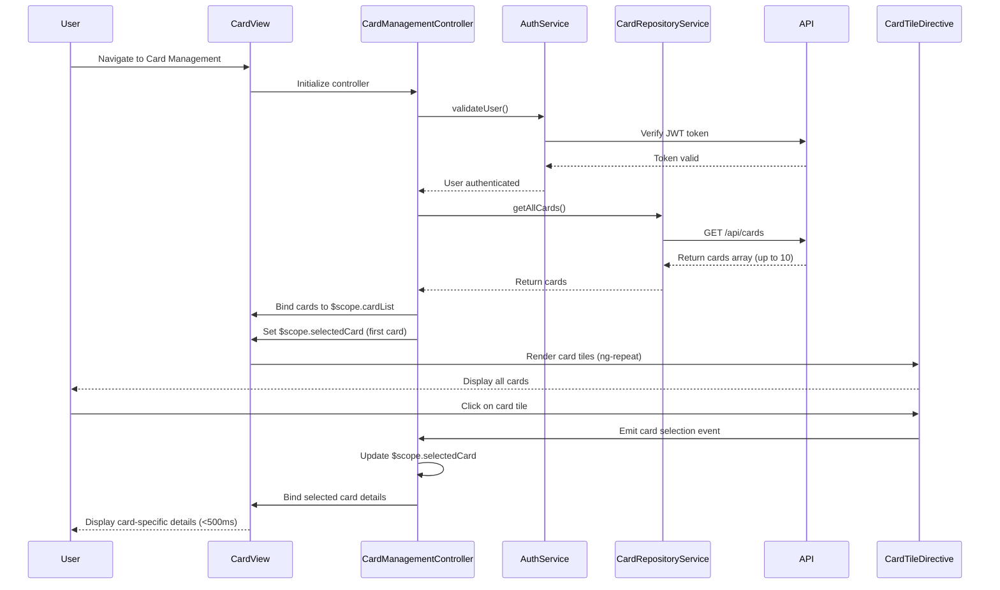

# Low-Level Design: QE-9604 - Multiple Credit Card Management

## a. Architecture Mapping

- **Card Management Module** → AngularJS Module (`app.cardManagement`) + Controller (`CardManagementController`)
- **User Authentication Service** → AngularJS Service (`AuthService`) for secure access control
- **Credit Card Data Repository** → AngularJS Service (`CardRepositoryService`) for CRUD operations on card data
- **Card Display** → Directive (`cardTile`) for rendering individual card details
- **Card Selection** → Controller method with `$scope.selectedCard` for state management

**Folder Structure:**
```
app/
├── modules/
│   └── card-management/
│       ├── card-management.module.js
│       ├── card-management.controller.js
│       ├── services/
│       │   ├── auth.service.js
│       │   └── card-repository.service.js
│       └── directives/
│           └── card-tile.directive.js
├── models/
│   └── card.model.js
└── views/
    └── card-management/
        └── card-list.html
```

## b. Component Specifications

| Name | Artifact Type | Responsibility | Key Dependencies |
|------|---------------|----------------|------------------|
| `app.cardManagement` | Module | Root module for multi-card management feature | `ngRoute`, `app.common` |
| `CardManagementController` | Controller | Manages card list, selection state, and card-specific data display | `CardRepositoryService`, `AuthService`, `$scope` |
| `AuthService` | Service | Validates user authentication and authorizes card access | `$http`, `$window`, `API_CONFIG` |
| `CardRepositoryService` | Service | Fetches, stores, and retrieves credit card data from REST API | `$http`, `API_CONFIG` |
| `cardTile` | Directive | Renders individual card tile with details, status, and click handler | Isolated scope, Bootstrap CSS |
| `CardModel` | Model | Defines credit card data structure with attributes | None |

## c. Data Model

**CardModel (JavaScript ES6 Class):**
```javascript
class CardModel {
  constructor(id, cardNumber, cardHolderName, cardType, expiryDate, creditLimit, currentBalance, availableCredit, status, lastUsedDate) {
    this.id = id; // String
    this.cardNumber = cardNumber; // String (masked, e.g., "**** **** **** 1234")
    this.cardHolderName = cardHolderName; // String
    this.cardType = cardType; // String (Visa, Mastercard, Amex, etc.)
    this.expiryDate = expiryDate; // String (MM/YY)
    this.creditLimit = creditLimit; // Number
    this.currentBalance = currentBalance; // Number
    this.availableCredit = availableCredit; // Number (creditLimit - currentBalance)
    this.status = status; // String (active, inactive, blocked)
    this.lastUsedDate = lastUsedDate; // Date
  }
}

class CardListModel {
  constructor() {
    this.cards = []; // Array<CardModel>
    this.selectedCardId = null; // String
  }
}
```

## d. Data Flow

User navigates to card management view → `CardManagementController` initializes and calls `AuthService.validateUser()` → AuthService verifies JWT token → Controller calls `CardRepositoryService.getAllCards()` → Service makes GET request to `/api/cards` → API returns array of up to 10 cards → Controller stores cards in `$scope.cardList` and sets `$scope.selectedCard` to first card → View renders `cardTile` directive for each card using `ng-repeat` → User clicks on a card tile → Directive emits click event → Controller updates `$scope.selectedCard` with clicked card → View displays detailed card information (credit limit, balance, spend analysis) for selected card → Card switching completes in under 500ms via client-side state update.

## e. Primary Sequence Diagram



## f. Implementation Notes

- Use AngularJS DI to inject `AuthService` and `CardRepositoryService` into `CardManagementController`.
- Implement `CardRepositoryService` as singleton service with `$http` for REST API calls; cache card list in service to optimize switching performance.
- Use `$scope.selectedCard` for client-side state management; card switching updates scope variable without additional API calls.
- Implement `cardTile` directive with isolated scope (`scope: { card: '=', onSelect: '&' }`) and click handler to emit selection event.
- Use Bootstrap grid (`col-xs-12`, `col-sm-6`, `col-md-4`) for responsive card tile layout supporting 10+ cards across devices.

## g. Error Handling

HTTP interceptor captures API errors; controller displays user-friendly error messages and provides retry mechanism for failed card data fetch.

## h. Security Notes

Requires token-based authentication via existing SSO; `AuthService` validates JWT token before allowing card data access; API enforces user-card ownership validation.