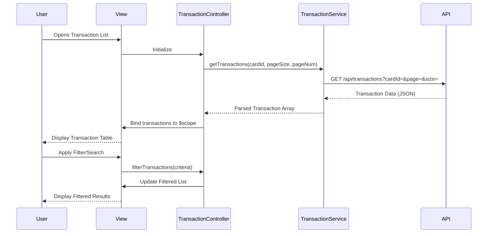

# Low-Level Design: Transaction Monitoring and Management
**Epic ID:** QE-9639  
**Technology Stack:** AngularJS 1.x, JavaScript ES6, HTML5, CSS3, Bootstrap, REST APIs, MVC Architecture

---

## a. Architecture Mapping

**HLD to AngularJS Artifact Mapping:**
- User Interface → AngularJS View (HTML5 + Bootstrap) + TransactionController
- Transaction Service → AngularJS Service (TransactionService)
- Transaction Data Source → REST API integration via $http service
- Search and Filter Engine → Controller logic + Filter directives
- Pagination Handler → Custom Directive (paginationDirective) + Controller logic

**Recommended Folder Structure:**
```
/app
  /modules
    /transactions
      /controllers
        transactionController.js
      /services
        transactionService.js
      /directives
        paginationDirective.js
        transactionFilterDirective.js
      /views
        transaction-list.html
      transactionModule.js
```

---

## b. Component Specifications

| Component Name | Artifact Type | Responsibility | Key Dependencies |
|----------------|---------------|----------------|------------------|
| transactionModule | Module | Defines the transaction monitoring module and its dependencies | angular, ui.router |
| TransactionController | Controller | Manages transaction list display, search, filter, and pagination logic | TransactionService, $scope, $filter |
| TransactionService | Service | Fetches transaction data from REST API, handles caching | $http, $q, API_CONFIG |
| paginationDirective | Directive | Renders pagination controls and handles page navigation | None |
| transactionFilterDirective | Directive | Provides search and filter UI controls | None |
| transaction-list.html | View | Displays transaction table with search, filter, and pagination controls | TransactionController |

---

## c. Data Model

**Transaction Model:**
```javascript
{
  transactionId: String,
  date: Date,
  merchantName: String,
  amount: Number,
  cardId: String,
  cardName: String,
  category: String,
  status: String
}
```

**Pagination Model:**
```javascript
{
  currentPage: Number,
  pageSize: Number,
  totalRecords: Number,
  totalPages: Number
}
```

---

## d. Data Flow

User opens the transaction list view → TransactionController initializes and calls TransactionService.getTransactions() → TransactionService makes REST API call to fetch transaction data → API returns transaction array → Service caches and returns data to Controller → Controller applies filters and pagination → View renders transaction table with Bootstrap styling → User applies search/filter or navigates pages → Controller updates filtered dataset and re-renders view.

---

## e. Primary Sequence Diagram



---

## f. Implementation Notes

- Use AngularJS $http service with interceptors for API calls; implement caching strategy using $cacheFactory for frequently accessed transaction data.
- Leverage ES6 arrow functions and template literals in service layer; use AngularJS DI for all dependencies.
- Implement client-side pagination using custom directive; default page size = 20 transactions.
- Use AngularJS $filter service for search and filtering; support filtering by date range, merchant name, amount, and card.
- Bootstrap table component with responsive design; use ng-repeat with track by transactionId for performance optimization.

---

## g. Error Handling

HTTP interceptor-based error handling with user-friendly notifications via Bootstrap alerts; try/catch blocks in service layer for data parsing errors.

---

## h. Security Notes

Standard input validation and secure API calls assumed; token-based authentication via existing SSO for API requests.

---