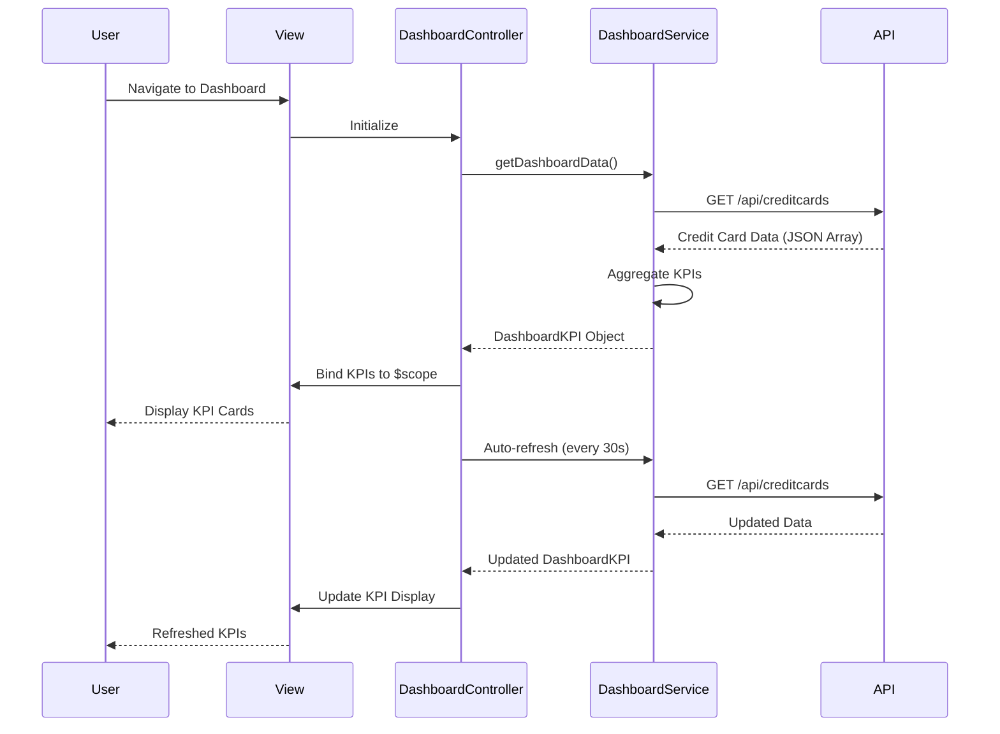

# Low-Level Design: Credit Card Portfolio Management and KPI Dashboard
**Epic ID:** QE-9640  
**Technology Stack:** AngularJS 1.x, JavaScript ES6, HTML5, CSS3, Bootstrap, REST APIs, MVC Architecture

---

## a. Architecture Mapping

**HLD to AngularJS Artifact Mapping:**
- User Interface → AngularJS View (HTML5 + Bootstrap) + DashboardController
- Dashboard Service → AngularJS Service (DashboardService)
- Credit Card Data Source → REST API integration via $http service
- KPI Aggregation Engine → Service-layer business logic (DashboardService)
- Data Refresh Service → AngularJS $interval service for periodic refresh

**Recommended Folder Structure:**
```
/app
  /modules
    /dashboard
      /controllers
        dashboardController.js
      /services
        dashboardService.js
      /directives
        kpiCardDirective.js
      /views
        dashboard.html
      dashboardModule.js
```

---

## b. Component Specifications

| Component Name | Artifact Type | Responsibility | Key Dependencies |
|----------------|---------------|----------------|------------------|
| dashboardModule | Module | Defines the dashboard module and its dependencies | angular, ui.router |
| DashboardController | Controller | Manages dashboard state, KPI display, and data refresh logic | DashboardService, $scope, $interval |
| DashboardService | Service | Fetches credit card data from REST API, aggregates KPIs | $http, $q, API_CONFIG |
| kpiCardDirective | Directive | Renders individual KPI cards with responsive layout | None |
| dashboard.html | View | Displays KPI cards in Bootstrap grid layout | DashboardController |

---

## c. Data Model

**CreditCard Model:**
```javascript
{
  cardId: String,
  cardNumber: String,
  cardName: String,
  creditLimit: Number,
  availableCredit: Number,
  outstandingAmount: Number,
  monthlySpend: Number
}
```

**DashboardKPI Model:**
```javascript
{
  totalCreditLimit: Number,
  totalAvailableCredit: Number,
  totalOutstanding: Number,
  totalMonthlySpend: Number,
  cards: Array<CreditCard>
}
```

---

## d. Data Flow

User navigates to dashboard → DashboardController initializes and calls DashboardService.getDashboardData() → DashboardService makes REST API call to fetch all credit card data → API returns card array → Service aggregates KPIs (sum of limits, available credit, outstanding, monthly spend) → Service returns DashboardKPI object to Controller → Controller binds data to $scope → View renders KPI cards using kpiCardDirective in Bootstrap grid → $interval service triggers periodic refresh every 30 seconds → Updated data re-renders view.

---

## e. Primary Sequence Diagram



---

## f. Implementation Notes

- Use AngularJS $http service with promise-based API calls; implement $interval for 30-second auto-refresh with cleanup on $destroy.
- Leverage ES6 array methods (reduce, map) for KPI aggregation in service layer; use AngularJS DI for all dependencies.
- Create reusable kpiCardDirective with isolated scope for modularity; pass KPI name, value, and icon as attributes.
- Bootstrap grid system (col-md-3) for responsive 4-column KPI layout on desktop, stacked on mobile.
- Use ng-cloak to prevent flicker during initial load; loading spinner during API calls.

---

## g. Error Handling

HTTP interceptor-based error handling with user-friendly notifications via Bootstrap alerts; fallback to cached data on API failure.

---

## h. Security Notes

Requires token-based auth via existing SSO; secure API calls with HTTPS and input validation for card data.

---