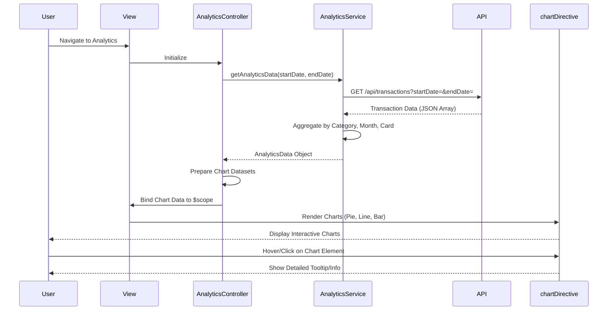

# Low-Level Design: Spending Analytics and Insights
**Epic ID:** QE-9641  
**Technology Stack:** AngularJS 1.x, JavaScript ES6, HTML5, CSS3, Bootstrap, REST APIs, MVC Architecture

---

## a. Architecture Mapping

**HLD to AngularJS Artifact Mapping:**
- User Interface → AngularJS View (HTML5 + Bootstrap) + AnalyticsController
- Analytics Service → AngularJS Service (AnalyticsService)
- Transaction Data Service → REST API integration via $http service
- Categorization Engine → Backend service (pre-categorized data assumed)
- Visualization Renderer → AngularJS Directive (chartDirective) using Chart.js or D3.js

**Recommended Folder Structure:**
```
/app
  /modules
    /analytics
      /controllers
        analyticsController.js
      /services
        analyticsService.js
      /directives
        chartDirective.js
      /views
        analytics.html
      analyticsModule.js
```

---

## b. Component Specifications

| Component Name | Artifact Type | Responsibility | Key Dependencies |
|----------------|---------------|----------------|------------------|
| analyticsModule | Module | Defines the analytics module and its dependencies | angular, ui.router, chart.js |
| AnalyticsController | Controller | Manages analytics view state, chart data preparation, and user interactions | AnalyticsService, $scope |
| AnalyticsService | Service | Fetches transaction data, aggregates spending by category and card | $http, $q, API_CONFIG |
| chartDirective | Directive | Renders interactive charts (pie, bar, line) using Chart.js | chart.js library |
| analytics.html | View | Displays category-wise spending, monthly trends, and card-wise analysis charts | AnalyticsController |

---

## c. Data Model

**SpendingByCategory Model:**
```javascript
{
  category: String,
  amount: Number,
  percentage: Number
}
```

**MonthlyTrend Model:**
```javascript
{
  month: String,
  totalSpend: Number
}
```

**CardWiseSpend Model:**
```javascript
{
  cardId: String,
  cardName: String,
  totalSpend: Number
}
```

**AnalyticsData Model:**
```javascript
{
  categorySpending: Array<SpendingByCategory>,
  monthlyTrends: Array<MonthlyTrend>,
  cardWiseSpending: Array<CardWiseSpend>
}
```

---

## d. Data Flow

User navigates to analytics view → AnalyticsController initializes and calls AnalyticsService.getAnalyticsData() → AnalyticsService makes REST API call to fetch transaction data for last 12 months → API returns transaction array with category and card info → Service aggregates data by category (9 categories), by month, and by card → Service returns AnalyticsData object to Controller → Controller prepares chart datasets → chartDirective renders interactive pie chart (category-wise), line chart (monthly trends), and bar chart (card-wise) using Chart.js → User interacts with charts (hover, click) for detailed insights.

---

## e. Primary Sequence Diagram



---

## f. Implementation Notes

- Use AngularJS $http service for API calls; implement Chart.js via custom chartDirective with isolated scope for reusability.
- Leverage ES6 array methods (filter, reduce, map) for data aggregation in service layer; use AngularJS DI for all dependencies.
- Support 9 predefined categories: Food & Dining, Fuel, Shopping, Travel, Entertainment, Utilities, Healthcare, Education, Miscellaneous.
- Implement responsive chart sizing using Chart.js responsive options; Bootstrap grid for multi-chart layout.
- Cache analytics data for 5 minutes to reduce API calls; provide date range filter (default: last 12 months).

---

## g. Error Handling

HTTP interceptor-based error handling with user-friendly notifications via Bootstrap alerts; fallback to empty state message if no data available.

---

## h. Security Notes

Standard input validation and secure API calls assumed; token-based authentication via existing SSO for API requests.

---