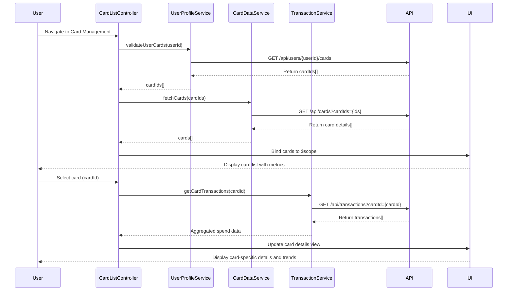

# Low-Level Design: QE-9678 - Multiple Credit Card Management

## a. Architecture Mapping

**AngularJS Artifacts:**
- **cardManagementModule** (Module) - Root module for multi-card management feature
- **CardListController** (Controller) - Manages card list display and user interactions
- **CardDetailsController** (Controller) - Handles individual card detail view
- **CardDataService** (Service) - Fetches card data from REST API and manages card state
- **TransactionService** (Service) - Retrieves and aggregates card-wise transaction data
- **UserProfileService** (Service) - Validates card ownership and user associations
- **cardListDirective** (Directive) - Renders card list with card-specific metrics
- **cardTrendChart** (Directive) - Displays monthly spend trends per card

**Recommended Folder Structure:**
```
app/
├── modules/
│   └── card-management/
│       ├── controllers/
│       │   ├── card-list.controller.js
│       │   └── card-details.controller.js
│       ├── services/
│       │   ├── card-data.service.js
│       │   ├── transaction.service.js
│       │   └── user-profile.service.js
│       ├── directives/
│       │   ├── card-list.directive.js
│       │   └── card-trend-chart.directive.js
│       ├── views/
│       │   ├── card-list.html
│       │   └── card-details.html
│       └── card-management.module.js
```

## b. Component Specifications

| Component Name | Artifact Type | Responsibility | Key Dependencies |
|---|---|---|---|
| cardManagementModule | Module | Root module declaration and dependency injection setup | ngRoute, cardDataService, transactionService |
| CardListController | Controller | Orchestrates card list display, handles user selection, triggers data refresh | CardDataService, UserProfileService, $scope |
| CardDetailsController | Controller | Manages single card detail view, calculates card-specific KPIs | CardDataService, TransactionService, $routeParams |
| CardDataService | Service | Fetches card data via REST API, caches card information, manages sync | $http, $q, API_CONFIG |
| TransactionService | Service | Retrieves transactions by card ID, aggregates spend data, calculates trends | $http, $q, API_CONFIG |
| UserProfileService | Service | Validates card ownership, retrieves user-card associations | $http, $q, AuthService |
| cardListDirective | Directive | Renders card list UI, displays card metrics (limit, balance, outstanding) | CardDataService |
| cardTrendChart | Directive | Renders monthly spend trend chart using Chart.js for each card | TransactionService, Chart.js |

## c. Data Model

**CreditCard Model:**
```javascript
class CreditCard {
  cardId: String
  cardNumber: String (masked)
  cardHolderName: String
  cardType: String (Visa, MasterCard, etc.)
  creditLimit: Number
  availableCredit: Number
  outstandingBalance: Number
  monthlySpend: Number
  lastSyncTimestamp: Date
}
```

**CardTransaction Model:**
```javascript
class CardTransaction {
  transactionId: String
  cardId: String
  amount: Number
  transactionDate: Date
  merchant: String
  category: String
  description: String
}
```

**UserCardAssociation Model:**
```javascript
class UserCardAssociation {
  userId: String
  cardIds: Array<String>
  primaryCardId: String
}
```

## d. Data Flow

User navigates to card management view → CardListController initializes and calls UserProfileService to validate ownership → UserProfileService returns associated card IDs → CardDataService fetches all card details from REST API (`GET /api/cards?userId={userId}`) → CardListController receives card data and binds to view via $scope → cardListDirective renders card list with metrics → User selects a card → CardDetailsController loads and calls TransactionService to fetch card-specific transactions (`GET /api/transactions?cardId={cardId}`) → TransactionService aggregates monthly spend data → cardTrendChart directive renders trend visualization → UI updates with card-specific details, spending patterns, and monthly trends.

## e. Primary Sequence Diagram



## f. Implementation Notes

- Use AngularJS 1.x module pattern with ES6 classes for controllers and services; leverage `angular.module('cardManagementModule', [])` for module definition.
- Implement dependency injection via constructor parameters or `$inject` annotation to ensure minification safety.
- Use `$http` service for REST API calls with promise-based error handling; implement response interceptors for token refresh and error logging.
- Cache card data in CardDataService using in-memory object or `$cacheFactory` to minimize API calls; implement 5-second sync interval using `$interval`.
- Use Chart.js library wrapped in AngularJS directive for rendering monthly spend trend charts; ensure chart responsiveness via CSS and Chart.js responsive config.

## g. Error Handling

HTTP interceptor-based error handling with user-friendly toast notifications for API failures; try/catch blocks in controllers for data processing errors.

## h. Security Notes

Requires token-based authentication via existing SSO; card numbers must be masked in UI; API calls include auth token in headers.