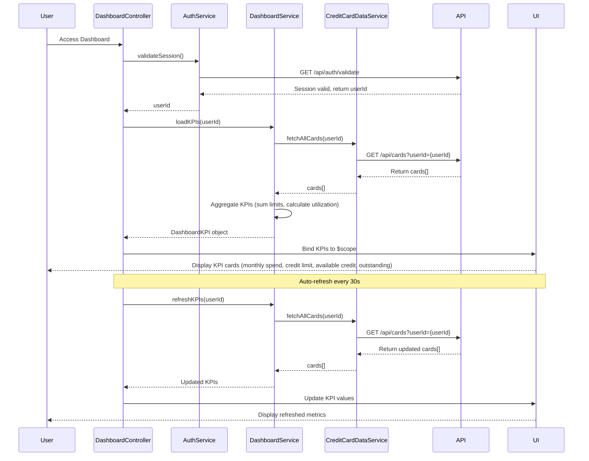

# Low-Level Design: QE-9679 - Dashboard and Key Performance Indicators

## a. Architecture Mapping

**AngularJS Artifacts:**
- **dashboardModule** (Module) - Root module for dashboard feature
- **DashboardController** (Controller) - Manages dashboard state and KPI calculations
- **DashboardService** (Service) - Aggregates data from multiple sources and computes KPIs
- **CreditCardDataService** (Service) - Fetches card balances, limits, and transaction data via REST API
- **AuthService** (Service) - Handles user authentication and session management
- **kpiCardDirective** (Directive) - Renders individual KPI cards (monthly spend, credit limit, etc.)
- **dashboardRefreshDirective** (Directive) - Manages real-time data refresh mechanism

**Recommended Folder Structure:**
```
app/
├── modules/
│   └── dashboard/
│       ├── controllers/
│       │   └── dashboard.controller.js
│       ├── services/
│       │   ├── dashboard.service.js
│       │   ├── credit-card-data.service.js
│       │   └── auth.service.js
│       ├── directives/
│       │   ├── kpi-card.directive.js
│       │   └── dashboard-refresh.directive.js
│       ├── views/
│       │   └── dashboard.html
│       └── dashboard.module.js
```

## b. Component Specifications

| Component Name | Artifact Type | Responsibility | Key Dependencies |
|---|---|---|---|
| dashboardModule | Module | Root module declaration and routing configuration | ngRoute, dashboardService, authService |
| DashboardController | Controller | Orchestrates dashboard initialization, handles user interactions, manages KPI display | DashboardService, $scope, $interval |
| DashboardService | Service | Aggregates multi-card data, calculates KPIs (total credit, available credit, outstanding, monthly spend) | CreditCardDataService, $q |
| CreditCardDataService | Service | Fetches card data from REST API, manages data caching and refresh | $http, $q, API_CONFIG |
| AuthService | Service | Validates user authentication, manages session tokens, provides user identity | $http, $window, $q |
| kpiCardDirective | Directive | Renders individual KPI metric card with value, label, and trend indicator | None (isolated scope) |
| dashboardRefreshDirective | Directive | Implements auto-refresh mechanism for real-time data updates | $interval, DashboardService |

## c. Data Model

**DashboardKPI Model:**
```javascript
class DashboardKPI {
  monthlySpend: Number
  totalCreditLimit: Number
  availableCredit: Number
  outstandingAmount: Number
  creditUtilization: Number (percentage)
  totalCards: Number
  lastRefreshTimestamp: Date
}
```

**CreditCardSummary Model:**
```javascript
class CreditCardSummary {
  cardId: String
  creditLimit: Number
  availableCredit: Number
  outstandingBalance: Number
  currentMonthSpend: Number
}
```

**UserSession Model:**
```javascript
class UserSession {
  userId: String
  authToken: String
  sessionExpiry: Date
  userName: String
}
```

## d. Data Flow

User accesses dashboard → AuthService validates session and retrieves user identity → DashboardController initializes and calls DashboardService.loadKPIs() → DashboardService calls CreditCardDataService to fetch all user cards via REST API (`GET /api/cards?userId={userId}`) → CreditCardDataService returns array of card summaries → DashboardService aggregates data (sums credit limits, calculates available credit, computes monthly spend total, calculates outstanding amounts) → DashboardService computes derived KPIs (credit utilization percentage) → DashboardController receives aggregated KPIs and binds to $scope → kpiCardDirective instances render individual KPI metrics → dashboardRefreshDirective triggers periodic refresh every 30 seconds → UI updates with real-time financial health metrics.

## e. Primary Sequence Diagram



## f. Implementation Notes

- Use AngularJS 1.x with ES6 classes; define dashboardModule using `angular.module('dashboardModule', ['ngRoute'])` with route configuration for dashboard view.
- Implement dependency injection using `$inject` annotation for minification safety; inject services into controllers via constructor.
- Use `$http` service for REST API calls with promise chaining; implement HTTP interceptor for adding auth tokens to request headers.
- Implement responsive design using Bootstrap grid system (col-xs, col-sm, col-md, col-lg) for KPI card layout; ensure mobile-first approach.
- Use `$interval` service in dashboardRefreshDirective for 30-second auto-refresh; cancel interval on scope destruction to prevent memory leaks.

## g. Error Handling

HTTP interceptor captures API errors and displays user-friendly error messages via toast notifications; controller-level try/catch for KPI calculation errors.

## h. Security Notes

Requires token-based auth via existing SSO; auth token included in all API request headers; session validation on dashboard load.